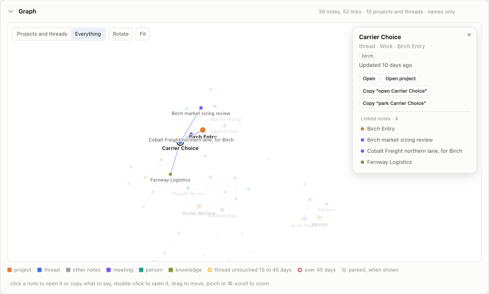

# Extra: a status page

One page that answers two questions before you open anything: is anything wrong, and where was I? It is a single HTML file you open in a browser, or in a small [Mac app](#a-mac-app) of its own. It needs no server, no account and no network, and it works whether or not you use Obsidian or cmux: each time it is built, it checks which of them this machine has and offers only what will work.

A newly installed workspace opens on the [simple home](simple-home.md) instead: your work, a box to ask something and the questions waiting on you, with *Continue* opening a piece of work in Claude's desktop app, and everything this page describes under *More*. One installed before the simple home existed keeps this page; *Settings › Home* switches either way.

## What it shows

- **Start here**, in a new workspace with no project yet: the one request that sets the first project up, and where the route is written.
- **A graph of the workspace**, behind *Explore* at the foot of the Overview, folded shut until you open it: every note in your zones and wikis, and the links between them, laid out to fill its card. *Projects and threads* and *Everything* switch how much it shows; on a wiki the first is its hubs instead, *People* in Meetings and *Concepts and entities* in Knowledge, two of them joined when one page links both, and each place remembers its own choice. A wiki's notes take the kinds of Garrick's model of it (meeting, mail and person; source, concept and entity), whatever its vault's colour groups say, and a page the model does not know is drawn grey, as other notes. A wiki page's long title is cut to about forty characters on the graph and given whole on its card. Click a note for its links and the same actions a thread's card offers; double-click opens it. [Reading the graph](#reading-the-graph) says what it draws and what it leaves out.
- **Threads**, one column per zone, led by the zone picked in Explore's drop-down and the others by name (all by name when the pick is everything or a wiki, or the graph is left out): a row per project, with a chevron that unfolds its threads, each with how long since its note was updated. *By name · Recent* above the columns chooses the order: by name, or each zone's projects and threads most recently touched first, a thread by the later of its note's `updated:` and an unwrapped checkpoint, a project by its newest thread. The window remembers the choice, as it remembers the folds. Under a live thread's name is its next action: its own open task line, one in its zone's `Todo.md` opening with `[[Thread]]` or one written in the thread's own notes, with its date chip when it has a date. A live thread no open action names says *no next action* instead, which is not calling it late. A row carries no party tags; its card does. The project's row shows its most recent thread, and a project with no thread notes is a row of its own, its name in line with the others. The bar fills toward sixty days and is never coloured: how long since a note moved is a figure, not a fault, and a thread left alone for weeks is often simply slow or waiting on somebody. What marks a thread instead is its own next action: *overdue* when a due date has passed, *chase due* when a `#waiting` line's chase date has come, and *check* when `check.py` names a file in its folder. Its zone and its project count those as *needing a chase*. Threads you have parked ("park X"), and every thread of a project you parked, sit in a folded *Parked* group at the foot of their zone, grouped the same way, out of the counts. A live thread whose note has no `### Resume here` block, the block the threads skill resumes from, says *no resume block*, and its project's row counts them; its card gives the date the block gives itself, from its *Where it stands* line. With the [cmux extra](cmux.md) installed, a dot a small gap after a name says a session is open there: green while it waits, blue while it works. A project counts its threads' sessions. Hover a project or a thread for its card; while you do, or while it has the keyboard's focus, its node lights up in the graph as it does when you hover the node itself, without moving or selecting anything. A node the graph is not showing, in another place or parked, is left as it is. With `effort` switched on, *Updated*, *Time* and *Cost* above the columns switch what the bars and figures show (see [Preview features](#preview-features)). The box at the head of the card, *Find a project or thread*, looks through every zone at once for a name, whichever zone leads the card, and finds the threads the columns do not show: parked under another project, or finished. It matches as you type, word by word, each word the start of a word in a thread's name, its project's or its zone's, or in the `spoken:` form of the first two, ignoring case and accents: `freight` finds *Freight Terms*, `fourth quarter` finds *Q4 Planning*, and `acme fr` the Freight Terms under Acme Review. It looks at names only, never inside a note. While a query is in the box, the matches take the columns' place, live first, then parked, then finished, each with its project and zone and a *parked* or *done* chip. A match is a row like any other: its name opens it, and its card is the row's, with *Wake* on a parked one; a finished one's card opens its note, where its `### Outcome` is, and changes nothing. Clearing the box, or `Esc` in it, puts the columns back exactly as they were, folds and order included. `/` puts the cursor in the box from anywhere on the page but a field or the Guide, the down arrow moves into the matches, and `Enter` opens the first. The window keeps the query while the page is rebuilt, so a thread woken from the matches shows there as live.
- **Checks**: what `System/tools/check.py --quick` finds, run as the page is built, grouped by check. The quick run leaves out the comparison of wording with the meetings, the slow part on a large workspace; the commit hook still makes it, and a full `check.py` on a schedule covers the rest.
- **Open actions**: the unticked items in each zone's `Todo.md`, counted by section, with *Open the list*, which opens the [Todo tab](#the-todo-tab) on that zone. A zone without a `Todo.md` is left out, and with none at all so is the card; the check reports the missing file.
- **Inboxes**: what is waiting to be filed in each zone's `Inbox/` and in the Meetings inbox.
- **Scheduled jobs and assistant calls**, when you use the [scheduled jobs](scheduled-jobs.md) extra: a fourteen-day strip per job, one cell per day, and the spend against its caps. The caps are the ones the jobs run under: the `GARRICK_CAP_*` values in the launchd plists of the jobs that call the assistant, with the default for any a plist leaves out and the lowest where jobs differ. With no such plist, the page shows the caps it was built with, and the card says which it used. A cap set to 0 shows as *no cap*. A job the cap stopped gets one line in *Needs attention*, however many calls it lost, and so does a call stopped at its per-call budget (`GARRICK_MAX_CALL_USD`, shown under the meters). A job whose lock is held says *running now*, and offers no *Run now*. A job whose launchd plist runs `job.py` but which has not run yet has a row of its own, with its schedule, a hollow mark and *not run yet*: neither fine nor a failure, so it stays out of *Needs attention*. An exit job.py calls quiet (its heartbeat's `ok` or `quiet`, or a code the plist lists in `GARRICK_QUIET_EXITS`) is fine, and a failure says the heartbeat's own reason. A job idle for as long as its plist allows (`GARRICK_IDLE_DAYS`, 7) goes under *Needs attention* as a warning. Once three days have calls, a chart shows the cost of each of the last fourteen days. The table gives each job's calls, cost, turns per call on average, and the tools it was refused: red for a tool the deny list in `System/jobs/headless-settings.json` forbids, which also goes under *Needs attention*, amber for one the job was only not allowed. A missing or unreadable deny list goes there too.
- **Repositories and wikis**: how many files have changed since the last commit in the workspace, each zone and the wikis, split into staged, not staged, untracked and conflicted, with their paths to read; and the date and title of the newest entry in each wiki's log. The card counts files, not commits, and never commits anything: another session may be halfway through that work. A repository with a change left uncommitted for more than a day turns amber and goes under *Needs attention*.



The page has three tabs, Overview, Todo and Status, and two when no zone has a `Todo.md`. **Overview** shows where your work stands, and nothing about the machinery. It opens on the threads, each with its next action, then open actions on the left and what is waiting in the inboxes on the right, and the graph behind *Explore* at the foot. A workspace with no project yet opens on *Start here*. **Status** shows the machinery behind it: the figures first (how many things need attention, live threads, open actions, files waiting, and the check or the assistant's calls), then *Needs attention*, the scheduled jobs and assistant calls when you run the jobs extra, the check, the repositories and the wikis. A red dot on the *Status* tab means something there failed. Each figure opens the card that explains it, switching tab if it has to.

One row stays pinned at the top while the page scrolls: Garrick's mark, the page's name and when it was built, the tabs, a circular arrow that rebuilds the page (in the Mac app; in a browser it copies the command that does), the cog for [Settings](#settings), and three icons for an automatic, light or dark theme. There is no sidebar: the tabs move between the work and the machinery, and the cards are open on the page. At the top of the *Status* tab, *Only what needs attention* hides everything there that is healthy. Every section folds. Every card except *Needs attention* can be dragged by the grip in its header to another place on its tab, moved to the other tab with the arrows beside the grip, or hidden with its ×. A hidden card is listed at the foot of Settings, above *Reset view*, and clicking it there brings it back. *Reset view* puts everything back as built, parked notes hidden again, and keeps your theme and the apps you chose to open projects in. The page remembers all of this in your browser and nowhere else, so each browser keeps its own. A browser that has moved or hidden a card keeps that arrangement card for card, whatever order a newer Garrick builds: a new default reaches a browser that has arranged nothing, and *Reset view* is what adopts it anywhere else. A card a newer Garrick adds appears where that build puts it, ahead of the cards you placed in the same column. A card a newer Garrick removes simply goes, and nothing else moves. *A thought* went that way: a browser that still holds text typed into it shows that text once, at the top of the Overview, with *Copy* and *Close*, and either one removes it from the browser.

## Settings

The cog beside the page's name opens *Settings*. In the Mac app, *Settings…* in the app menu (⌘,) opens it too.

Each section shows its controls and nothing else. The "?" beside a section's heading shows what the section does, where it stands, together with each row's own line, such as what a hotkey opens; pressing it again hides them. Until then, a row's line is its tooltip. In a window wide enough, the sections sit in two columns: *Opening a thread*, *Explore*, *Zones*, *Menu bar* and *While you wait* on the left, *Notifications*, *About Garrick* and *Preview features* on the right, with *Reset view* at the foot. Its "?", or pointing at the button, says what it resets.

**Opening a thread** lists the ways a project or thread can be opened: the note's own link (*Open in Obsidian*, or *Open the note* where Obsidian is not installed), *Reveal in Finder*, *Open in cmux*, *Open in Codex* and *Open in Claude*. Each build checks which of the apps this Mac has and whether each one can actually open a folder, and a launcher that cannot work here is greyed out with the reason on the row: *Not installed on this Mac*, or, for a Codex app that has lost the launcher it opens a folder through, *Installed, but its own launcher is missing: reinstall the Codex app*. Nothing is offered and then refused after the click. Each row has two controls:

- **A checkbox:** whether project and thread cards offer it. The apps work in the [Mac app](#a-mac-app) only.
- **A radio button:** what clicking a thread's name in the Threads list does. The note's own link is the default. An app chosen here takes over the click in the Mac app; in a browser the name still opens the note.

*Open in Claude* starts a new session in the thread's folder with "open Pricing" already typed in; press Send to resume the thread. A Claude that is not running is started first and the link waits for its window, because a cold Claude drops a link sent while its window is still loading; the page says it is starting, and says what opened when the link has gone. *Open in Codex* and *Open in cmux* open the folder and then put "open Pricing" on the clipboard, saying so, so a clipboard you were using is never replaced silently. *Reveal in Finder* shows the folder and names the phrase without copying anything. Whichever you press, the phrase that resumes the thread reaches you, and you never have to rebuild it. Your choices are kept in the window's own storage as you make them. In the Mac app, closing Settings after a change also saves them for every viewer of the page, in `System/garrick-settings.json`, through `page_action.py`; each build carries that file into the page, and inside the app it comes before what a window remembers. That file is committed with your workspace, so the choice survives a rebuild and a restore; a window's own storage keeps only what belongs to that window, such as its theme and its folds. A browser keeps its own. Close Settings with the × at its top right, or Escape.

**Explore** holds one switch, *Follow the zone in view*, on until you switch it off. With it on, the graph behind *Explore* shows the zone you are reading on the Threads card (see [Reading the graph](#reading-the-graph)). The window remembers the switch, and *Reset view* turns it back on. A page built without the graph has no such section.

**Zones**, in the Mac app and in Obsidian, gives each zone a colour and an icon, so you can tell zones apart without reading their names. Each zone has a row: its name, drawn as you have chosen, then a button for its colour and one for its icon. Each button shows the current choice and opens a palette of every colour, as a dot, or every icon, drawn as it will appear; the first cell, a dashed ring, takes the choice away. Escape closes a palette without changing anything. The colours are cmux's sixteen named colours: Red, Crimson, Orange, Amber, Olive, Green, Teal, Aqua, Blue, Navy, Indigo, Purple, Magenta, Rose, Brown and Charcoal. The icons are a fixed set of twelve: briefcase, house, flask, rocket, book, globe, heart, star, leaf, wrench, chart and shield. There is no upload, so every icon stays legible at the size of a label.

The colour goes on the text of every label that names the zone: its heading on the Threads card, its button on the Todo tab, its line under *Open actions*, its tile under *Inboxes*, and the place drop-down on the graph when it shows that zone. The icon sits before the name in the same places. Backgrounds, the bars and the dots keep their meaning, and the graph keeps its own colours. Each colour has a light and a dark shade, so it reads against the page in either theme. A zone with no colour or icon looks as it always has, and a zone added later starts with neither.

Closing Settings after a change saves the zones beside the apps, in `System/garrick-settings.json`, as `"zones": {"Work": {"color": "Teal", "icon": "briefcase"}}`, and rebuilds the page. With the [cmux extra](cmux.md), the desk reads the same file: a tab it opens in a zone's project or thread colours that zone's cmux workspace, and a colour changed here recolours the zone's workspace if it is open. Commit the file with the rest of your workspace, as you would any note: these are choices you make once, so they belong in its history, and the check says so while they are not there. A workspace that kept them in `System/generated/status-settings.json`, as Garrick did up to 0.24.0, has them copied across the next time the page is built, without replacing a newer choice.

**While you wait**, in the Mac app and in Obsidian, sets what the [Garrick band](../../extras/mods/README.md#while-you-wait) offers while a long turn runs in Claude Code: one thing worth doing elsewhere, from `System/tools/next_up.py`. *Suggest something while a turn runs* switches it on or off, with the seconds a turn runs first (45, from 10 to 600). *Same zone only*, off until you switch it on, keeps the suggestions to the zone the session works in; off, they come from every zone. *What counts, first to last* lists the six sources in the order they are offered, each with a box and two arrows to move it: the interruption stack, Todo lines due today or late, chases that have come due, what waits in an Inbox, parked threads left alone and live threads not wrapped lately. The last row says how long each of those last two must be: a parked thread untouched for 30 days, a live one not wrapped for 14, unless you change them. Closing Settings after a change saves the section in `System/garrick-settings.json`, under `"while-you-wait"`, checked by `next_up.py` on the way; the band reads it at the start of each turn, and "what's next" in a session without the band reads the same.

**Notifications**, in the Mac app and in Obsidian, says which of the things Garrick can tell you reach you, and where. Everything that sends a notice goes through one module, `System/tools/notifications.py`: the scheduled jobs, the todo sweep, the cmux desk and the session hooks. The section opens on four plain choices, and everything else is under *More options*, closed until you open it.

- **Send to**: *This Mac*, a notification in the corner of the screen, on until you switch it off, and *My phone (Telegram)*, a message from a bot of your own. With the [cmux extra](cmux.md), a session in cmux gets its notice on its own tab instead of the corner, and that follows *This Mac*.
- **Tell me when**: *a session needs me*, *a long task finishes, after 2 min* (the minutes are yours to change), *the morning Todo summary is ready*, and *a scheduled job fails*. Each one ticked goes to everything ticked under Send to; unticked, it goes nowhere. A job gone idle and, with the cmux extra, the desk's replies when you start or close the day go wherever Send to does; the nightly *Todo refreshed* counts stay off.
- **Quiet from 22:00 to 07:00**, or other times, or off. The section says it in one line: "At night only “a session needs me” and the desk get through; the rest waits until morning." (without the cmux extra, no desk). One thing it leaves to the "?": a long task that finishes in quiet hours is not reported at all, rather than held. A held notice goes out with the first notice after the quiet hours end, or the first prompt you give a session, or `python3 System/tools/notifications.py flush`.
- **Telegram's Set up…** is two steps in place. First, in Telegram, message @BotFather, send `/newbot`, and paste the token it gives you into the field, then *Save*. The token goes from the page to `page_action.py` and straight into this Mac's keychain; it is never shown again, and never written to the settings file, a log or the page. Then send your bot any message and press *Find my chat*: Garrick asks Telegram for the chat that last wrote to the bot, keeps it, switches Telegram on and sends a test there. Once that is done the row says *Set up*, with *Change* to do it again. If the terminal suits you better, `python3 System/tools/notifications.py telegram-token` takes the token unseen and `telegram-chat` finds the chat.

*More options* holds the rest, and the four choices above write into it as you change them, so it always shows what will be saved:

- **The channels**, each switched on or off, with *Send a test*, which saves the section first and sends a test on that channel whatever the events say; the reply shows under the section. *cmux*, with the cmux extra, is the notice on a session's own tab; its test runs from a cmux tab, so *Copy a test* copies the command. *Telegram* has the chat ID as a field, for one you already know, and *Copy the token command*. *A command of your own* runs a program with the title and the message, as `GARRICK_NOTIFY_CMD` does for a job.
- **The events**, one row each, with a box per channel and what it does in quiet hours: *Send*, *Hold* till they end, or *Drop*:

  | Event | When it fires | Goes, until you change it |
  |---|---|---|
  | Needs you | a session is waiting: a permission to give, a question, an idle prompt | this Mac; sent in quiet hours |
  | Finished | a session ends a turn that ran at least the minutes on its row (2) | this Mac; dropped in quiet hours |
  | Todo refreshed | the nightly sweep has run: its counts, per zone | nowhere |
  | Todo summary | each zone's morning digest from the sweep | this Mac, and Telegram once it is set up |
  | Job failed or recovered | a scheduled job fails or works again, throttled as before, and a line a job sends of its own | every channel switched on |
  | Job idle | a job has run cleanly and done nothing for days | this Mac |
  | Desk | the cmux desk starting the day or shutting down (with the cmux extra) | this Mac; sent in quiet hours |

  With the cmux extra, Needs you and Finished also offer *only when away*: nothing while you are looking at that very cmux tab. cmux is the one place that can be asked, so the choice is not offered without it.
- **Zones**: send a zone's notices to a chat of its own, or keep a zone off some channels. A row per zone has a box for each channel that is switched on, and a Telegram chat of its own while Telegram is on, so one zone's notices never reach another's chat. A notice about no zone, such as a job's, is not held to any.

A choice the four cannot say, such as your command switched on, a zone kept off a channel, or an event sent somewhere of its own, makes the settings custom. The section then says "Your choices are custom, under More options." and the four choices stop writing into More options, so nothing you set there is undone behind your back. *Use the simple choices* sets More options to what the four say, and closing Settings saves it.

A notice is short and plain: the zone or thread and what happened, such as "Work, Pricing: needs you. Permission asked." or "Work, Pricing: done, after 4 minutes.". Never the content of a note, a meeting or what the assistant said, since a phone shows it on a locked screen. Needs you and Finished come from hooks in Claude Code or Codex, which the `setup` skill installs when you say yes ("set up notifications"), or `python3 System/tools/notifications.py hooks --install`: Claude Code gets three, `UserPromptSubmit`, `Notification` and `Stop`, and Codex two, `UserPromptSubmit` and `Stop`, since it has no event for a session waiting on you. `hooks` alone says whether they are in, and `--uninstall` takes them out, leaving your other hooks as they are. A hook answers nothing and sends from a process of its own, so a slow network never holds the session, and it stays quiet for a session outside the workspace and for a scheduled job. cmux posts its own notice when a Claude session in it needs you; with the hooks in, switch one of the two off.

A job whose launchd plist sets `GARRICK_NOTIFY` or `GARRICK_NOTIFY_CMD` keeps sending where they say, past this section, and the section counts them: "3 scheduled jobs send their notices their own way and skip these settings." Point at the line for the jobs and the variable each sets. Take the variable out of the plist to use the section instead. Closing Settings after a change saves the section in `System/garrick-settings.json`, under `"notifications"`, beside the zones and the apps; the file's shape is the same whichever view set it. What the module keeps for itself, the notices quiet hours hold, when a session's turn began and the day a token was stored, is in `System/generated/notifications/`, never committed.

**About Garrick** says which Garrick the workspace was installed from, in the same words as `python3 System/tools/check.py --version`. *Copy version* copies that line. *What's new* shows the notes of that release, read from the copy of the changelog the installer put in `System/garrick-changelog.md`. A workspace installed from a clone of `main` also sees *Coming next*, which is what is waiting for the next release. Below that are the ways to reach Garrick's maintainers:

- *Report a bug* opens the bug form on GitHub with *Which Garrick* already filled in.
- *Report a wrong refusal* opens the form for a refusal by the wall check that should have passed.
- *Report a bypass privately* opens GitHub's private report form, for a way to get past the wall check. Only the maintainer sees it.
- *Suggest a change* and *Ask a question* open a new discussion under Ideas or Q&A.
- *Announcements* is where each release is announced. Watch it on GitHub to hear of the next one.
- *All releases* lists every release with what it changed.

Each one opens in your browser, and nothing is sent until you submit it there yourself. If you have no GitHub account, *Copy a report* copies an outline with your version in it. Fill it in and send it to whoever set Garrick up for you. Use invented names (Acme, Birch) in anything you report, never a real client's: pointing at *Report a bug* or *Report a wrong refusal* says so too. A way to get past the wall check goes in a private report, not an issue: *Report a bypass privately*.

The page itself loads nothing from the network, and a notice reaches Telegram or your own command only when you switch that channel on. To be told when a newer Garrick is out, switch on the release notice in `System/garrick-settings.json`, `{"release-notice": true}`: then a build asks GitHub at most once a day, through `System/tools/release.py` in a process of its own, never waiting for it, and *Needs attention* says "Garrick 0.16.0 is out; this workspace runs 0.15.2" from the next build on, with the command that updates and a link to that release's notes. It sends one request and nothing about your workspace; [Updating Garrick](../updating.md#being-told-a-newer-garrick-is-out) says exactly what. A request that fails shows nothing. Off, the page never asks: compare *All releases* with your version.

## The Todo tab

A *Todo* tab with every open action in the zones, one zone at a time, picked above the list (Work first, when you have it). Actions are grouped as `Todo.md` groups them, under its headings in their order; then *In thread notes*, the actions written in a thread's own notes; then *Done today*, what was ticked today. An empty heading is left out, but an empty Inbox says *Inbox clear*. Each action shows its thread, linked to the thread's note, in the zone or in a project kept in `System/`, its priority when high, and its date as Obsidian Tasks writes it: a due date with `📅`, a day to chase a `#waiting` line with `⏳`, red once it is overdue or due a chase. A line above the groups counts what is open, overdue and undated. *All*, *Overdue* and *No date* filter the list; *A–Z* sorts by thread, then by the action, and *Due date* puts dated actions first, soonest first. The page remembers the zone, the filter and the sort. A zone's *Open the list* on the Overview opens the tab on that zone.

In the Garrick app and in [Obsidian](#in-obsidian), the page has buttons that change your notes. On the Todo tab, a box ticks an action, and ticking one under *Done today* again reopens it. The row is struck through as you click, and you can go straight on to the next: the ticks you make within about two seconds of each other are saved together, in one commit, and the ones you make while that commit runs go in the next, so clearing five lines takes five clicks and at most two wall checks. A second click on a line before it has gone takes the tick back. When they are saved, a small *Saved 3* shows and fades by itself; if the wall check refuses them, a card stays that names the lines, and their boxes go back. Its date opens a menu: *Today*, *Tomorrow*, *Friday*, *Next Monday*, *In a week*, *In two weeks*, any other date, or *Clear the date*; a dated Inbox line says where it moves. The row changes at once and waits, greyed, for the rebuild. *＋ Add* above each zone's list writes a new one, which shows greyed in its section until the rebuild: the text, optionally a project or thread picked from a tree of the zone's projects with their threads folded under them, and optionally a date. The line goes to the top of the Inbox in the zone's `Todo.md`, opening with `[[Thread]]: ` when you picked one; with a date it goes where a dated line belongs, *This week* within seven days, *Soon* after that, *Waiting on* for a `#waiting` line. A line the list already holds is refused, and that means the same thing to do on the same thread, whatever date it carries and however it is spaced or capitalised, not only one written out character for character. On a thread's card, *Park* and *Wake* replace the phrases to copy. Each button changes one line or one `status:` field, the same way the skills would: ticking adds Obsidian Tasks' `✅` date, and parking sets `status: parked`, moves `updated:` and adds a dated "Parked." entry. Each change is then committed in the zone's repository, through its wall check. If the wall check refuses the commit, the file is put back as it was, unless you edited it meanwhile, in Obsidian say: then your edit is kept and the reply says so. The app runs `page_action.py` from the same folder as `status.py`, so copy both, and `prefs.py` with them: it is how each of them reaches the choices you keep. A browser has no way to reach it, so there the buttons stay hidden; the [Obsidian plugin](#in-obsidian) reaches it as the app does. See [What the actions keep](#what-the-actions-keep).

## Preview features

Some features are in Garrick's source before they are in a release. They are off until you switch them on in `System/garrick-flags.json`, and *Settings* lists each one and whether it is on. To switch one on, write its name there and rebuild the page:

```json
{"effort": true}
```

- **`effort`**: *Time* and *Cost* on the Threads card. The same rows show the assistant's active time, or its list-price cost, over the last 30 days instead of how long since each note moved, largest first; *Updated* puts them back by name, and the page remembers the choice. A project's row counts all of its work, its threads and what it did in no thread; each thread shows its own. A line under the columns gives the total and whatever no row shows: sessions outside the zones (in `System/`, a wiki or the workspace root), sessions started in a zone's own folder, and threads finished or renamed since, so the figures add up. Hover a figure for its raw tokens and sessions. It reads Claude Code's own transcripts in `~/.claude/projects/`, with no model call, through `effort.py` beside `status.py`, so copy both:
  - *Which thread.* The folder a session ran in gives the zone and project; a thread's own folder gives the thread. Otherwise the thread is the one whose `Threads/<X>/` notes the session wrote or edited most, and a project with no thread notes is its own thread. Anything left counts as the project's own work rather than a guess. A session started above the zones is placed by the notes it wrote.
  - *Time* is active time: the gaps between messages, with any gap over five minutes left out as idle.
  - *Cost* is the list price of the tokens, the measure *Assistant calls* uses. It comes out a little under Claude Code's own count, which also prices small background calls the transcripts do not record. Cache reads dominate the raw token counts, which is why the card shows cost and time, not tokens.
  - *Scheduled jobs* are left out: a headless run is already in *Assistant calls*.
  - *Moved and renamed folders.* `--also OLD` reads a folder the whole workspace used to live in as the workspace, and `--moved OLD=NEW` counts a renamed project or a moved wiki under its present name (`--moved "Zones/Work/Acme Old=Zones/Work/Acme Review"`). Both can be given more than once, to `effort.py --record` and to `status.py` alike, so the page and the nightly record count the same way; in the Mac app, give them to `make-app.sh` after `--`.
  - *History.* Claude Code deletes transcripts after 30 days by default, the same span the card shows. To keep the days anyway, run `python3 System/status/effort.py --workspace <your workspace> --record` nightly, for example as a [job](scheduled-jobs.md): each day's totals per thread go to `effort.jsonl` beside the jobs ledger, and the page reads that file as well as the transcripts.
  - Codex keeps its sessions elsewhere, in another format, and is not counted yet; the card says so.
  - Only names, durations and figures reach the page, never a line of a transcript.

- **`ask`**: the fields of the menu and the panel, and a box that the Ask hotkey (⌘G unless you set another) opens from any app, answer a request in plain words and act on it, in the Garrick app only. See [Ask](#ask).

A preview feature may still change. When one is released it is switched on for everyone and its flag goes away. The [Todo tab](#the-todo-tab), its buttons and the [menu bar](#in-the-menu-bar) went that way, so `todo-list`, `page-actions` and `menu-bar` left in the file change nothing.

## Thread cards

Hover a thread in the list, or move to it with the keyboard, and a card opens under it. It shows the thread's name, its party tags, and how long since its note was updated, or that it is parked. It does not repeat the zone, which is the column it sits in, or the project, which is the row it unfolds from. Then come the actions:

- *Open* opens the thread note. The project's own note opens from the project's row and its card.
- *Copy "open Pricing"* copies the phrase that resumes the thread, in a browser. In the Mac app and in Obsidian, where the buttons below open the thread, it is left out; it stays on a card no app is offered for.
- *Park*, at the top right beside the thread's name, copies "park Pricing", the phrase that sets it aside; on a parked thread it is *Wake*. Opening a parked thread in an assistant wakes it too, since the session starts on "open Pricing". In the Mac app and in Obsidian, it parks or wakes the thread itself.
- *Rename…* and *Delete…*, under the card's name, and *New thread here* on a project's card. Above the columns, *New project* and *New thread*. Each opens a small dialog: a new project asks for the zone, its name, the party it is for and its first thread; a thread for the zone, the project and its name; a rename for the new name. As a new project's or thread's name is typed, a line under it names any project or thread with the same name, or one heard as it, in any zone and any status: *Already there: Freight Terms (Acme Review, Work, parked). Open it*. It is the test `scaffold.py` puts to a sibling's name, put to every name in the workspace, and it only warns: two projects can each have a *Pricing* thread, so the dialog still makes the new one if asked. *Delete…* says what would go (the folder and how many files, the hub's line, the open `Todo.md` lines that name it, a project's threads) and what stays, and offers *Finish instead*, *Park instead* and *Cancel* before *Delete*; a project's *Delete* waits until its name is typed. In the Mac app and in Obsidian, the dialog's request goes to `scaffold.py` through `page_action.py`, so the page, the voice command and the script make the same folders, notes and commits; when the script refuses, the reason stays on the page as a card until you dismiss it. For a minute after a rename or a deletion, *Undo* reverts it. Anywhere else the dialog copies the phrase to say instead ("new thread Renewal in Acme").
- A project's card has *Park* and *Wake* too, for the whole project: its hub note says `status: parked`, and every thread in it is parked with it, listed under the zone's *Parked* fold and left out of the menu. A thread parked with its project says so on its card, and has no *Park* or *Wake* of its own; wake the project, and each thread is back as it was before. The graph's panel offers the same for a project.
- *Open in Claude*, *Open in Codex* and *Open in cmux*, in the [Mac app](#a-mac-app) and in [Obsidian](#in-obsidian), one for each of those apps that is installed and switched on in [Settings](#settings). Claude starts a session in the thread's folder with "open Pricing" typed in. Codex and [cmux](cmux.md) open the folder and then put "open Pricing" on the clipboard. A project gets the same buttons for its own folder. The page says it is opening; the app or the plugin says what opened, and the table below is what each one tells you.
- With the [cmux extra](cmux.md) installed and cmux on the Mac, *Open in cmux* goes through the desk instead: a tab for the thread, resumed. A card whose project or thread has a session open says so, and offers *Close session* beside *Park*. The top row gains *Start up*, which brings back the day's tabs, and *Shut down*, which asks for a second click, then wraps each session and quits cmux.
- The card also says when the thread's resume point is dated, or that its note has no Resume here block.

#### What each launcher does, and what it tells you

The page's own message is always that it is opening: *Opening Pricing in Claude…*. What opened is said by the host, the [Mac app](#a-mac-app) or the [Obsidian plugin](#in-obsidian), because only it knows how it went. Both say the same words.

| Launcher | Host state | What happens | What you are told |
|---|---|---|---|
| *Open in Claude* | Running | The link goes at once, as it always has | Opened Claude in Pricing with "open Pricing" typed in. Send it to resume. |
| *Open in Claude* | Not running | Claude is started, the link waits for its window, then goes. The wait watches Claude's own `~/Library/Logs/Claude/main.log` for the `boot: done` line it writes when the window has loaded, polling every half second, up to forty seconds, then a second for its URL handler to take over | First: Starting Claude, then opening Pricing. This takes a few seconds. Then the sentence above |
| *Open in Claude* | Not running, and its log cannot be read | The fixed fallback stands in: fifteen seconds, then the link goes | As above |
| *Open in Claude* | Not running, and forty seconds pass with no `boot: done` | The link goes anyway | Claude did not say its window was ready within forty seconds. Opened Pricing anyway; if the session came up empty, the phrase that resumes it is "open Pricing". |
| *Open in Claude* | Refuses the link | Nothing opens | Claude did not open Pricing. The phrase that resumes it is "open Pricing". |
| *Open in Claude* | Not installed | Nothing opens, and the page is rebuilt without it | Claude is not installed here any more. Rebuilding the page without it. |
| *Open in Codex* | Installed with its own launcher | The folder opens, and only then is the phrase put on the clipboard | Opened Codex in Pricing. The clipboard now holds "open Pricing"; paste it to resume. |
| *Open in Codex* | Installed without its own launcher | Never offered: the build checks for it, and Settings greys the row with the reason, *Installed, but its own launcher is missing: reinstall the Codex app*. A page built before the launcher went missing rebuilds itself when clicked | Codex's own launcher is missing; reinstall the Codex app. Rebuilding the page without it. |
| *Open in Codex* | Not installed | Never offered; Settings greys the row, *Not installed on this Mac*. A stale page rebuilds itself when clicked | Codex is not installed here any more. Rebuilding the page without it. |
| *Open in Codex* | Will not start | Nothing opens, and the clipboard is left alone | Codex did not open Pricing. The phrase that resumes it is "open Pricing". |
| *Open in cmux* | Installed, no [cmux extra](cmux.md) | The folder opens, and only then is the phrase put on the clipboard | Opened cmux in Pricing. The clipboard now holds "open Pricing"; paste it to resume. |
| *Open in cmux* | Installed, with the cmux extra's desk ready | A tab for the thread, whose session starts on the phrase. Nothing is copied: there is nothing to paste | Opening Pricing in cmux…, then what the desk did |
| *Open in cmux* | Not installed | Never offered; Settings greys the row, *Not installed on this Mac*. A stale page rebuilds itself when clicked | cmux is not installed here any more. Rebuilding the page without it. |
| *Open in cmux* | Will not open the folder | Nothing opens, and the clipboard is left alone | cmux did not open Pricing. The phrase that resumes it is "open Pricing". |
| *Reveal in Finder* | Always available | The folder is shown. Nothing is copied | Showed Pricing in Finder. Nothing was copied; the phrase that resumes it is "open Pricing". |
| Any | The folder is gone | Nothing opens, and the page is rebuilt | That folder is not in this workspace any more. Rebuilding the page. |
| Any | A browser | No launcher is offered at all: *Copy "open Pricing"* stands in its place | Copied "open Pricing". Paste it to your assistant. |

Two rules hold across the table. The clipboard is replaced in one case only — a launcher that cannot take the phrase itself and did open the folder, which is Codex and cmux — and the message that follows says so in the same breath; everywhere else it is left exactly as you had it. And the phrase that resumes the thread always reaches you: typed into the session, named in the message, or put on the clipboard and said.

The sentences are the same in both hosts, and `tests/test_status_more.py` holds them against each other and against the page's own build. The rows themselves are a hand check: open each launcher once with its app running, once with it closed, and once with it uninstalled, and read what the page says.

*Park* and *Wake* show at once. As soon as the app or the Obsidian plugin says the change was made, the row moves to its zone's *Parked* fold or back, a project with every thread parked with it, its card says what it now is, and the zone's line, the foot of the list and the *Live threads* tile count it. The row stays greyed until the rebuild brings the real one; a page reloaded before then moves it again. A refused request moves nothing.

After *Park*, *Wake*, *Open in cmux* or *Close session*, the page keeps asking the app for a rebuild, every two seconds for up to thirty, until it shows what you asked for: a session can take a few seconds to open or close. A rebuild asked for while one runs follows it, so the one running, which may have read the workspace before your click, is not the last. The page keeps its place on each reload.

In the Mac app, *Open* and the app buttons are drawn as the apps' icons, the same line its [menu bar](#in-the-menu-bar) shows: the note's app first, then Finder, cmux, Codex and Claude. The one a click on the thread's name runs sits on a tinted square. Hover an icon for its name. A browser shows the words.

The graph's panel offers the same actions under the same labels, the app buttons included, for a thread's note as for a project's hub. On a project's hub note it also offers "open Acme Review", unless a thread has the same name. Names are said in the shortest form that is unique, the way the threads skill says them: "Pricing", or "Acme Review, Pricing" when two projects have a thread called Pricing, and "Work, House, Kitchen" when projects called House in two zones both have a Kitchen thread. Escape closes the card, and moving the pointer away does too.

## What it shows, and what it leaves out

**It shows names, tags, dates, counts, check findings and the targets of links.** From each note it reads the frontmatter, as "what's open" does, using the workspace's own parser, `System/tools/garrick_lib.py`, when it is there. From a thread's note it also reads whether it has a `### Resume here` block and the date on that block's first lines, and nothing else of it. From each `Todo.md` it reads the section headings and counts the unticked lines under them. From each wiki log it takes the newest entry's date and title. The check's findings appear as `check.py` words them, so they can quote a link's target, a party's name or an alias. The graph reads the targets of each note's `[[links]]` and draws them as lines. It names every note it draws, meeting titles included. The rest of a note's body never reaches the page. Pass `--no-graph` and no note is read for its links.

**It stores nothing.** It reads files the workspace and the jobs extra already keep, and writes only itself (with `--settle`, also a one-line mark beside itself, `status.html.settle`). Delete it and nothing is lost.

**It lives in `System/generated/status.html`**, the workspace's folder for pages a tool rebuilds. The page is the one place that shows every zone at once, so two rules keep that folder harmless, and `check.py` holds both. It never enters git history: the root `.gitignore` names it, and the check reports a generated file that is committed, or a `.gitignore` that has lost the line. And it never counts as shared wording. The wall check lets a run of words through when it also appears in material every side reads. That material is a fixed list: the `AGENTS.md` files at the root, in `Wikis/` and in `Wikis/Meetings/`, `System/rules.md`, `System/context.md`, `System/skills/`, `System/templates/`, `System/tools/` and the Knowledge wiki. Nothing else under `System/` is on it, `System/generated/` included, so a page that gathers every zone can never make wording count as shared. You can write the page elsewhere with `--out`; inside the workspace, anywhere but `System/generated/` earns a warning.

## Set it up

1. **Copy `extras/status/` into your workspace as `System/status/`**, next to `System/jobs/` if you have it, and commit it in the workspace root's repository. The previews' scripts (`page_action.py`, `ask.py` and `ask-brief.md`) go with it, and `obsidian/` holds the [Obsidian plugin](#in-obsidian). A workspace installed before this extra existed needs one line added to its root `.gitignore`: `System/generated/`. The check tells you if it is missing. From then on, [updating Garrick](../updating.md#extras) updates `System/status/` with the rest.
2. **Build it and open it:**
   ```sh
   python3 System/status/status.py --workspace ~/Garrick --open
   ```
   The folder you name must hold `System/rules.md` and `Zones/`. A mistyped path stops with a message and creates nothing.
3. **Links open your notes where you read them.** Each build reads [Obsidian](obsidian.md)'s own list of vaults. A note in a vault Obsidian knows, whether that is the workspace root or a zone or wiki you opened on its own, opens there, in the vault closest to it. Any other note opens as a file, in whatever app opens Markdown on your machine. Nothing needs setting: open a folder as a vault in Obsidian and the next build links into it. To name the root vault yourself, pass `--obsidian Garrick`; to keep every link a file link, pass `--no-obsidian`.
4. **Keep it current on a schedule**, if you like, through the jobs wrapper. It calls no assistant, so it needs no `--agent`:
   ```sh
   python3 System/jobs/job.py status --cwd ~/Garrick -- \
     python3 System/status/status.py --workspace ~/Garrick
   ```
   `extras/status/garrick.status.plist` runs that every evening at 23:30. Where several things may ask for a build at once, such as a hook at the end of each session, add `--settle 10`: each request waits ten seconds and builds only if no later one came meanwhile, so a burst makes one page.

The page says how old it is, and turns its banner red when it is more than a day and a half old, so a schedule that stopped is not mistaken for a quiet week.

## A Mac app

*Garrick.app* shows the page in a window of its own, so it sits in the Dock and the app launcher instead of a browser tab. It is a viewer for the one file and nothing more, so the page is still built by `status.py` alone. What it adds:

- **It keeps the page current.** When the page is more than 30 minutes old, the app rebuilds it at launch and again whenever you bring the app forward, and it reloads the page whenever it is rewritten, by itself, a schedule or a terminal. The window's subtitle says *Rebuilding…* meanwhile, and the last build stays on screen.
- **Its buttons do what they say.** The top row's circular arrow becomes *Rebuild now*. *Copy* puts a phrase on the clipboard, as in a browser. Project and thread cards, and the graph's panel, gain *Open in Claude*, *Open in Codex* and *Open in cmux* in place of *Copy "open Pricing"*, for the ones that are installed and switched on in [Settings](#settings), and show every way to open a note as its app's icon. The app menu's *Settings…* (⌘-comma) opens Settings.
- **Links go where your Mac sends them**: a note to Obsidian or your Markdown app, a log to its viewer.
- **The Edit menu works in its fields.** ⌘V pastes into the Todo list's *Add* field and the panel's field, with Cut, Copy, Undo and Redo beside it.
- **Safari can inspect it.** With Safari's *Develop* menu on, *Develop › your Mac › Garrick* opens the Web Inspector on the page, for its console and what it keeps in storage. The app names itself `GarrickApp` in its user agent.

Build it once, from the workspace:

```sh
System/status/app/make-app.sh
```

It compiles `Garrick.swift` with the Xcode command line tools, which a Mac that runs `git` and `python3` already has, and puts the app in `~/Applications`, signed for this Mac only. It downloads nothing. The app reads the workspace's place, the `python3` that built it and any flags you give after `--` (`make-app.sh -- --no-graph`) from its own settings, so build it again after moving the workspace or changing those. [Updating Garrick](../updating.md#extras) builds it again when the app's code changes, with the flags it keeps. `--dest` puts it elsewhere. It will not replace another app of the same name, and it replaces a build from before 0.10.0, when the app was called *Garrick's Status*, keeping its settings. Drag it to the Dock to keep it there. To test it, `~/Applications/Garrick.app/Contents/MacOS/Garrick --check` loads the page without a window, presses one card's buttons without acting on them, prints what it found, the page's script errors included, and quits.

### In the menu bar

Settings has a *Menu bar* section, in the app only, with five settings that the app keeps itself:

- **Show the menu** keeps Garrick's menu at hand outside the window: by default as Garrick's mark in the menu bar, drawn in the menu bar's own colours, or as a panel (see *Shows as*). Closing the window then leaves the app there, without a Dock icon, and *Open Garrick* in its menu, or the app's icon in Finder, brings the window back. A red dot on the mark, in the menu bar or at the top of the panel, means the same as the red dot on the *Status* tab: something failed. Point at the mark and its tooltip says so, and a screen reader reads it.
- **Shows as** picks where the menu lives: *Menu bar icon*, or a panel that slides out from the left or right edge of the screen, or down from the top. See [As a panel](#as-a-panel).
- **Open at login** starts the app when you log in, as a login item. It opens the way you left it: in the menu bar alone if its window was closed, with no Dock icon. Opened by you, from the Finder, the Dock or Spotlight, it goes straight to its window whatever you left, its Dock icon there from the start. It needs macOS 13 or later; macOS may ask you to allow it under *Login Items* in System Settings.
- **Hotkey** opens the menu, or the panel, from any app, with the cursor in its field. Click the field and press the keys, with ⌘, ⌃ or ⌥; *Clear*, or Delete in the field, takes it away. While the field has the cursor, the app lets go of its own shortcuts, so ⌘G can be recorded too. A shortcut another app already holds is refused, and so is one with only ⌥ or ⌥⇧, which macOS 15 and later never pass to an app; the line under the field says why. It needs no Accessibility permission.
- **Ask hotkey** opens the [Ask box](#ask) from any app, with the preview `ask` on. It is ⌘G until you set another, records the same way, and *Clear* leaves the Ask box with none. One key never serves both: a key already set in the other field is refused, except that a *Hotkey* of ⌘G takes it from an *Ask hotkey* you never set, which is then none.
- **Then start dictation** starts dictating into the [Ask box](#ask) as soon as it opens, so one press opens it and starts listening. See [Dictating into the Ask box](#dictating-into-the-ask-box).

A field at the top of the menu finds a project or thread: type part of a name and the menu keeps only what matches, a thread listed under its project. Return opens the first thread found, or the first project, the default way. Whatever you type also shows as *Ask Garrick* above the list; click it, or press Return when nothing matches, and it asks as the panel's field does (see [As a panel](#as-a-panel) and [Ask](#ask)). The menu lists the live projects of the zone the graph shows, as last picked in the window, by name. With *All* picked it lists every zone, and with a wiki picked it lists Work. Point at a project and its submenu opens: a line of app icons, the ways its card offers to open it (the note, *Reveal in Finder*, Claude, Codex, cmux, as switched on in Settings), then its live threads. Point at a thread for its own line of icons. Click an icon to open the project or thread in that app, cmux through the desk when it is ready, as the card's *Open in cmux* does; hover one for its name. Click a project's or a thread's name itself and it opens the way clicking a thread's name does in the window: the default chosen under *Opening a thread*, which sits on a tinted square in the line of icons. Nothing else is listed: no bars, no figures, no parked threads. At the foot are *Open Garrick's Status*, *Settings…* and *Quit*. *Settings…* brings the window forward with Settings open, whether or not the window was open, as ⌘, does in it. The keyboard moves through the menu and opens a submenu, but Return on a name does nothing; click it, or pick its icon.

**Process the Inbox** opens the menu, when an assistant is switched on in Settings. It says how many items wait in the inboxes, each zone's and the Meetings inbox, as the page counts them, or *empty*. Clicking it opens the default assistant for clicking a thread at the workspace root with "process the inbox". If that default is the note or Finder, it uses the first of Claude, Codex and cmux that is switched on. Claude gets the phrase typed in, so you press Send; Codex and cmux get it on the clipboard, and are told so. Everything the app opens goes through the one route the cards' buttons use, so a Claude that is not running is started and waited for here too, and what opened is said in the same words ([the table above](#what-each-launcher-does-and-what-it-tells-you)). With the [cmux extra](cmux.md)'s desk ready, cmux instead opens a tab at the workspace root, in the *System* workspace, whose session starts on "process the inbox". The `intake` skill then reads each item and decides what it is, a conversation for Meetings, something to read for Knowledge, or material for a project, so mail and recordings need no separate buttons.

**When the menu lists less than the page.** Each time the app fills its menu or its panel it writes `garrick-app-menu.json` in the jobs folder (`~/Library/Logs/garrick-jobs/`, or `GARRICK_JOBS_DIR`). It holds counts and zone names, never a project's or thread's name: when it was filled, the menu or the panel, the style, the zones the app had with how many projects each (`-1` when it could not read them), the zone the graph shows and the zones it chose to list, how many characters the field held, the rows it built, when the page last sent its menu and whether that had rows, when the page last finished loading, the page's script errors since, and the menu saved for the next launch. Compare its `rows` with what you see: rows built but not shown point at the drawing, no rows at the data, and an old `pagePost` at a page that never told the app. The menu's script runs on its own, so an error elsewhere on the page cannot keep the menu from the app.

**Keep awake**, above *Open Garrick's Status*, stops your Mac going to sleep on its own, the way the `caffeinate` command does. Pick *For 1 Hour*, *For 3 Hours*, *Until Turned Off*, or *While an Agent Is Working*, and *Off* to stop. The row's title says what is on and, for a timed choice, how long is left. While it holds the Mac awake, its cup is filled and the mark carries an amber dot at its bottom right. *Display Stays On Too* keeps the screen lit as well; without it, the screen still dims and sleeps.

*While an Agent Is Working* checks once a minute whether Claude Code or Codex is in the middle of a turn, and keeps the Mac awake only then. It reads their transcripts on this Mac, through `agents_working.py` beside `status.py`, and calls no model. A transcript not written for 30 minutes no longer counts, so a session that crashed mid-turn lets the Mac sleep, and so does a single command that runs longer than that without output. Run `python3 System/status/agents_working.py --verbose` to see what it sees. This choice is the only one remembered when the app restarts. A forgotten *Until Turned Off* should not come back at login.

The app holds the Mac awake itself, so quitting it, or a crash, lets the Mac sleep again. Taking the icon out of the menu bar, or the panel off its edge, turns Keep awake off. A MacBook with its lid closed and no external display sleeps anyway: only an administrator's `pmset` setting can change that, and Garrick doesn't try.

#### As a panel

With *Shows as* set to a panel, the icon leaves the menu bar and the same list lives in a panel at the edge you picked. Rest the pointer against that edge for a quarter of a second and the panel slides out; move away and it slides back. The hotkey opens it too, with the cursor in its field: type part of a name and Return opens the first thread that matches.

The same field asks. Whatever you type also shows as *Ask Garrick* at the top of the list; click it, or press Return when no project or thread matches, and the default assistant for clicking a thread opens at the workspace root with your words, as *Process the Inbox* opens with its phrase. Claude gets them typed in for you to send; Codex and cmux get them on the clipboard, except that with the desk ready cmux opens a tab at the root that starts on them. The panel itself answers nothing and calls no model, unless the preview `ask` is on: then it answers in place (see [Ask](#ask)). A click in another app closes it, and so does Escape when the panel has the keyboard. The panel never brings Garrick forward, so the app you were in stays in front.

The panel shows every project of the zone, folded; the chevron beside a project shows its threads, and folds them again. A session's dot comes after a name, so the names stay in line. The panel remembers which projects you unfolded, after a restart too, and opens as you left it. While you type in its field, every thread that matches shows, folded or not. Point at a row for its app icons, as in the menu's submenu, and click its name to open it the default way. *Process the Inbox* is at the top, and *Keep awake*, *Open Garrick*, the cog for *Settings* and *Quit* at the foot. The red dot on the mark in its header means what the red dot in the menu bar means.

*From the top* grows down out of the notch on a MacBook that has one, black like the notch, and opens when the pointer rests on the notch itself, where the menu bar has no items. On a display without a notch it hangs from the middle of the menu bar, and the middle 200 points of the top edge open it. On the left or right, only the top third of the edge opens it, and the panel hangs from the top of the screen over it, so other apps that live on that edge keep the rest. Only an outer edge of the screen counts: an edge where the pointer can carry on to another display never opens it.

Three edges can collide with macOS. On the left, Stage Manager shows its strip of recent apps there, and a Dock placed on the left lives there too. At the top, *Automatically hide and show the menu bar* shows the menu bar when the pointer rests there. The right edge collides with neither: Notification Center opens with a trackpad swipe, not by resting the pointer there.

Seeing where the pointer is needs no permission in macOS; only reading keys typed in other apps would, and the panel never does.

The menu is filled from the page, so it holds what the last build found. Opening it rebuilds a page more than 30 minutes old, and the app checks every hour, so the dot is never a day behind. An app built before needs a rebuild to get the icon; the flag alone does not add it. An update that changes the app's code rebuilds it for you, with the flags it was built with.

### Ask

With the preview `ask` on, the panel's field answers you itself, and so does the menu's. Type "open Pricing in Claude", "park the launch video", "add call Dana to Acme for Friday" or "what's open", then click *Ask Garrick* or press Return when no project or thread matches. The answer shows under the field, one sentence and what was done, and the panel stays open for a follow-up such as "no, the other one". When the request opened something, the panel closes and that app comes forward. The menu's field closes the menu and hands your words to the Ask box, which answers the same way.

The [Ask hotkey](#in-the-menu-bar), ⌘G until you set another, opens the Ask box from any app, and *File › Ask Garrick…* does in the window, showing the same key. Held this way, the key stops reaching other apps while the preview is on, so with ⌘G their *Find Next* needs *Edit › Find* instead; set another key, clear it, or switch the preview off, and ⌘G is theirs again, with no restart. A key another app already holds the same way is left to it. With the preview off, a field opens your assistant with the words, as before.

#### Dictating into the Ask box

Settings › Menu bar › *Then start dictation* lets the Ask hotkey start dictation as well. Once the box has opened with the cursor in its field, Garrick starts the dictation you pick, so the words land in the box:

- **Off**, the default: nothing is started.
- **macOS Dictation**: Garrick starts it as *Edit › Start Dictation* does. It needs no permission, but Dictation must be switched on under System Settings › Keyboard.
- **Press Fn**, **Press Fn twice** or **Press a shortcut**: Garrick presses the key your own dictation app starts on, as if you had pressed it. Record a shortcut in *Dictation shortcut*. Unlike the hotkeys, ⌥ alone is allowed there, but neither of Garrick's hotkeys is. If your dictation app catches the shortcut before the field does, pause the app while you record it. Pressing a key needs the Accessibility permission: macOS asks when you pick one of these, and Garrick is listed under System Settings › Privacy & Security › Accessibility. Each time the app is rebuilt, with an update for example, macOS may ask again.

Garrick presses the key once, when the box opens. Pressing the Ask hotkey again while the box is already open presses nothing, so an app that toggles on its key is not stopped by mistake. Stopping is up to your dictation app, and so is Escape: it closes the box as before. An app that listens only while its key is held down cannot be started this way.

A dictation app that pastes what you said with ⌘V reaches the box through Garrick's *Edit › Paste*, so the box takes the words without Garrick coming to the front. Both routes were checked on macOS 27 from a box built like this one: Fn with a dictation app that toggles on it and pastes with ⌘V, and macOS Dictation.

`ask.py`, beside `status.py`, does the asking. It keeps one assistant session warm, so a request answers in a second or two; it is replaced every three hours, and stops when nothing has been asked for three hours. The session sees the names and states of your projects and threads, read from their frontmatter, and nothing from inside a note. It proposes actions, and `ask.py` checks each one against that list before anything runs:

- *open* a project or a thread, in the app you named (Claude, Codex, cmux or Finder) or your default for clicking a thread. The app opens it as a row's icon does: Claude with "open Pricing" typed in, and cmux, with the desk ready, as a tab that starts on it.
- *park* or *wake* a thread, or a whole project, and *add* a line to a zone's Todo list. These run through `page_action.py`, as the page's buttons do: committed in the zone's repository, logged in `page-actions.log`.

An app you name must be switched on under *Opening a thread* in Settings, as on the page; one switched off is refused, and the panel stays open to say so.

It does nothing else. It does not tick lines, run jobs, change settings, read notes or send anything, and says so when asked.

It runs as the [scheduled jobs](scheduled-jobs.md) do, so it needs `agent.py` from that extra in `System/jobs/`:

- **The assistant** is `GARRICK_HARNESS`: Claude, by default, or Codex. Claude keeps one `claude -p` session open with no tools, no MCP servers and no transcript on disk. Codex has no warm session, so each request is one read-only `codex exec`, given the last six exchanges again, and takes longer.
- **The tier** is `GARRICK_ASK_TIER`: `haiku` by default, or `sonnet` or `opus`. It names a tier, never a model.
- **The limits** are the jobs' own. The session loads `headless-settings.json`, the deny profile. Each request is one call against `GARRICK_CAP_CALLS_HOUR`, `GARRICK_CAP_CALLS_DAY` and `GARRICK_CAP_COST_DAY`, and one line in the ledger as job `ask`, so the *Assistant calls* card counts it. A request past a cap is refused and calls nothing. A Claude session as a whole stops at `GARRICK_MAX_CALL_USD`: that request says so, and the next one starts a new session. The app passes on the environment it started with. Opened from the Dock or at login, that is only what `launchctl setenv` has set, so the defaults hold unless you set these there.
- **The record** is one line per request in `ask.log` in the jobs folder: the request, the answer, what was done, how long it took and the tokens.
- **One server per workspace.** A lock beside its socket in the jobs folder keeps a second from starting. A request waits as long as the slowest thing it can ask for takes, eight minutes: two turns, and an action that commits and so waits for the zone's wall check. One that hears nothing by then says that the change may still be on its way and what to look at before asking again; it never just says to ask again. The app gives up half a minute after `ask.py` does, so `ask.py`'s own message is the one you read.
- **Asked again, it asks first.** The box's actions keep the same record as the page's buttons, so asking for the same thing again is recognised, as the page's *A record that outlives the page* below describes. Within two minutes you get the first one's answer. After that, and for as long as any client could have been waiting on it, the box says what was done and when, and asks whether you want it done a second time. Say yes and it is done again; say anything else and nothing happens. A line worded differently the second time is a different request to the record, so the Todo list's own check is what refuses it: a line already open in the list is never added twice.

To try it from a terminal: `python3 System/status/ask.py --workspace ~/Garrick ask "what's open"`. `--list` prints what the session is given, and `stop` stops it.

## In Obsidian

`extras/status/obsidian/` is an Obsidian plugin that shows the page in an Obsidian tab, with the buttons the Mac app gives it. Desktop Obsidian only.

1. Copy the folder into a vault inside your workspace, as `.obsidian/plugins/garrick-status/`: `main.js` and `manifest.json`. The vault can be the workspace root, a zone or a wiki. An update copies in a newer plugin for you, in every such vault, unless you changed the copy there.
2. In Obsidian, *Settings › Community plugins*, switch on *Garrick*.
3. Click Garrick's mark in the ribbon, or run *Garrick: Open* from the command palette.

The plugin finds the workspace as the first folder at or above the vault that holds `System/rules.md` and `Zones/`. If your vault sits elsewhere, name the workspace in *Settings › Garrick*, which also takes the Python to run, where `status.py` is, and flags for it.

What it adds, as the Mac app does:

- **The page in a tab**, rebuilt when it is more than 30 minutes old, as the tab opens and each hour while it is open, and reloaded whenever it is rewritten. *Rebuild* and *Open in browser* sit at the tab's top right.
- **Its buttons.** Copy, *Rebuild now*, *Reveal in Finder*, *Open in cmux*, *Open in Codex* and *Open in Claude* work as in the app, and so do the buttons that change something, through `page_action.py`. Each says what it did in the page's own toast, and one that takes a while shows it running, as in the app. The app's menu bar settings do nothing here.
- **Links.** A note in this vault opens in a new tab beside the page. Anything else goes to macOS, as from a browser.
- **Parked work out of the file list.** A thread whose note says `status: parked` is hidden in the file explorer, and so is a project whose hub says it or whose threads are all parked. It follows your notes as they change. Switch it off in *Settings › Garrick*.

The page itself only knows how to reach the Mac app. So the plugin shows a copy of it, `status-obsidian.html` beside `status.html`, with a few lines at the top that give it the same bridge, and pass each message out through the web view's console under a word chosen at random when the plugin starts. Like the page, the copy is rebuilt output in `System/generated/`, never committed.

To check it by hand after installing or updating: open the tab and click *Rebuild now*; the toast says *Rebuilding…* and the page's age resets. Copy a thread's phrase and paste it somewhere. Click a thread's note link and it opens in a tab. Tick a Todo line and, once it says what it did, untick it: each says so, and `page-actions.log` has two lines. Park a thread from its card and its folder leaves the file explorer; wake it and it comes back.

## What the actions keep

The buttons that change something all go through `page_action.py`, from the Mac app, the [Obsidian plugin](#in-obsidian) or [Ask](#ask).

Each request names one verb, and `page_action.py` takes these and no others. A new verb is a new way for the page to change your workspace, so the test suite fails until it is listed here, where a reviewer sees it.

| Verb | What it does |
|---|---|
| `todo-done` | Ticks a Todo line, with Obsidian Tasks' `✅` date; with `keys` in place of `key`, several lines of one note in one commit |
| `todo-undo` | Reopens a line ticked from the page, or several with `keys` |
| `todo-date` | Sets or clears a line's date: `📅`, or `⏳` on a `#waiting` line |
| `todo-add` | Writes a new line in a zone's `Todo.md`, and refuses one already there |
| `park` | Sets a thread's `status:` to `parked`, with a dated entry, through `scaffold.py park`, and commits it in the zone; named by its project alone, the hub's, which parks every thread in it. A thread already set aside is refused |
| `wake` | Sets it back to `active`, with a dated entry, through `scaffold.py wake` |
| `interrupt` | Saves a thread's place when something cuts in: *where*, the *next* step and, if given, what to *keep* in mind, written into its Resume here block with the time, a dated entry and a commit, then the thread on top of the interruption stack. It stays `active` |
| `back` | Takes the top thread off the stack, or the one named from anywhere in it, and replies with its note's path and the three saved lines; it writes no note. An empty stack says so and offers the most recent live thread |
| `stack` | Lists the stack, top first; changes nothing |
| `unstack` | Takes a thread off the stack without reading it back, as a wrap, park or finish does |
| `new-project` | Makes a project with its first thread, through `scaffold.py`, and commits it in the zone |
| `new-thread` | Makes a thread in a project the same way |
| `check-name` | Says whether a new name, or a new name for a rename, would do; makes nothing |
| `rename` | Renames a project or thread, every link to it in the zone and every link to a file inside its folder, through `scaffold.py rename`, in one commit |
| `delete` | Without `confirm`, lists what deleting a project or thread would remove; with `confirm` naming it, removes it in one commit, through `scaffold.py delete` |
| `undo` | Reverts a rename or a deletion, while it is still the zone's last commit |
| `run` | Starts a scheduled job now, through launchd, unless it holds its lock |
| `settings` | Saves how a thread opens, for every viewer of the page, and which page Garrick opens on (`home`) |
| `answer` | Answers a [Needs you](simple-home.md#needs-you) question by one of its options: the work's Next action becomes what the option leads to, with a dated entry, the question says it was answered, and both are committed in one commit |
| `later` | Puts a Needs you question off to a later day, tomorrow unless `until` names one, and commits it |
| `continue` | Commits Garrick's own record of a piece of work, asks Claude where it stands, and opens that session in Claude's desktop app ([Continue](simple-home.md#continue)) |
| `ask-desktop` | Asks Claude the words typed into Ask something, in the workspace's folder, and opens that session in the desktop app; where the app cannot open it, the answer comes back to the page |
| `example` | Puts the example away, or brings it back, through `System/tools/example.py` |
| `open` | With the [cmux extra](cmux.md): a tab for a thread or project, resumed. Or by `folder`, its full path: a project's or a thread's folder, the same way, or the workspace root, whose tab starts on the request's `prompt`; any other folder is refused |
| `close` | With the cmux extra: closes its tabs, unless one is mid-turn |
| `startup` | With the cmux extra: starts cmux and brings back the day's tabs |
| `shutdown` | With the cmux extra: wraps each session, then quits cmux |

- **A log.** Every request, done or refused, is one line in `page-actions.log` in the jobs folder: `~/Library/Logs/garrick-jobs/` on a Mac, or `GARRICK_JOBS_DIR`, the folder the [scheduled jobs](scheduled-jobs.md) use. A line holds the time, the verb, the fields that verb reads (the zone, the note, the folder, the line's key, the date, the job) and what came of it. The text of a new Todo line, and the words a tab at the root starts on, are cut to 60 characters, and nothing else a request carries is written. A request from Ask ends `(ask)`.
- **A second click finds its line.** A line is named by a hash of its exact text, and giving it a date changes the text. Until the page rebuilds, a second click on the same row still carries the old name. For an hour, `page_action.py` remembers which old name became which new one, note by note, in `todo-rekeys.json` beside the log, so a second date, a tick or an undo lands on the line you meant. A line changed any other way is still refused, and the page rebuilds.
- **One at a time per zone.** Each click is its own process, so two quick clicks, or a click and a request to Ask, can arrive together. Each takes the zone's lock first, `page-action-<zone>.lock` in the jobs folder, and holds it from reading the note to committing it, so the second waits for the first rather than undoing it. A request that waits 45 seconds is refused, and you can click again. Ticks on the page never wait on the lock: the page keeps them until the zone is free and sends them as one request, `{"verb": "todo-done", "zone": "Work", "file": "Todo.md", "keys": […]}`, which takes the lock once, ticks every line, and makes one commit, *Work: done, 3 actions*. One request holds the ticks or the unticks of one note; the rest go in the next. If one of its lines has changed since the page was built, the whole request is refused and nothing is written, since it is one commit.
- **A commit gets five minutes.** Each commit runs the zone's wall check, which on a large workspace can take a minute or more the first time, and longer while another job has the disk; every other git command gets a minute. A commit still running after five minutes is stopped, as is a signing key waiting for its passphrase. The reply then says the wall check was still running, not that it refused: a ticked line or a park is put back as it was, unless you edited the note meanwhile, and a new project or thread stays made, unstaged. Committed by hand, it goes through, since git waits there as long as the check takes. Any other fault is still answered, in one line of JSON, and logged.
- **The page shows a request running.** A button that commits in a zone (ticking, dating or adding a Todo line, *Park*, *Wake*, *New project*, *New thread*, *Rename*, *Delete* and *Undo*) keeps its toast up until the reply comes, with a spinner and the time so far: *Making Acme… 40 s*. After ten seconds it adds why: *Committing: the wall check can take a minute.* Until then every button that acts on that zone is greyed out and does nothing, and a request for it from a dialog keeps the dialog open and says the zone is busy; other zones stay usable. A reply that came within the toast's usual four seconds shows as before and fades. One that took longer shows as a card naming what was asked and how long it took. A card that says it was done fades four seconds after it came, unless the pointer is on it, and its × closes it sooner; one that was refused stays until you dismiss it with its ×, so you see it when you come back. A refused *Rename*, *Delete*, *New project* or *New thread* stays as a card however quickly it came back: the dialog has closed by then, and a toast would fade before its reason was read. A Todo box is never held: a tick on a busy zone is kept and sent once the zone is free (see *One at a time per zone*). A batch of ticks shows no running toast unless it takes longer than four seconds; once saved it is one small *Saved 3*, and refused, it is a card that stays, names its lines and puts their boxes back. What a Todo button says it did is the line's own words, cut to 60 characters, without the Markdown link back to the meeting it came from: the link stays in `Todo.md`, where it is useful. When the zone's wall check refuses a tick, the card says the sentence the rules give for a wall, word for word, and nothing of what the check found. What runs and what waits to be seen is kept in the window's session storage, so the rebuild after a request, or one meanwhile, keeps it. A request with no reply after sixteen minutes, longer than any of the limits above, is taken as lost, and the page says to look at git status in the zone before trying again. The app and the Obsidian plugin host the same page and hand it every reply, a failed one too, so both show the same.
- **A record that outlives the page.** Park, wake and the four Todo requests each leave a record in `operations.jsonl` in the jobs folder, beside the log, one for a batch of ticks that lists every line in it, so a reload knows which rows are still on their way: one line per state, `queued`, `running` (with the phase *checking* while the wall check runs), then `completed`, or `failed` with an outcome of `refused` (a check said no), `crashed` (an error) or `unknown` (the worker died and left nothing). It is outside the workspace, so it is never committed and never shows in Obsidian; the notes and git remain the record of what changed. `System/tools/operations.py` keeps it, and the page asks for it with a read-only `{"verb": "operations"}` when it loads and every few seconds while an action of its own is running. It asks only an app or plugin that says it can answer a request that reads; one from 0.26.0 or earlier is never asked, and the page there works exactly as it did, while the record is still written and is read as soon as you update the app. So reloading the page, or quitting and reopening the app, finds an action that was still running, with its phase, and shows the result of one that finished while you were away, for ten minutes, until you dismiss it. A worker found dead is reported as unknown, with what to check and that trying again is safe. Only the outcome `saved` ever reads as done: every other sentence comes from one table in `operations.py`, and a test asserts that none of them says a thing was saved, parked, ticked, added, renamed, made or committed. The same request sent twice within two minutes makes one edit: while the first is running the second is told so, and once it has saved the second is answered with that result without doing anything. Two minutes covers a double click, not a retry: the Ask box waits up to eight and a half minutes before it gives up and suggests looking before asking again. So for eight and a half minutes after the first one ended, or for as long as it is still running, the same request is not done again either. It is told what was done and when, in that action's own words, and asked whether it is meant a second time. On the page the question stays with a *Do it again* button; the box asks in words. Only that confirmation, which names the action it was asked about, does it again. A refusal or a crash is not remembered, so it is tried again. The two minutes, the eight and a half, and every wait they are measured against are worked out from one another in one place, the clock at the top of `operations.py`. Without `operations.py` in the workspace, or with a jobs folder that cannot be written, every reply is what it was before the record, and the page says once that actions are not recoverable here. It does not say that for an app it cannot ask, where the actions *are* recorded.
- **One declared contract for every request.** `System/tools/operations.py` declares each action in one table: the fields a request may carry, which of them say what it is, what it touches, whether it commits, whether retrying it is safe, and what must still be true for it to run. A request carrying a field its verb does not declare is refused by name instead of being accepted with the field ignored, so nothing a request happens to carry can widen what the action touches. *Park* and *Wake* check the note's `status:` first, so a second *Park* of a thread already set aside says so rather than writing another dated entry; a Todo request checks the hash of the line's exact text, so a line that has moved or changed is refused rather than the wrong line ticked. The words of both refusals come from that one module, so what you read is the same whether the request came from the page, the ask box or the command line.
- **Run now waits for a running job.** *Run now* on a job's strip starts the job through launchd. If the job still holds its lock, the folder `<job>.lock` that `job.py` keeps in the jobs folder, it is already running, and the button says so instead. Whether the lock still stands is `job.py`'s own call, read from the jobs extra beside the page: a run whose `job.py` is still alive holds it whatever the clock says, as after the Mac slept. Without that extra, a lock past the time its `until` file names belongs to a run that died, and the job starts.
- **One stack of interrupted threads.** `interrupt` and `back` keep their order in `System/generated/interrupted.json`, last in, first out, across zones: zone, project, thread, the note's path from the zone, and the time it was held. It is never committed, since everything else in it is in the thread notes; a missing or unreadable file is an empty stack. A thread already on it moves to the top rather than appearing twice. Parking a thread, or its whole project, takes it off, and so do `delete` and `unstack`; `rename` moves its entry to the new name. What was saved goes in the note, never in `page-actions.log`, which names only the thread.
- **One file for how a thread opens.** `{"verb": "settings", "launchers": ["note", "cmux"], "default": "cmux"}` saves *Opening a thread* to `System/garrick-settings.json`, so the Mac app and Obsidian agree: every way to open a thread with `true` or `false`, and the default for clicking a thread's name. The names are `note`, `finder`, `cmux`, `codex` and `claude`, and the default must be one switched on, or `note`. `{"verb": "settings", "zones": {"Work": {"color": "Teal", "icon": "briefcase"}, "Personal": {}}}` saves *Zones* in the same file, every zone the page lists with what was chosen; a request may carry the apps, the zones or both, and what it leaves out stays as saved. An unknown colour or icon is refused, and a zone no longer in the workspace is left out. A zone whose colour changed has its cmux workspace recoloured through the desk, when the cmux extra and cmux are there; nothing else is refused for want of them. The file is written through `garrick_lib`'s accessor, which every reader shares, so nothing else is told where it is; it waits in the workspace root's repository to be committed, with the rest of your settings.

The app, or the plugin, rebuilds the page after every request.

## Buttons that copy, not act

In a browser the page is a file, and a file cannot act on your workspace, so its buttons copy instead. Paste what a card copies to your assistant. The top row's circular arrow copies the command that rebuilds the page. It is absolute and quoted, so it runs from any folder, and it carries the flags the page was built with.

In a browser, nothing on the page can change a file, and nothing it copies runs until you paste it somewhere yourself. In the Mac app and in Obsidian, the buttons that change something tick, date, add, park and wake, make, rename and delete projects and threads, and run a job, each through `page_action.py`, which [keeps a record](#what-the-actions-keep); so can [Ask](#ask), with the preview `ask` on. Beyond those, the page there can rebuild the page, which writes only the page, and open a cmux tab in a folder of your workspace, which writes nothing. Without the [cmux extra](cmux.md), it hands the folder to cmux the way Finder's *Open With* does, so it needs no access to cmux's controls and types nothing into the tab. With the extra, *Open in cmux*, *Close session*, *Start up* and *Shut down* go through its desk, which drives cmux through its own controls and types the phrase that resumes a thread into the new tab. So does everything else the app opens in cmux: its menu's and panel's rows, *Process the Inbox*, the fields' words and Ask (see [the cmux extra](cmux.md#from-the-status-page)).

## Reading the graph

The graph shows one place at a time: Work when you have it, or another zone or wiki picked from the drop-down above it, or *All*. The page remembers the pick. The line under the legend counts what is drawn.

The graph also follows the zone you are reading on the Threads card. With the zones one under another, in a narrow window or the Mac app, the zone in view is the one whose section fills most of the window, and the graph switches to it once it has held the view for about a third of a second, so a zone you scroll quickly past is left alone. With the zones side by side, every one is in view and scrolling changes nothing: point at a column for as long, or open a project or thread in it, and the graph switches to that zone. The zone in view when the page opens is where following starts, so a page always opens on your pick. A followed zone is shown as a pick would be, in the drop-down too, with the same view, but only on this page: the window keeps the zone you picked yourself, that zone still leads the Threads card, and a reload opens on it. Following never reorders the card, so a column never moves under the pointer. Picking *All* or a wiki pauses following until the page reloads, since the card cannot be in either. *Follow the zone in view* in [Settings](#settings) switches it off.

With *All*, each zone and wiki has its own spot on the card: a few sit in a row, more go round an ellipse in the card's proportions, and places that link to each other sit side by side. A zone reads as a cluster, and the notes fill the card in either view.

Each kind of note has its own colour: projects, threads, meetings, mail filed in the Meetings wiki, people, Knowledge pages and other notes. The legend lists only the kinds the view draws. A zone or wiki inside an Obsidian vault with colour groups of its own (*Groups* in Obsidian's graph settings, kept in the vault's `.obsidian/graph.json`) is coloured as Obsidian colours it instead, and a note no group takes is grey. The page reads groups written as `[key]`, `[key:value]`, `file:`, `path:` and `tag:`, joined by `OR`; any other term matches nothing, since the page reads no note's text to test it. The vault's *Excluded files* (`.obsidian/app.json`) stay off the graph too. A thread whose own next action is overdue, or whose `#waiting` chase date has come, carries a red ring; age alone never marks a note. Parked threads, with the notes in their folders, are hidden, and so is any project with no live thread left; *Show parked* draws them, faded.

Click any note in a project and its panel offers the same apps a card does, opening its thread's folder, or its project's.

Some notes stay off the graph: each zone's `Todo.md`, which has its own card; every `AGENTS.md`, which holds instructions for assistants rather than notes; the zones' inboxes; and any folder of raw records, old versions or generated pages (`raw`, `archive`, `generated`). A project or thread is drawn whatever it is called.

Projects and threads are named. Hover or click a note and its linked notes are named too; zoom in and the rest are. Names are placed in order: the note in focus, its links, projects, then threads. A name with no room under its note moves above or beside it, or waits until you zoom in or hover, so one name never covers another. The exception is a project's name or the selected note's, which always shows, even on a graph too crowded to leave it room.

The graph sways a few degrees back and forth when left alone. A hover, a drag, an open panel or your system's reduced-motion setting stops it, and once nothing moves it stops drawing. *Fit* brings back the whole graph after you zoom in or move it.

## Reading the job strips

Each cell is one day, coloured by how the day *ended*: red when its last run failed or most of its runs did, amber when a run failed and the job recovered, green when every run was clean, grey when nothing ran. A day is not painted red for one failure among many runs; a page that is always red gets ignored as surely as one that is never red. Hover a cell for its runs and their exit codes.

## The mark

The mark is a cabinet of three compartments: a narrow spine, the open one in Garrick's blue and a closed one beneath, for each party's work in its own place and one thing open at a time. It follows the page's theme: navy `#1E2833` and blue `#3D73E0` in the light theme, cream `#F5F0E6` and the lighter `#8EB1F5` in the dark one, where `#3D73E0` would fall to 3.4 to 1. The tab icon is the small cut, drawn on the 16-pixel grid so its walls stay a pixel wide, and follows your browser's light or dark setting. The Mac app's icon is the mark on a navy tile. `#3D73E0` is also the page's accent in the light theme. The dark theme's accent is a lighter blue of the same hue, `#6590E6`, with a contrast of at least 4.5 to 1 against every dark surface. [The mark's note](../assets/brand.md) has the files and colours.

## What you lose without it

Nothing. Every number on the page comes from a file you can open, a command you can run, or a question you can ask: "what's open", `check.py`, `agent.py ledger`. The page puts them in one place, so the first thing you see is what needs you.
