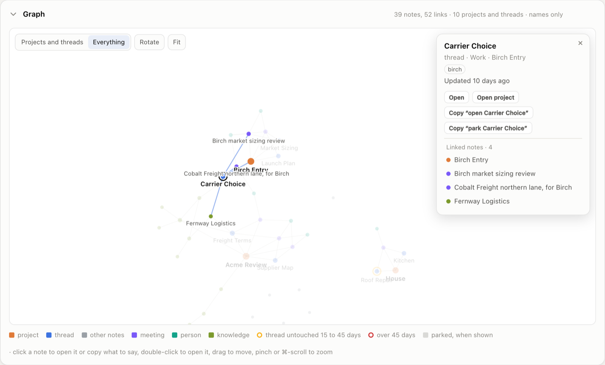

# Extra: the Garrick App

One page that answers two questions before you open anything: is anything wrong, and where was I? The Garrick App is the control panel over your zones, projects and threads, and not where the work happens: it opens a piece of work in the app you work in. It is a single HTML file you open in a browser, in Obsidian, or in a small [Mac app](#a-mac-app) of its own. Its code keeps the name it had when it was the status page: `status.py`, in `extras/status/`, copied into a workspace's `System/status/`. It needs no server, no account and no network, and it works whether or not you use Obsidian or cmux: each time it is built, it checks which of them this machine has and offers only what will work.

A newly installed workspace has this page from the start, put in place and built by the installer, and opens it on the [simple home](simple-home.md) instead: your work, a box to ask something and the questions waiting on you, with *Continue* opening a piece of work in Claude's desktop app, and everything this page describes under *More*. One installed before the simple home existed keeps this page; *Settings › Home* switches either way.

## What it shows

- **What needs attention** is a list the page keeps as data, not a card: worst first, one line each, the figure *2 things need attention* (a link to the tab with the worst trouble) and the dot on the simple home. Red lines: the check did not run or found errors, a scheduled job failed or did not run on time, the spending cap or the per-call budget stopped a job, the deny list for scheduled calls is missing or broken, a job tried a tool the deny list forbids. Amber lines: items waiting in the inboxes, check warnings, a job idle past its limit, a repository whose oldest uncommitted change is more than a day old, a newer Garrick when the [release notice](#settings) is on, and a [published](../commands.md#what-a-project-published) file that differs from its shared copy. All of `check.py`'s errors make one line, *The check found 12 errors*, and all its warnings one more, so this count is of problems while the Checks card lists each finding. Each trouble shows on the card that explains it: the check's on *Checks*, a job's on *Scheduled jobs*, a cap or a budget on *Assistant calls*, the inboxes on *Inboxes*, a repository, a newer Garrick (its release notes on GitHub) and a published file on *Repositories*, and a thread's on its row. A tab whose cards hold trouble carries a dot, red for something failed and amber for the rest, worst first; a card you hid still counts, and the hidden-cards list in Settings marks it. A published file's line says which copy changed and when, *Acme Review: 261007 - Business case.xlsx: the shared copy changed on 30 Oct, after the copy here (7 Oct)*, from the dates `drift.py` records, and in the Mac app it has *Show both*, which reveals the copy here and the shared copy in Finder, each in a window of its own. Finder only selects them: neither is opened or read, and a copy kept online only is not downloaded. *Show both* reveals only the two copies `drift.py` named for that row of `published.md`, the shared one through the zone's `.shared/` link and nowhere else. With nothing to list the figure says *All clear*.
- **Start here**, in a new workspace with no project yet: the one request that sets the first project up, and where the route is written.
- **A graph of the workspace**, behind *Explore* at the foot of the Overview, folded shut until you open it: every note in your zones and wikis, and the links between them, laid out to fill its card, one zone or wiki at a time. The legend is the filter: click a kind to show or hide it, and each place remembers its own choice. A place opens on its hubs, projects and threads in a zone, people in Meetings, concepts and entities in Knowledge, and with only hubs shown two of them are joined when one page links both. In Meetings entities are hubs too, off until you turn them on in the legend: then a person and the entity met in the same meeting are joined. Every place is coloured by its kinds, and *Graph colours* in [Settings](#settings) chooses the colour of each kind. A wiki's notes take the kinds of Garrick's model of it (meeting, mail and person; source, concept, entity and decision), with or without Obsidian; a `type:` the model does not know that at least three pages of the wiki share is a kind of its own, named after it (*Domains* for `type: domain`) and hidden until you show it, and any other page is drawn grey, as other notes. *Find a note*, the box above the graph, finds a note by its name. A wiki page's long title is cut to about forty characters on the graph and given whole on its card. Click a note for its links and the same actions a thread's card offers, with *Preview*, a magnifier, to read it without leaving Garrick in the Mac app and Obsidian; double-click opens it. [Reading the graph](#reading-the-graph) says what it draws and what it leaves out.
- **Threads**, one column per zone, led by the zone picked in Explore's drop-down and the others by name (all by name when the pick is a wiki, or the graph is left out): a row per project, with a chevron that unfolds its threads, each with how long since its note was updated. *By name · Recent* above the columns chooses the order: by name, or each zone's projects and threads most recently touched first, a thread by the later of its note's `updated:` and an unwrapped checkpoint, a project by its newest thread. The window remembers the choice, as it remembers the folds. A live thread's row is its name, its bar and at most two chips, on the name's line at its right: a long name gives way to its ellipsis before a chip does, and the project's name under a thread keeps its own line. *todo 3* counts its open actions: its own open task lines, in its zone's `Todo.md` opening with `[[Thread]]` or written in the thread's own notes. It is green while none of them is [late](#the-todo-tab) and red once one is, and its tooltip names the late ones and since when. A click lists them under the row, late first, each with its date, and in the app with its box to tick and its date to change as on the [Todo tab](#the-todo-tab); a tick there is saved the same way, with the ticks made around it. A thread with nothing open shows no chip at all. *check* means `check.py` found an error in a file in the thread's folder that the page can explain: a click says what is wrong and what fixes it, with *Fix* where [Nurture](../commands.md#nurturing-the-context) has a mechanical fix for it, such as a status word no tool reads, and otherwise the request to copy for your assistant: `nurture <thread>`, or `wrap` or `finish` where that is what writes the missing block. A warning never marks a row, nor an error the page cannot put in plain words; both stay on the Checks card and in Nurture. A row carries no party tags; its card does. The project's row shows its most recent thread, and a project with no thread notes is a row of its own, its name in line with the others. The bar fills toward sixty days and is never coloured: how long since a note moved is a figure, not a fault, and a thread left alone for weeks is often simply slow or waiting on somebody. What marks a thread instead is a red *todo* or a *check*, and its zone and its project count the threads with a red *todo* as *late*: *2 live · 1 late*. The card keeps no legend under the list: point at a chip, the bar or the days beside it, and it says what it means. Threads you have parked ("park X"), and every thread of a project you parked, sit in a folded *Parked* group at the foot of their zone, grouped the same way, out of the counts. A live thread whose note has no `### Resume here` block, the block the threads skill resumes from, has the check's *check* for it, with *wrap* as its fix, and its project's row counts them; its card gives the date the block gives itself, from its *Where it stands* line. With the [cmux extra](cmux.md) installed, a dot a small gap after a name says a session is open there: green while it waits, blue while it works. A project counts its threads' sessions. Hover a project or a thread for its card; while you do, or while it has the keyboard's focus, its node lights up in the graph as it does when you hover the node itself, without moving or selecting anything. A node the graph is not showing, in another place or parked, is left as it is. With `effort` switched on, *Updated*, *Time* and *Cost* above the columns switch what the bars and figures show (see [Preview features](#preview-features)). The box at the head of the card, *Find a project or thread*, looks through every zone at once for a name, whichever zone leads the card, and finds the threads the columns do not show: parked under another project, or finished. It matches as you type, word by word, each word the start of a word in a thread's name, its project's or its zone's, or in the `spoken:` form of the first two, ignoring case and accents: `freight` finds *Freight Terms*, `fourth quarter` finds *Q4 Planning*, and `acme fr` the Freight Terms under Acme Review. It looks at names only, never inside a note. While a query is in the box, the matches take the columns' place, live first, then parked, then finished, each with its project and zone and a *parked* or *done* chip. A match is a row like any other: its name opens it, and its card is the row's, with *Wake* on a parked one; a finished one's card opens its note, where its `### Outcome` is, and changes nothing. Clearing the box, or `Esc` in it, puts the columns back exactly as they were, folds and order included. `/` puts the cursor in the box from anywhere on the page but a field or the Guide, the down arrow moves into the matches, and `Enter` opens the first. The window keeps the query while the page is rebuilt, so a thread woken from the matches shows there as live.
- **Checks**: what `System/tools/check.py --quick` finds, run as the page is built, sorted by [Nurture](../commands.md#nurturing-the-context)'s kinds: walls, mechanical, attribution and judgment, the largest group open. Each finding's path opens the file. A walled party shows by its tag in angle brackets, *names `<acme>`*, as the check prints it whenever a program reads its JSON, so a finding copied off the page names nobody. A mechanical one on a note in a zone has *Fix*, which applies Nurture's fix for that note, as a thread row's check chip does, and any other mechanical one *Nurture*; a wall has *Take it out* and an attribution *Answer*, each handing the request that nurtures its zone or wiki to your assistant; a judgment is the file to open and read. Without `System/tools/nurture.py` the findings are listed by check. The quick run leaves out the comparison of wording with the meetings, the slow part on a large workspace; the commit hook still makes it, and a full `check.py` on a schedule covers the rest. Above the findings, once [Nurture](../commands.md#context-debt) has run on the whole workspace, the *context debt*: what its last run left, weighed by kind, and under the figure what it is made of, *49: judgment 38, attribution 10, mechanical 1*, a wall first and in red. Each finding Nurture leaves weighs by its kind, a wall 10, an attribution question or a correction 5, a judgment or a mechanical fix not yet made 1, and the threshold, 40 unless `nurture-threshold` says otherwise, is the figure above which the morning digest says so; [Context debt](../commands.md#context-debt) has the rest. With three nightly records or more, a line runs from the first record, or 30 days back, to the latest, against the threshold, dashed, with the first value, the latest and the threshold written on it, so nothing needs hovering. Its scale stops at twice the threshold, or the highest ordinary night, whichever is larger: a night above that, such as one with ten wall findings, is an open dot at the top with its figure beside it, and the other nights keep their differences. A night with no record is a tick under the line, *No Nurture record for Thu 30 Oct* when you point at it. Then the three scopes carrying most of it, a zone, a wiki or System, then a button named for the request that nurtures the heaviest, such as *Nurture Work*, with a line saying what one pass will do there: how many fixes on one yes, how many questions one at a time, how many left for your judgment. Under it, the last run's outcome, what it fixed, what was answered and what it left, and that the figure is that run's while the list is this build's quick check, so the two can differ: Nurture weighs what the full check, the wiki lint and the shared-file comparison found, and the list holds only what `check.py --quick` finds now. In the app it opens your assistant at the workspace root with the request typed in, as *Process the Inbox* does; in a browser it copies the request. The page reads the debt from Nurture's daily records and runs nothing. Under it, one link, *Answer in Context*, opens the [Context tab](#the-context-tab) and names each group with what it holds open, its wiki questions and its findings: Nurture runs every night, and what it leaves is answered there. Before the first run there is no figure at all, rather than a zero that would look measured. The card's caption counts the errors and warnings, so a folded card still says them, and says nothing when the check found nothing. Under the debt, once the commit hook has refused anything, a line counts the last 30 days of its refusals by kind (*link*, *name*, *wording*, *path*, *unlabelled*, *unreadable*), the days they fell on, and the commits that landed within ten minutes of a refusal in the same repository, *overridden*, read from that repository's log, since a `--no-verify` cannot be seen by the hook. The hook records each refusal as one line in `System/generated/walls/refusals.jsonl`: the time, the zone, which kind of repository, the kind of finding and whether a party was named as walled. It holds no path, name, party or text, and `System/generated/` is never committed.
- **Todo**: the unticked items in each zone's `Todo.md`, counted by section, with *Open*, which opens the [Todo tab](#the-todo-tab) on that zone. A zone without a `Todo.md` is left out, and with none at all so is the card; the check reports the missing file.
- **Inboxes**: what is waiting to be filed in each zone's `Inbox/` and in the Meetings inbox. While anything waits, *Process the Inbox* sits at the card's foot. In the app it opens the same assistant as the menu bar's row, at the workspace root, with "process the inbox" typed in (see [In the menu bar](#in-the-menu-bar)); in a browser, or with no assistant switched on, it copies the phrase. With every inbox empty there is no button.
- **Scheduled jobs and assistant calls**, when you use the [scheduled jobs](scheduled-jobs.md) extra: a fourteen-day strip per job, one cell per day, under the line its plist gives in `GARRICK_ABOUT`, with Garrick's own jobs (a `garrick.` label, and a name that starts with `gr-`) and *Yours* in two groups; a job a session starts, with no plist, is *started by a session*. A job of Garrick's renamed in 0.49.0 as the update says is one row under its new name, with its runs from before the rename, once no plist runs the old name; a run under the old name since then keeps a row of its own ([Garrick's jobs and yours](scheduled-jobs.md#garricks-jobs-and-yours)). A job made of several steps, as the nightly job is, lists in its panel how each step of its last run went. A job's name opens a panel: what it does, its schedule, label, whether it calls the assistant, its last runs and the end of its log, with *Open log* for the whole file, which the Mac app opens in your plain-text editor. The panel puts a job's last 30 log lines on the page, so a job should log counts and paths, never an assistant's answer or a note's text. A plist loaded before this release shows no description until it is copied in again. The strip is read from each job's heartbeat and log in the jobs folder (`GARRICK_JOBS_DIR`, `~/Library/Logs/garrick-jobs` unless a job sets another), and the spend against its caps, from the ledger in the same folder, `ledger.jsonl`, at list price. The *Scheduled jobs* caption says how many jobs ended their last run failed, or did not run on time, and nothing when none did. The caps are the ones the jobs run under: the `GARRICK_CAP_*` values in the launchd plists of the jobs that call the assistant, with the default for any a plist leaves out and the lowest where jobs differ. With no such plist, the page shows the caps it was built with. Pointing at a meter says where its caps came from. A cap set to 0 shows as *no cap*. A job the cap stopped is a line in the *Assistant calls* trouble list, and the tab's dot, however many calls it lost, and so does a call stopped at its per-call budget (`GARRICK_MAX_CALL_USD`, shown as *Per call* beside the meters). A job whose lock is held says *running now*, and offers no *Run now*. A job whose launchd plist runs `job.py` but which has not run yet has a row of its own, with its schedule, a hollow mark and *not run yet*: neither fine nor a failure, so it stays out of the tab's dot. An exit job.py calls quiet (its heartbeat's `ok` or `quiet`, or a code the plist lists in `GARRICK_QUIET_EXITS`) is fine, and a failure says the heartbeat's own reason. A job idle for as long as its plist allows (`GARRICK_IDLE_DAYS`, 7) goes under *Needs attention* as a warning. Once three days have calls, a chart shows the cost of each of the last fourteen days. The table gives each job's calls, cost, turns per call on average, and the tools it was refused: red for a tool the deny list in `System/jobs/headless-settings.json` forbids, which also goes under *Needs attention*, amber for one the job was only not allowed. A missing or unreadable deny list goes there too.
- **Repositories and wikis**: how many files have changed since the last commit in the workspace, each zone and the wikis, split into staged, not staged, untracked and conflicted, with their paths to read and a button that copies the repository's folder; and the date and title of the newest entry in each wiki's log. The card counts files, not commits, and never commits anything: another session may be halfway through that work. A repository with files changed since the last commit has a ring for its mark, and one whose oldest change is more than a day old turns amber and goes under *Needs attention*. The card's caption counts the repositories with changes; pointing at a repository says its last commit and its changes.



The page has the tabs Overview, Todo, Status, Context and Guide, and fewer when a tab has nothing to show (no zone has a `Todo.md`, or nothing is open to ask and no zone has anything to show). **Overview** shows where your work stands, and nothing about the machinery. It opens on the threads, each with what it owes and what is broken in it, then *Todo* on the left and *Inboxes* on the right, and the graph behind *Explore* at the foot. A workspace with no project yet opens on *Start here*. **Status** shows the machinery behind it: the figures first (*All clear*, or how many things need attention, then *Live threads*, *Todo*, *Inboxes*, and *Checks* or the assistant's calls), each named as the card it opens, then the scheduled jobs and assistant calls when you run the jobs extra, the repositories and the wikis. *Checks* sits on the **Context** tab, under the findings it explains, and moves back if you move it. A dot on a tab means a card there holds trouble: red when something failed. **Move to…** in a card's header lists the other tabs, and every tab with content (Overview, Todo, Status and Context) has a left and a right slot below its own content to put a card in; Reset view puts every card back. Each figure opens the card that explains it, switching tab if it has to. **Guide** shows Garrick's own docs, these pages among them: see [The Guide](#the-guide).

One row stays pinned at the top while the page scrolls: Garrick's mark, the page's name and when it was built, the tabs, a circular arrow that rebuilds the page (in the Mac app; in a browser it copies the command that does), the cog for [Settings](#settings), and three icons for an automatic, light or dark theme. There is no sidebar: the tabs move between the work and the machinery, and the cards are open on the page. At the top of the *Status* tab, *Only what needs attention* hides everything there that is healthy. Every section folds. Every card can be dragged by the grip in its header to another place on its tab, moved to another tab with *Move to…*, or hidden with its ×. A hidden card is listed at the foot of Settings, above *Reset view*, and clicking it there brings it back. *Reset view* puts everything back as built, parked notes hidden again, and keeps your theme and the apps you chose to open projects in. The page remembers all of this in your browser and nowhere else, so each browser keeps its own. A browser that has moved or hidden a card keeps that arrangement card for card, whatever order a newer Garrick builds: a new default reaches a browser that has arranged nothing, and *Reset view* is what adopts it anywhere else. A card a newer Garrick adds appears where that build puts it, ahead of the cards you placed in the same column. A card a newer Garrick removes simply goes, and nothing else moves. *A thought* went that way: a browser that still holds text typed into it shows that text once, at the top of the Overview, with *Copy* and *Close*, and either one removes it from the browser.

## Settings

The cog beside the page's name opens *Settings*. In the Mac app, *Settings…* in the app menu (⌘,) opens it too.

Settings is a wide sheet over the page: one column of sections that scrolls, read from top to bottom, with a list of the sections on its left. Click a name in the list and that section comes to the top of the column; as you scroll, the list marks the section you are reading. The sections are grouped by what people come for: *How Garrick looks and opens things* (*Home*, *Opening a thread*, *Explore*, *Zones*, *Graph colours*, *Menu bar*, and *While you wait* while its [preview feature](#preview-features) is on), *What it tells you* (*Notifications*), *How it keeps older material* (*Manage older material*, which is Memory) and *About Garrick* (*About Garrick*, *Preview features*), with *Reset view* at the end. In a narrow window the list becomes a strip across the top. A section a browser cannot use, such as *Notifications*, is left out of both the column and the list.

Settings shows the choices and little else: each section opens with one sentence at most saying what it is for, and a row has a line of its own only where it helps you choose, such as what a hotkey opens or why a greyed row cannot work here. How a feature works is behind the "?" beside a section's heading, which shows a short explanation where it stands, and on this page, which holds the rest; pressing the "?" again hides it. Reset view's "?", or pointing at the button, says what it resets.

**Opening a thread** lists the ways a project or thread can be opened: the note's own link, *Open the note*, which opens it in the app macOS opens a Markdown file in, whether or not Obsidian is installed, *Preview*, *Reveal in Finder*, *Open in cmux*, *Open in Codex* and *Open in Claude*. Each build checks which of the apps this Mac has and whether each one can actually open a folder, and a launcher that cannot work here is greyed out with the reason on the row: *Not installed on this Mac*, or, for a Codex app that has lost the launcher it opens a folder through, *Installed, but its own launcher is missing: reinstall the Codex app*. Nothing is offered and then refused after the click. In the Mac app each row carries the icon it carries on Explore's cards: the app's own icon, your Markdown app's for the note's link, and a magnifier for *Preview*; a browser, whose cards show words, shows none. Each row has two controls:

- **A checkbox:** whether project and thread cards offer it. The apps work in the [Mac app](#a-mac-app) only. *Preview* is Explore's [preview of a note](#thread-cards), offered in the Mac app and Obsidian, and on until you switch it off; it opens nothing, so it has no radio button, and a browser, which never offers it, leaves the row out. The [Garrick band](../../extras/mods/README.md) in Claude Code follows the same boxes: no *Obsidian* button without *Open the note*, no *Finder* without *Reveal in Finder*.
- **A radio button:** what clicking a thread's name in the Threads list does. The note's own link is the default. An app chosen here takes over the click in the Mac app; in a browser the name still opens the note. The band's *While you wait*, a [preview feature](#preview-features), opens its suggestion this way too, falling back to the next way switched on that it can run.

With the [cmux extra](cmux.md) installed and *Open in cmux* switched on, a row under it, *A cmux tab starts*, chooses Claude Code or Codex for the tabs the desk opens. It is the desk's own `agent` setting: closing Settings writes it to `System/desk.json` through the desk, so a tab opened from the app, a menu or by voice starts the same assistant.

*Open in Claude* on a thread opens Claude's desktop app on that thread with Claude's answer to "Where am I on Pricing?" already on screen, the way the simple home's [Continue](simple-home.md#continue) does, and with nothing left to send. Where the Claude Code command-line tool is not installed, it falls back to starting a new session in the thread's folder with "open Pricing" typed in, and you press Enter to send it; a Claude that is not running is then started first and the link waits for its window, because a cold Claude drops a link sent while its window is still loading. The same fallback opens a project of several threads, which has no one thread to ask about. *Open in Codex* and *Open in cmux* open the folder and then put "open Pricing" on the clipboard, saying so, so a clipboard you were using is never replaced silently. *Reveal in Finder* shows the folder and names the phrase without copying anything. Whichever you press, the phrase that resumes the thread reaches you, and you never have to rebuild it. Your choices are kept in the window's own storage as you make them. In the Mac app, closing Settings after a change also saves them for every viewer of the page, in `System/garrick-settings.json`, through `page_action.py`; each build carries that file into the page, and inside the app it comes before what a window remembers. That file is committed with your workspace, so the choice survives a rebuild and a restore; a window's own storage keeps only what belongs to that window, such as its theme and its folds. A browser keeps its own. Close Settings with the × at its top right, or Escape.

**Explore** holds one switch. *Follow the zone in view*, on until you switch it off, makes the graph behind *Explore* show the zone you are reading on the Threads card (see [Reading the graph](#reading-the-graph)). The window remembers it, and *Reset view* puts it back. A page built without the graph has no such section.

**Zones**, in the Mac app and in Obsidian, gives each zone a colour and an icon, so you can tell zones apart without reading their names. Each zone has a row: its name, drawn as you have chosen, then a button for its colour and one for its icon. Each button shows the current choice and opens a palette of every colour, as a dot, or every icon, drawn as it will appear; the first cell, a dashed ring, takes the choice away. Escape closes a palette without changing anything. The colours are cmux's sixteen named colours: Red, Crimson, Orange, Amber, Olive, Green, Teal, Aqua, Blue, Navy, Indigo, Purple, Magenta, Rose, Brown and Charcoal. The icons are a fixed set of twelve: briefcase, house, flask, rocket, book, globe, heart, star, leaf, wrench, chart and shield. There is no upload, so every icon stays legible at the size of a label.

The colour goes on the text of every label that names the zone: its heading on the Threads card, its button on the Todo tab, its line on the *Todo* card, its tile under *Inboxes*, and the place drop-down on the graph when it shows that zone. The icon sits before the name in the same places. Backgrounds, the bars and the dots keep their meaning, and the graph keeps its own colours. Each colour has a light and a dark shade, so it reads against the page in either theme. A zone with no colour or icon looks as it always has, and a zone added later starts with neither.

Closing Settings after a change saves the zones beside the apps, in `System/garrick-settings.json`, as `"zones": {"Work": {"color": "Teal", "icon": "briefcase"}}`, and rebuilds the page. With the [cmux extra](cmux.md), the desk reads the same file: a tab it opens in a zone's project or thread colours that zone's cmux workspace, and a colour changed here recolours the zone's workspace if it is open. Commit the file with the rest of your workspace, as you would any note: these are choices you make once, so they belong in its history, and the check says so while they are not there. A workspace that kept them in `System/generated/status-settings.json`, as Garrick did up to 0.24.0, has them copied across the next time the page is built, without replacing a newer choice.

**Graph colours**, in the Mac app and in Obsidian, on a page built with the graph, sets the colour of each kind of note in [Explore](#reading-the-graph). It has a row for each kind the legend can show: projects, threads, other notes, meetings, mail, people, sources, concepts and entities, then any kind found from a wiki's pages. Each row shows the kind's dot in its colour and uses the same palette as *Zones*. Its first cell, *Default*, drawn in the colour Garrick ships, puts the kind back to that colour. The palette offers the zones' colours except Red, Crimson and Amber, which the graph keeps for its rings, so no kind looks like a late next action. A colour chosen here has the same light and dark shades as a zone's, so a kind's dot and its notes read in either theme; a kind on *Default* keeps its one colour in both. *Reset colours* puts every kind back to its default. Closing Settings after a change saves the section beside the zones, as `"graph": {"project": "Teal", "thread": "Indigo"}`, with a kind on *Default* left out, and rebuilds the page, which then draws the chosen colours on the graph and in its legend. The file is yours, so an update leaves the choice alone.

**While you wait** is a [preview feature](#preview-features), parked: Settings shows it only while `while-you-wait` is on in `System/garrick-flags.json`, and with it off, what was saved stays in the settings file, unused by the band. In the Mac app and in Obsidian, it sets what the [Garrick band](../../extras/mods/README.md#while-you-wait-a-preview-feature) offers while a long turn runs in Claude Code: one thing worth doing elsewhere, from `System/tools/next_up.py`. *Suggest something while a turn runs* switches it on or off, with the seconds a turn runs first (45, from 10 to 600). *Same zone only*, off until you switch it on, keeps the suggestions to the zone the session works in; off, they come from every zone. *What counts, first to last* lists the six sources in the order they are offered, each with a box and two arrows to move it: the thread left most recently today, Todo lines due today or late, chases that have come due, what waits in an Inbox, parked threads left alone and live threads not wrapped lately. The last row says how long each of those last two must be: a parked thread untouched for 30 days, a live one not wrapped for 14, unless you change them. Closing Settings after a change saves the section in `System/garrick-settings.json`, under `"while-you-wait"`, checked by `next_up.py` on the way; the band reads it at the start of each turn, and "what's next" in a session without the band reads the same.

**Manage older material** (Memory), in the Mac app and in Obsidian, sets how pages fade out of the wikis' working memory, and shows what that would do now. It appears once the workspace has `System/tools/fade.py`, which keeps the settings' defaults and does the counting; if it cannot read them, the section says so in one line and the rest of Settings works as before. Its one line says what it does: old meetings and reading leave the index after the months set here, nothing is deleted, and nothing moves until you say "fade the meetings" or "fade the library". Then, for each wiki:

- *Let old Meetings pages fade* or *Let old Knowledge pages fade*, the wiki's switch, and under it each of its kinds, as `fade.py` lists them, with the months until a page goes dormant, the months until it is archived, or *never*; the archive's months never come before the dormant ones.
- One line of counts, such as "Meetings: 600 working · 17 dormant · next pass moves 5", with *Full list* once a review has written `System/generated/fade/<Wiki>.md`, every page the next pass would move and why. As you change a value the app counts again from the unsaved values, through `page_action.py`'s `memory-preview`, which only reads, so a change can be judged before it is kept; a host older than this counts only what is saved.

Everything else is under one *Advanced*, closed until you open it: which pages each kind takes, what keeps a page working, bringing a page back, and search and the morning digest, each described below. What the section no longer shows is here:

- **The three grades, in plain words.** *Working* pages are listed in the wiki's index and read by every search and briefing. *Dormant* pages are put aside: out of the index, but still found when a search reaches back for them, and the search says so. *Archived* pages are found only when you ask to search the archive. Nothing is ever deleted: faded pages stay in their wiki, dormant ones in its `dormant/` folder and archived ones in its `archive/`, each beside its raw file, and git keeps every move.
- **Three steps, kept apart.** *Save*: closing Settings saves the rules, and saving moves nothing. *Review*: "what would fade" writes the list of what the next pass would move, and why. *Confirm*: pages move only when you say yes to that list, "fade the meetings" or "fade the library".
- **The full list.** "What would fade" writes, per wiki, every page the next pass would move, with its date, where it would go and why, and the pages old enough to go that stay because active work links them, with what keeps each one. *Full list* opens it.
- **How age is counted**, in `fade.py`'s own words, behind the section's "?": from the day the meeting took place (`date:`), or the day the reading came out (`published:`, else `date:`); without one, from the date the file name starts with, such as `260314` or `2026-03-14`; never from when the page was last opened or changed. A date that names only a month or a year counts from the end of it, and a page with no date never fades by age.
- **Which pages each kind takes**, under *Advanced*: the `type` and domain values that belong to the kind, written as lists separated by commas.
- **What keeps a page working**, under *Advanced*, has a switch for each thing that protects active work: a live thread links it, a live project's notes link it, an open action in a Todo list links it, its frontmatter says `pinned: true`. Person, organisation and topic pages, and the wiki's own lists, never move.
- **Bringing a page back**, under *Advanced*. *Propose bringing back a dormant page that active work links again* is on until you switch it off. `fade.py`'s own sentence under it says how waking works: a dormant page is proposed to come back when a live thread, a live project's notes or an open action links it (where that protection is on), or a working page links it afresh rather than through the link the fade rewrote; `pinned: true` brings it back too, and is the only way back from the archive. Opening, reading or quoting a page brings nothing back, nothing comes back until you confirm a review, and a superseded page never comes back.
- **Search and the morning digest**, under *Advanced*. *Without being asked, search reads* working pages only, or working and dormant ones. *Say what would fade in the morning digest* adds a line once at least that many pages would fade, 10 unless you change it.

How age is counted and how waking works are shown, behind the "?" and under *Advanced*, as `fade.py` words them (its `AGE_SAID` and `WAKE_SAID`), and its tests hold each sentence against what the code does, so the page cannot promise what the fade does not do. Closing Settings saves the section in `System/garrick-settings.json`, under `"memory"`, checked on the way, and moves nothing.

**Notifications**, in the Mac app and in Obsidian, says which of the things Garrick can tell you reach you. Notices go to this Mac and nowhere else: a notification in the corner of the screen, or, for a session running in cmux, cmux's own notification on that session's tab, with no switch for it. Everything that sends a notice goes through one module, `System/tools/notifications.py`: the scheduled jobs, the todo sweep, the cmux desk and the session hooks. The section holds five choices and quiet hours:

- **Tell me when**: *a session needs me*, *a long task finishes, after 2 min* (the minutes are yours to change), *the morning Todo summary is ready*, *a scheduled job fails*, and *a newer Garrick is out* (sent once for each release, held until morning in quiet hours, and only when the check above is on). Each one ticked is shown; unticked, it is not. A job gone idle and, with the [cmux extra](cmux.md), the desk's replies when you start or close the day are shown while any of the five is ticked, so five empty boxes mean no notice at all. The nightly *Todo refreshed* counts are never shown.
- **Quiet from 22:00 to 07:00**, or other times, or off. The section says it in one line: "At night only “a session needs me” and the desk get through." (without the cmux extra, no desk). The rest is held until morning, except a long task that finishes in quiet hours, which is not reported at all. A held notice goes out with the first notice after the quiet hours end, or the first prompt you give a session, or `python3 System/tools/notifications.py flush`.

| Notice | When it fires | In quiet hours |
|---|---|---|
| Needs you | a session is waiting: a permission to give, a question, an idle prompt | sent |
| Finished | a session ends a turn that ran at least the minutes set (2) | dropped |
| Todo summary | each zone's morning digest from the sweep | held |
| Job failed or recovered | a scheduled job fails or works again, throttled, and a line a job sends of its own | held |
| Job idle | a job has run cleanly and done nothing for days | held |
| Desk | the cmux desk starting the day or shutting down (with the cmux extra) | sent |

A notice is short and plain: the zone or thread and what happened, such as "Work, Pricing: needs you. Permission asked." or "Work, Pricing: done, after 4 minutes.". Never the content of a note, a meeting or what the assistant said. Needs you and Finished come from hooks in Claude Code or Codex, which the `setup` skill installs when you say yes ("set up notifications"), or `python3 System/tools/notifications.py hooks --install`: Claude Code gets three, `UserPromptSubmit`, `Notification` and `Stop`, and Codex two, `UserPromptSubmit` and `Stop`, since it has no event for a session waiting on you. `hooks` alone says whether they are in, and `--uninstall` takes them out, leaving your other hooks as they are. A hook answers nothing and sends from a process of its own, so it never holds the session, and it stays quiet for a session outside the workspace, for a scheduled job (`GARRICK_HEADLESS=1`), and for the [Ask](#ask) box's background session (`GARRICK_BACKGROUND`): for those it marks no turn, sends nothing held from quiet hours, and sends no notice. cmux posts its own notice when a Claude session in it needs you; with the hooks in, switch one of the two off. To see what a notice looks like, run `python3 System/tools/notifications.py test mac`, or `test cmux` from a cmux tab.

A job whose launchd plist sets `GARRICK_NOTIFY` or `GARRICK_NOTIFY_CMD` keeps sending where they say, past this section, exactly as before: `GARRICK_NOTIFY_CMD` is the way to send a notice somewhere of your own, such as a chat app, and [Scheduled jobs](scheduled-jobs.md) says what it is given. Settings does not list those jobs; take the variable out of the plist to use the section instead. Closing Settings after a change saves the section in `System/garrick-settings.json`, under `"notifications"`, as `{"tell": {...}, "after": 2, "quiet": {...}}`. Settings saved by an older Garrick still read: an event that went to this Mac stays on, this Mac switched off turns every notice off, and the Telegram chat, the per-zone choices, a command of your own and the choices made under *More options* are ignored, then dropped the next time the section saves. What the module keeps for itself, the notices quiet hours hold and when a session's turn began, is in `System/generated/notifications/`, never committed.

**About Garrick** says which release the workspace runs, such as *Garrick 0.43.0*: the newest release in the copy of the changelog the installer put in `System/garrick-changelog.md`. `python3 System/tools/check.py --version` says more: the commit, the day and how it was installed. Under it are three links:

- *Report a bug* opens the bug form on GitHub with *Which Garrick* already filled in.
- *Suggest a change* opens a new discussion under Ideas.
- *Release notes* lists every release with what it changed.

Each one opens in your browser, and nothing is sent until you submit it there yourself. Use invented names (Acme, Birch) in anything you report, never a real client's: pointing at a link says so too. A way to get past the wall check goes in a private report, not an issue, as [SECURITY.md](../../SECURITY.md) says, and the bug form points there. A refusal by the wall check that should have passed has a form of its own among GitHub's issue forms.

The page itself loads nothing from the network, and neither does a notice. Two things under the links ask GitHub, and only when you choose:

- **Check for updates** is a button. A click asks GitHub now for the newest release, which is the consent for that one request. Nothing newer: the line says "Garrick 0.58.0 is the newest release, and this workspace runs 0.58.0", and when it asked. A newer release: the button updates at once, with a progress line, then lists what the update did, as its report words it: the counts replaced and added, each file written as `.new`, each instruction file under *Split* with "Say 'merge the update' to your assistant", each file skipped for uncommitted changes, and the pieces that run from a copy outside the workspace. A failed question is one line and changes nothing. A workspace that is not older than the newest release, by version number, is never updated by the button.
- **Check for a newer Garrick** is a switch, with *Daily* or *Weekly* beside it. It is off by default and saved when Settings closes, as `release-notice` and `release-notice-every` in `System/garrick-settings.json`. On, a build of the page and the nightly job of the [scheduled jobs](scheduled-jobs.md) extra ask `System/tools/release.py` in a process of its own when a check is due, and the *Repositories* card says "Garrick 0.16.0 is out; this workspace runs 0.15.2" from the next build on, with the command that updates and a link to that release's notes. A check never updates: it only tells, and the button or your assistant updates.

[Updating Garrick](../updating.md#being-told-a-newer-garrick-is-out) says exactly what goes over the wire: one request, and nothing about your workspace. A request that fails shows nothing. With both off, the page never asks: compare *Release notes* with your version.

## The Context tab

The **Context** tab, headed *Context Nurture*, is where the questions your wikis and Nurture raise are answered, one zone at a time or all of them. *Needs you* stays in the [simple home](simple-home.md#needs-you), for the questions that block a piece of work; this panel is for the rest. It calls no model.

The tab is one view: the questions and findings, and under them *Allowed by you* once there is something to list. A saved window or a link that names the old Parties tab opens Context. There is nothing to flip here: a wall is a flag on a zone, shown read-only in the [Guide](#the-guide) and changed with `scaffold.py zone --name <Zone> --walled` or `--open`.

- **Counters** at the top: open, due today (a *Later* whose day has come), proposed verdicts, and answered but not yet worked in. Decisions to review are the decision pages the assistant flagged with a `revisit:` reason, listed under their group with the reason and a link to the page; only you change a decision's status. The count is shown per zone.
- **Filters**: the zone, the wiki, and the age. With no zone chosen yet, the panel opens on the first zone, by name, that has an open question, and on the first zone when none has; a zone you chose stays chosen.
- **List** is a two-way switch, *Wiki questions* or *Nurture findings*, with the count of each on it: `Wiki questions 3 | Nurture findings 11`. It is one or the other, never both.
- **All groups the list.** With *All* in Zone, the rows sit under one heading per zone, such as *Work* and *Harbour*, and each group holds what that zone shows on its own. Questions that carry no zone sit in a *Knowledge* group of their own. A save is made in its own zone and never mixes two.
- **One question open at a time**, oldest first: the bold line, why it matters, the raw record it came from and the pages the answer would change, each opening in your note app, a field for the answer, and a line naming the files a save will write. **Return** files the answer and moves on to the next; *Later* takes a day after today: the field beside it starts tomorrow, and a day on or before today sends nothing and says "Pick a day after today." in the panel. *Close* is for a question with nothing to work in. A request the app refuses, for any of these buttons, shows its reason under the buttons and the question stays in the list. *Record as a decision* files your words as the raw answer and as a decision page that stands as valid, both in one save, in the question's own zone; a Knowledge question has no zone, so its button is off.
- **A question that is open again shows again.** Right after you save, the panel hides the question until the page is rebuilt. It keeps the time of each save, and once a build is newer than the save, the page's own data decides: a *Later* whose day has come, or a save that was rolled back, shows without restarting the app.
- **Proposed verdicts**, each with its reason, accepted one by one or all at once. Accepting closes the question.
- **Allowed by you** lists every allowance in `System/walls-allowed.json` as committed at the workspace root's HEAD, the copy the check honours (an entry still only on disk is not listed), below the findings, once there is one: the file, the kind of finding allowed, the day, and who allowed it, with **Remove**. Only a person at a terminal can allow a finding, with `check.py allow`; the page never offers it. An allowance lets one finding in one file through, for the file as it was when you allowed it; editing the file ends it, and the entry then says so. *Remove* sends `walls-unallow` for that file and finding, and the refusal is back. The ledger never holds the text a finding matched. A ledger that is missing, unreadable or of a version the page does not know shows nothing, and an entry that does not read is skipped. In a browser, which cannot act, *Remove* says so.
- **Work them in** hands "work through the open questions" to your default assistant at the workspace root, the route *Process the Inbox* takes. The `meetings` and `knowledge` skills do the work, and commit it.

In a browser, which cannot act, the panel shows the questions and every button copies what to say.

The **Nurture findings** list holds the findings Nurture leaves for you to open, one group per zone: a judgment, or an attribution it could not settle. Each row has the file's path, the name of the check and its line, and *Open in Claude* (and *Open in Codex*, where installed) hands that one finding to a session; when the session ends, the row's state comes from the next build. The page answers no attribution and writes no party: a person's employer, an entity page's party and a value written wrong are settled in a session (`nurture.py`, or "nurture the context"). A finding that is a wall is never listed: the Checks card says it in its own words.

**What the walls decide.** The page is one static file, as the rest of the status page is: every zone's list is in the page source and the script shows one, each holding only what belongs to that zone. An item is listed, counted or offered only if its zone can be read, from its folder under `Zones/` or a Meetings page's `zone:`, and is the zone shown. A question whose `pages:` name a page of another zone does not list that page, and an item with no zone the workspace knows is listed nowhere. A page with a wall finding on it has no row. `party:` and `parties:` are an index: the panel never reads them as a wall. What you type is data: it is written as text, never run, opened or followed as a path.

**Counts are per zone.** No counter, tab number, menu count or switch adds two zones: the page cannot show that no wall stands between them, so it fails closed. With one zone in view the tab carries its number. With several, the tab shows none and each zone's heading carries its own count. The menu bar's menu and the edge panel have a *Context* row that names each zone with its own open count, such as `Context · Work 2 · Harbour 1`; *File › Context* in the app does the same: each brings the window forward on this tab.

## The Todo tab

A *Todo* tab with every open action in the zones, one zone at a time, picked above the list (Work first, when you have it). Actions are grouped as `Todo.md` groups them, under its headings in their order; then *In thread notes*, the actions written in a thread's own notes; then *Done today*, what was ticked today. The notes read are the ones `check.py` reads as the zone's notes: not an archive, build output, hidden or template folder, an installed package or cache such as `node_modules/`, or anything in a repository of its own or a Garrick checkout kept inside a project, and not a note the vault's Obsidian excludes (*Excluded files*), though the zone's `Todo.md` always counts. An empty heading is left out, but an empty Inbox says *Inbox clear*. Each action shows its thread, linked to the thread's note, in the zone or in a project kept in `System/`, its priority when high, and its date as Obsidian Tasks writes it: a due date with `📅`, a day to chase a `#waiting` line with `⏳`. An action is **late** once its due date has passed or its chase day has come, and that is the only thing the page calls late, wherever it counts it: the *todo* chip, the Threads card's zone and project lines, Explore's ring, this tab. A late action's date turns red and still says *Due …* or *Chase …*, which tells the two kinds apart. A line above the groups counts what is open, late and undated, and the *Todo* tab has a red dot while anything is late. *All*, *Late* and *No date* filter the list; *A–Z* sorts by thread, then by the action, and *Due date* puts dated actions first, soonest first. The page remembers the zone, the filter and the sort. A zone's *Open* on the Overview's *Todo* card opens the tab on that zone, and *Open Todo.md* above the list opens the file.

In the Mac app and in [Obsidian](#in-obsidian), the page has buttons that change your notes. On the Todo tab, a box ticks an action, and ticking one under *Done today* again reopens it. The row is struck through as you click, and you can go straight on to the next: the ticks you make within about two seconds of each other are saved together, in one commit, and the ones you make while that commit runs go in the next, so clearing five lines takes five clicks and at most two wall checks. A second click on a line before it has gone takes the tick back. When they are saved, a small *Saved 3* shows and fades by itself; if the wall check refuses them, a card stays that names the lines, and their boxes go back. Its date opens a menu: *Today*, *Tomorrow*, *Friday*, *Next Monday*, *In a week*, *In two weeks*, any other date, or *Clear the date*; a dated Inbox line says where it moves. The row changes at once and waits, greyed, for the rebuild. *＋ Add* above each zone's list writes a new one, which shows greyed in its section until the rebuild: the text, optionally a project or thread picked from a tree of the zone's projects with their threads folded under them, and optionally a date. The line goes to the top of the Inbox in the zone's `Todo.md`, opening with `[[Thread]]: ` when you picked one; with a date it goes where a dated line belongs, *This week* within seven days, *Soon* after that, *Waiting on* for a `#waiting` line. A line the list already holds is refused, and that means the same thing to do on the same thread, whatever date it carries and however it is spaced or capitalised, not only one written out character for character. On a thread's card, *Park* and *Wake* replace the phrases to copy. Each button changes one line or one `status:` field, the same way the skills would: ticking adds Obsidian Tasks' `✅` date, and parking sets `status: parked`, moves `updated:` and adds a dated "Parked." entry. Each change is then committed in the zone's repository, through its wall check. If the wall check refuses the commit, the file is put back as it was, unless you edited it meanwhile, in Obsidian say: then your edit is kept and the reply says so. The app runs `page_action.py` from the same folder as `status.py`, so copy both, and `prefs.py` with them: it is how each of them reaches the choices you keep. A browser has no way to reach it, so there the buttons stay hidden; the [Obsidian plugin](#in-obsidian) reaches it as the app does. See [What the actions keep](#what-the-actions-keep).

## The Guide

The *Guide* tab holds Garrick's own docs, these pages among them, so you can read them without leaving the page. They are the copy in `System/garrick-docs/`, which the installer puts in the workspace and every update replaces, so they describe the release the workspace runs rather than the newest one. The tab works in every host the page opens in, a browser included.

- **Walls**, above the contents: the rule in three sentences, and one line for each zone, *walled* or *open*, with the `scaffold.py zone` command that changes it. The page only shows the flags; it flips none.
- **The contents** sit on the left, in reading order, in five sections: *Start here*, *Understand*, *Do*, *Extras* and *Look up*, each page with its headings under it. One page shows at a time, and the window remembers the last one you read.
- **Search the Guide**, above the contents, keeps the pages and headings whose titles hold every word you type, ignoring case. It looks at titles and headings, not at the text of a page. `Esc` clears it.
- **Links.** A link from one page to another, or to a heading on it, stays in the tab and lands on that heading. A link into Garrick's own files outside the docs, such as `System/rules.md`, opens on GitHub at the release the workspace runs, or at `main` for a workspace that follows it, in your browser. Images are carried in the page.

The pages wait as text at the end of the page and are laid out only when the tab first opens, so the other tabs cost no more for having them. A workspace with no `System/garrick-docs/` shows one line instead, saying that an update brings them. Your assistant answers questions about Garrick from the same copy: see [Where a question goes](../../template/AGENTS.md#where-a-question-goes).

## Preview features

Some features are in Garrick's source before they are in a release. They are off until you switch them on in `System/garrick-flags.json`, and *Settings* lists each one and whether it is on. To switch one on, write its name there and rebuild the page:

```json
{"effort": true}
```

- **`effort`**: *Time* and *Cost* on the Threads card. The same rows show the assistant's active time, or its list-price cost, over the last 30 days instead of how long since each note moved, largest first; *Updated* puts them back by name, and the page remembers the choice. A project's row counts all of its work, its threads and what it did in no thread; each thread shows its own. One line under the columns gives the total: *Last 30 days: 4 h active · $12 at list price · 9 sessions*. Point at it for whatever no row shows, so the figures add up: sessions outside the zones (in `System/`, a wiki or the workspace root), sessions started in a zone's own folder, and threads finished or renamed since; and for how the figures are counted, as below. Hover a row's figure for its raw tokens and sessions. It reads Claude Code's own transcripts in `~/.claude/projects/`, with no model call, through `effort.py` beside `status.py`, so copy both:
  - *Which thread.* The folder a session ran in gives the zone and project; a thread's own folder gives the thread. Otherwise the thread is the one whose `Threads/<X>/` notes the session wrote or edited most, and a project with no thread notes is its own thread. Anything left counts as the project's own work rather than a guess. A session started above the zones is placed by the notes it wrote.
  - *Time* is active time: the gaps between messages, with any gap over five minutes left out as idle.
  - *Cost* is the list price of the tokens, the measure *Assistant calls* uses. It comes out a little under Claude Code's own count, which also prices small background calls the transcripts do not record. Cache reads dominate the raw token counts, which is why the card shows cost and time, not tokens.
  - *Scheduled jobs* are left out: a headless run is already in *Assistant calls*.
  - *Moved and renamed folders.* `--also OLD` reads a folder the whole workspace used to live in as the workspace, and `--moved OLD=NEW` counts a renamed project or a moved wiki under its present name (`--moved "Zones/Work/Acme Old=Zones/Work/Acme Review"`). Both can be given more than once, to `effort.py --record` and to `status.py` alike, so the page and the nightly record count the same way; in the Mac app, give them to `make-app.sh` after `--`. A project or thread renamed from the page needs neither: the page keeps the move in `System/generated/moved.json`, never committed, and both count it as if `--moved` had been given.
  - *History.* Claude Code deletes transcripts after 30 days by default, the same span the card shows. The [nightly job](scheduled-jobs.md#the-nightly-job) keeps the days anyway: it runs `effort.py --record` each night, which writes each day's totals per thread to `effort.jsonl` beside the jobs ledger, and the page reads that file as well as the transcripts. Give the job's plist the same `--also` and `--moved` as the page. Without the scheduled jobs extra, run `python3 System/status/effort.py --workspace <your workspace> --record` yourself now and then, within 30 days.
  - Codex keeps its sessions elsewhere, in another format, and is not counted yet; the line under the columns says so when you point at it.
  - Only names, durations and figures reach the page, never a line of a transcript.

- **`while-you-wait`**: the [Garrick band](../../extras/mods/README.md#while-you-wait-a-preview-feature)'s suggestion line while a long turn runs in Claude Code, with `/garrick next`, `open`, `tick` and `later`, and [*While you wait*](#settings) in Settings. Parked rather than released: off, the band shows no such line and the four words say the feature is off. "What's next" answers either way, from the same `System/tools/next_up.py`.

- **`ask`**: a box that the Ask hotkey (⌘G unless you set another) opens from any app answers a request in plain words and acts on it, in the Mac app only. The fields of the menu and the panel only find, with the preview on or off. See [Ask](#ask).
- **`ask-agent`**: with `ask` on, Ask becomes one session with read tools that Garrick serves and checks, instead of a command session and an answer session. See [One session that reads with tools](#one-session-that-reads-with-tools).

A preview feature may still change. When one is released it is switched on for everyone and its flag goes away. The [Todo tab](#the-todo-tab), its buttons and the [menu bar](#in-the-menu-bar) went that way, so `todo-list`, `page-actions` and `menu-bar` left in the file change nothing.

## Thread cards

Hover a thread in the list, or move to it with the keyboard, and a card opens under it. It shows the thread's name, its party tags, and how long since its note was updated, or that it is parked. It does not repeat the zone, which is the column it sits in, or the project, which is the row it unfolds from. Then come the actions:

- *Open* opens the thread note. The project's own note opens from the project's row and its card.
- *Copy "open Pricing"* copies the phrase that resumes the thread, in a browser. In the Mac app and in Obsidian, where the buttons below open the thread, it is left out; it stays on a card no app is offered for.
- *Park*, at the top right beside the thread's name, copies "park Pricing", the phrase that sets it aside; on a parked thread it is *Wake*. Opening a parked thread in an assistant wakes it too, since the session starts on "open Pricing". In the Mac app and in Obsidian, it parks or wakes the thread itself.
- *Rename…*, *Move…* (on a thread) and *Delete…*, under the card's name, and *New thread here* on a project's card. Above the columns, *New project* and *New thread*. Each opens a small dialog: a new project asks for the zone, its name, the party it is for and its first thread; a thread for the zone, the project and its name; a rename for the new name; a move for the project it goes to, chosen from the zone's projects as the page holds them now, so one renamed or made a moment ago is in it (a project the page does not list yet is shown selected, marked *not yet on the page*, and never swapped for the first). As a new project's or thread's name is typed, a line under it names any project or thread with the same name, or one heard as it, in any zone and any status: *Already there: Freight Terms (Acme Review, Work, parked). Open it*. It is the test `scaffold.py` puts to a sibling's name, put to every name in the workspace, and it only warns: two projects can each have a *Pricing* thread, so the dialog still makes the new one if asked. *Delete…* says what would go (the folder and how many files, the hub's line, the open `Todo.md` lines that name it, a project's threads) and what stays, and offers *Finish instead*, *Park instead* and *Cancel* before *Delete*; a project's *Delete* waits until its name is typed. In the Mac app and in Obsidian, the dialog's request goes to `scaffold.py` through `page_action.py`, so the page, the voice command and the script make the same folders, notes and commits; when the script refuses, the reason stays on the page as a card until you dismiss it. A rename the script made says one line, *Renamed Acme Review to Apex Review.*, commits the old name it adds to `System/context.md` as a heard name, on its own in the workspace's repository (unless that file holds other changes not committed, which it then leaves, and says so), and renames the row at once, as *Park* and *Wake* move one: its name, its link and its place by name, *Rename…* and *Delete…* on the new name, and *Find* by it, a project's threads with it; a reload before the rebuild that confirms it renames the row again. For a minute after a rename or a deletion, *Undo* reverts it; when it is refused, the reason stays as a card too. Anywhere else the dialog copies the phrase to say instead ("new thread Renewal in Acme").
- A project's card has *Park* and *Wake* too, for the whole project: its hub note says `status: parked`, and every thread in it is parked with it, listed under the zone's *Parked* fold and left out of the menu. A thread parked with its project says so on its card, and has no *Park* or *Wake* of its own; wake the project, and each thread is back as it was before. The graph's panel offers the same for a project.
- *Open in Claude*, *Open in Codex* and *Open in cmux*, in the [Mac app](#a-mac-app) and in [Obsidian](#in-obsidian), one for each of those apps that is installed and switched on in [Settings](#settings). Claude hands the thread over as [Continue](simple-home.md#continue) does, through `page_action.py`'s `continue`: it asks Claude "Where am I on Pricing?" without a window, then opens the desktop app on that session, already answered. Codex and [cmux](cmux.md) open the folder and then put "open Pricing" on the clipboard. A project gets the same buttons for its own folder. The page says it is opening; the app or the plugin says what opened, and the table below is what each one tells you.
- With the [cmux extra](cmux.md) installed and cmux on the Mac, *Open in cmux* goes through the desk instead: a tab for the thread, resumed. A card whose project or thread has a session open says so, and offers *Close session* beside *Park*.
- The card also says when the thread's resume point is dated, or that its note has no Resume here block.

#### What each launcher does, and what it tells you

The page's own message is always that it is opening: *Opening Pricing in Claude…*. What opened is said by the host, the [Mac app](#a-mac-app) or the [Obsidian plugin](#in-obsidian), because only it knows how it went. Both say the same words.

*Open in Claude* on a thread goes one of two ways, decided when the page is built. Where the build finds the Claude Code command-line tool (looked for as [Continue](simple-home.md#continue) looks for it), the button sends the simple home's own request, `continue`: the working card at the foot of the page says *Opening Pricing in Claude…* for the seconds Claude takes to answer, then what happened. Pressing it again within twelve hours opens the same session without asking again, and the full and simple homes share that session. Where the build finds no tool, and on a project of several threads, the button is the deep link of the rows below it, which types "open Pricing" into a new session and leaves it for you to send.

| Launcher | Host state | What happens | What you are told |
|---|---|---|---|
| *Open in Claude* | The command-line tool is here | Garrick's record of the thread is committed, Claude is asked "Where am I on Pricing?" without a window, read-only, and the desktop app opens on that session | Opened Acme Review, Pricing in Claude. It already knows where it stands (by the name the simple home gives the work: a project that is one thread goes by the project's) |
| *Open in Claude* | The command-line tool is here, pressed again within twelve hours | The same session opens again, without asking | Opened Acme Review, Pricing in Claude |
| *Open in Claude* | The command-line tool is here, but the call is refused | Nothing opens. The refusal stays on the working card in its own words: the tool gone since the page was built, the desktop app's local sessions switched off by your organisation, Claude not answering in time | That refusal, for example: Claude Code's command-line tool is not installed on this Mac, and Continue needs it to open your work in Claude. … |
| *Open in Claude* | No command-line tool, Claude running | The link goes at once | Opened Claude in Pricing with "open Pricing" typed in. Press Enter to send it. |
| *Open in Claude* | No command-line tool, Claude not running | Claude is started, the link waits for its window, then goes. The wait watches Claude's own `~/Library/Logs/Claude/main.log` for the `boot: done` line it writes when the window has loaded, polling every half second, up to forty seconds, then a second for its URL handler to take over | First: Starting Claude, then opening Pricing. This takes a few seconds. Then the sentence above |
| *Open in Claude* | No command-line tool, Claude not running, and its log cannot be read | The fixed fallback stands in: fifteen seconds, then the link goes | As above |
| *Open in Claude* | No command-line tool, Claude not running, and forty seconds pass with no `boot: done` | The link goes anyway | Claude did not say its window was ready within forty seconds. Opened Pricing anyway; if the session came up empty, the phrase that resumes it is "open Pricing". |
| *Open in Claude* | No command-line tool, and Claude refuses the link | Nothing opens | Claude did not open Pricing. The phrase that resumes it is "open Pricing". |
| *Open in Claude* | Not installed | Nothing opens, and the page is rebuilt without it | Claude is not installed here any more. Rebuilding the page without it. |
| *Open in Codex* | Installed with its own launcher | The folder opens, and only then is the phrase put on the clipboard | Opened Codex in Pricing. The clipboard now holds "open Pricing"; paste it to resume. |
| *Open in Codex* | Installed without its own launcher | Never offered: the build checks for it, and Settings greys the row with the reason, *Installed, but its own launcher is missing: reinstall the Codex app*. A page built before the launcher went missing rebuilds itself when clicked | Codex's own launcher is missing; reinstall the Codex app. Rebuilding the page without it. |
| *Open in Codex* | Not installed | Never offered; Settings greys the row, *Not installed on this Mac*. A stale page rebuilds itself when clicked | Codex is not installed here any more. Rebuilding the page without it. |
| *Open in Codex* | Will not start | Nothing opens, and the clipboard is left alone | Codex did not open Pricing. The phrase that resumes it is "open Pricing". |
| *Open in cmux* | Installed, no [cmux extra](cmux.md) | The folder opens, and only then is the phrase put on the clipboard | Opened cmux in Pricing. The clipboard now holds "open Pricing"; paste it to resume. |
| *Open in cmux* | Installed, with the cmux extra's desk ready | A tab for the thread, whose session starts on the phrase. Nothing is copied: there is nothing to paste | Opening Pricing in cmux…, then what the desk did |
| *Open in cmux* | Not installed | Never offered; Settings greys the row, *Not installed on this Mac*. A stale page rebuilds itself when clicked | cmux is not installed here any more. Rebuilding the page without it. |
| *Open in cmux* | Will not open the folder | Nothing opens, and the clipboard is left alone | cmux did not open Pricing. The phrase that resumes it is "open Pricing". |
| *Reveal in Finder* | Always available | The folder is shown. Nothing is copied | Showed Pricing in Finder. Nothing was copied; the phrase that resumes it is "open Pricing". |
| Any | The folder is gone | Nothing opens, and the page is rebuilt | That folder is not in this workspace any more. Rebuilding the page. |
| Any | A browser | No launcher is offered at all: *Copy "open Pricing"* stands in its place | Copied "open Pricing". Paste it to your assistant. |

Two rules hold across the table. The clipboard is replaced in one case only — a launcher that cannot take the phrase itself and did open the folder, which is Codex and cmux — and the message that follows says so in the same breath; everywhere else it is left exactly as you had it. And the thread always reaches you: already asked about in Claude, or its phrase typed into the session, named in the message, or put on the clipboard and said.

The sentences are the same in both hosts, and `tests/test_status_more.py` holds them against each other and against the page's own build. The rows themselves are a hand check: open each launcher once with its app running, once with it closed, and once with it uninstalled, and read what the page says.

*Park* and *Wake* show at once. As soon as the app or the Obsidian plugin says the change was made, the row moves to its zone's *Parked* fold or back, a project with every thread parked with it, its card says what it now is, and the zone's line, the foot of the list and the *Live threads* tile count it. The row stays greyed until the rebuild brings the real one; a page reloaded before then moves it again. A refused request moves nothing.

After *Park*, *Wake*, *Open in cmux* or *Close session*, the page keeps asking the app for a rebuild, every two seconds for up to thirty, until it shows what you asked for: a session can take a few seconds to open or close. A rebuild asked for while one runs follows it, so the one running, which may have read the workspace before your click, is not the last. The page keeps its place on each reload.

In the Mac app, *Open* and the app buttons are drawn as the apps' icons, the same line its [menu bar](#in-the-menu-bar) shows: the note's app first, then Finder, cmux, Codex and Claude. The one a click on the thread's name runs sits on a tinted square. Hover an icon for its name. A browser shows the words.

The graph's panel offers the same actions under the same labels, the app buttons included, for a thread's note as for a project's hub. On a project's hub note it also offers "open Acme Review", unless a thread has the same name. Names are said in the shortest form that is unique, the way the threads skill says them: "Pricing", or "Acme Review, Pricing" when two projects have a thread called Pricing, and "Work, House, Kitchen" when projects called House in two zones both have a Kitchen thread. Escape closes the card, and moving the pointer away does too.

In the Mac app and in Obsidian, the graph's panel also has *Preview*, a magnifier first among its actions, named *Preview* when you point at it and to a screen reader: the note read inside Garrick, over the graph, as Quick Look reads a file. Switch it off under *Opening a thread* in Settings and the panel no longer offers it, in the app or in Obsidian, and nothing in Explore opens the preview. It shows the note's title, where it lives, its properties in a short list and its text drawn for reading, headings, lists, tables and code included; a `[[link]]` reads as its words and goes nowhere. Following a linked note from the panel and pressing *Preview* again reads that note. *Open in default app* opens the file in the app your Mac uses for Markdown files, whatever *Opening a thread* in Settings says. *Close*, Escape or a click outside the preview closes it, and the panel, the selected note and the graph's place and zoom are as you left them. A note that has moved since the page was built, cannot be read or is larger than 400 KB says so in the preview, and one that is not there has no *Open in default app*. It reads only: it is not an editor, and nothing stays open. A browser cannot read a file, so the page there has no *Preview*, and neither does an app built before it; build the app again with `make-app.sh`.

## What it shows, and what it leaves out

**It shows names, tags, dates, counts, check findings and the targets of links.** From each note it reads the frontmatter, as "what's open" does, using the workspace's own parser, `System/tools/garrick_lib.py`, when it is there. From a thread's note it also reads whether it has a `### Resume here` block and the date on that block's first lines, and nothing else of it. From each `Todo.md` it reads the section headings and counts the unticked lines under them. From each wiki log it takes the newest entry's date and title. The check's findings appear as `check.py` words them, so they can quote a link's target, a party's name or an alias. The graph reads the targets of each note's `[[links]]` and draws them as lines. It names every note it draws, meeting titles included. The rest of a note's body never reaches the page: *Preview* in the Mac app or Obsidian reads the one note you ask for, when you ask, and the page as built holds none of it. Pass `--no-graph` and no note is read for its links.

**It stores nothing.** It reads files the workspace and the jobs extra already keep, and writes only itself, the flags it was built with beside it in `status.flags.json`, the check's last result in `status.check.json`, what the effort ledger last read of each transcript in `status.effort.json` when Effort is switched on, and, with `--settle`, a one-line mark, `status.html.settle`. Delete them and nothing is lost: the next build runs the check and reads every transcript again.

**It lives in `System/generated/status.html`**, the workspace's folder for pages a tool rebuilds. The page is the one place that shows every zone at once, so two rules keep that folder harmless, and `check.py` holds both. It never enters git history: the root `.gitignore` names it, and the check reports a generated file that is committed, or a `.gitignore` that has lost the line. And it never counts as shared wording. The wall check lets a run of words through when it also appears in material every side reads. That material is a fixed list: the `AGENTS.md` files at the root, in `Wikis/` and in `Wikis/Meetings/`, `System/rules.md`, `System/context.md`, `System/skills/`, `System/templates/`, `System/tools/` and the Knowledge wiki. Nothing else under `System/` is on it, `System/generated/` included, so a page that gathers every zone can never make wording count as shared. You can write the page elsewhere with `--out`; inside the workspace, anywhere but `System/generated/` earns a warning. The files a build keeps go with the page, beside it and named after it: for `status.html`, `status.check.json`, the check's last result with its findings, and `status.effort.json`, which holds every session's working folder and the paths of the files it wrote, in every zone, far more than the page shows. `--out` inside a zone puts both in that zone's folder, where a commit can carry them into its history.

## Set it up

A workspace installed with the simple home, as every new one is, has it already: the installer puts `extras/status/` in place as `System/status/`, commits it with the rest, and builds the page once, so it is there from the first minute. "Set up Garrick" then offers to build the [Mac app](#a-mac-app) on a yes. Step 1 is then done, and step 2 builds the page again whenever you want.

1. **Copy `extras/status/` into your workspace as `System/status/`**, in a workspace installed without it, next to `System/jobs/` if you have it, and commit it in the workspace root's repository. The previews' scripts (`page_action.py`, `ask.py`, `ask_scope.py`, `ask_tools.py` and the `ask-*.md` briefs) go with it, and `obsidian/` holds the [Obsidian plugin](#in-obsidian). A workspace installed before this extra existed needs one line added to its root `.gitignore`: `System/generated/`. The check tells you if it is missing. From then on, [updating Garrick](../updating.md#extras) updates `System/status/` with the rest.
2. **Build it and open it:**
   ```sh
   python3 System/status/status.py --workspace ~/Garrick --open
   ```
   The folder you name must hold `System/rules.md` and `Zones/`. A mistyped path stops with a message and creates nothing.
3. **Links open what you chose.** Every link on the page is a link to the file or folder itself, and nothing opens [Obsidian](obsidian.md) unless you chose it. In the [Mac app](#a-mac-app), a link to a project's hub or a thread's note, such as a Checks finding on one or a thread named on the Todo tab, opens as that project's or thread's row does, through the default in *Settings › Opening a thread*, or what the row falls back to when that default is switched off. Any other file opens in the app macOS opens it in, so a `.json` or a `.csv` opens in its own app and a note in your Markdown app, which is Obsidian only if you made it so; a folder, such as an inbox on the Inboxes card, opens in Finder; a job's log opens in your plain-text app. A file that could run, install or follow something rather than show it, an app, a script or anything executable, an installer, a disk image, a configuration profile, a shortcut, an Automator workflow, a web page, an alias, or a link to a web page or a file elsewhere (`.webloc`, `.inetloc`, `.fileloc`), is shown in Finder instead; a document kept as a package, such as an `.rtfd`, still opens. A link that leads outside the workspace, or through a symlink anywhere on its way, opens nothing and says so: so a zone, a project or any other folder that is itself a symlink opens nothing from the page, nor does anything inside it. A link to a place on the page itself, such as a link to a card, stays on the page. In [Obsidian's tab](#in-obsidian) the plugin follows the same rules, except that a note opens in Obsidian, since you are working there; in a browser a link opens as the browser opens a file. Nothing needs setting. A page built before 0.51.0 was given `--obsidian VAULT` or `--no-obsidian` to choose Obsidian links; those flags are gone, and a build that is still given them, by an app or a plugin set up earlier, ignores them.
4. **Keep it current on a schedule**, with the [scheduled jobs](scheduled-jobs.md) extra: its [nightly job](scheduled-jobs.md#the-nightly-job), `gr-nightly`, rebuilds the page every night at 05:15 as its last step, after the night's fixes, so a day without sessions starts with a page that says what the night found. It builds as this does:
   ```sh
   python3 System/status/status.py --workspace ~/Garrick --same-flags
   ```
   `--same-flags` draws the page with the flags the Mac app or the Obsidian plugin last gave it, as below; leave it out and the schedule's build forgets them. Where several things may ask for a build at once, such as a hook at the end of each session, add `--settle 10`, and `--same-flags` there too: each request waits ten seconds and builds only if no later one came meanwhile, so a burst makes one page. `scaffold.py` does this itself: after it adds a zone, makes, renames or deletes a project or a thread, parks, wakes or undoes, it starts a settled build in the background, so what a session made is on the page within seconds. A request through `page_action.py`, from a button, from Ask or from a session, starts none from `scaffold.py`: `page_action.py` asks for the one build itself, once the commit is done. That build, and the one `correct.py` makes after a correction, passes `--same-flags`: each build stores the flags that shape the page (`--no-cmux`, `--no-graph`, `--also`, `--moved`) in `System/generated/status.flags.json`, and a `--same-flags` build draws with them, so the page keeps the flags the Mac app or the Obsidian plugin gives it. The last build to store wins, so a build by hand with none of those flags stores none; a `--same-flags` build stores nothing, it is refused alongside any of those flags, and with nothing stored it builds as `--workspace` alone does. The nightly job and an update's rebuild, where no Garrick.app is built, pass `--same-flags` too. The builds `scaffold.py` and `correct.py` start also pass `--reuse-check`: every build keeps the check's result in `System/generated/status.check.json`, and a build with `--reuse-check` shows that result, whatever its age, and never runs the check, which on a large workspace is more than half the build; the Checks card then says how old it is, and so does the Checks tile beside the counts they take from it. With no result kept yet it says "No check result yet" and claims no pass. The check stays fresh through the builds that run it: the nightly job, an update, the Mac app and a build by hand. A build whose `status.py` is replaced while it runs, as an update can during that wait, writes nothing and builds again from the new file, so the page is always the one the code on disk draws.

The page says how old it is, and turns its banner red when it is more than a day and a half old, so a schedule that stopped is not mistaken for a quiet week.

## A Mac app

*Garrick.app* shows the page in a window of its own, so it sits in the Dock and the app launcher instead of a browser tab. It is a viewer for the one file and nothing more, so the page is still built by `status.py` alone. What it adds:

- **It keeps the page current.** When the page is more than 30 minutes old, the app rebuilds it at launch and again whenever you bring the app forward, and it reloads the page whenever it is rewritten, by itself, a schedule or a terminal. The window's subtitle says *Rebuilding…* meanwhile, and the last build stays on screen.
- **Its buttons do what they say.** The top row's circular arrow becomes *Rebuild now*. *Copy* puts a phrase on the clipboard, as in a browser. Project and thread cards, and the graph's panel, gain *Open in Claude*, *Open in Codex* and *Open in cmux* in place of *Copy "open Pricing"*, for the ones that are installed and switched on in [Settings](#settings), and show every way to open a note as its app's icon. The app menu's *Settings…* (⌘-comma) opens Settings.
- **Links open as you chose**: a project's hub or a thread's note as its row does, any other file in the app macOS opens it in, a folder in Finder, a job's log in your plain-text app, a file that could run something shown in Finder, and nothing outside the workspace or through a symlink. A web link opens in your browser; no other kind of link opens anything. Step 3 above says which.
- **The Edit menu works in its fields.** ⌘V pastes into the Todo list's *Add* field and the panel's field, with Cut, Copy, Undo and Redo beside it.
- **Safari can inspect it.** With Safari's *Develop* menu on, *Develop › your Mac › Garrick* opens the Web Inspector on the page, for its console and what it keeps in storage. The app names itself `GarrickApp` in its user agent.

On a workspace that opens on the simple home, "Set up Garrick" offers to build it, in one question at its end, and runs the command below on your yes. Otherwise, or to build it yourself, run it once, from the workspace:

```sh
System/status/app/make-app.sh
```

It compiles `Garrick.swift` with the Xcode command line tools, which a Mac that runs `git` and `python3` already has, and puts the app in `~/Applications`, signed for this Mac only. It downloads nothing. The app reads the workspace's place, the `python3` that built it and any flags you give after `--` (`make-app.sh -- --no-graph`) from its own settings, so build it again after moving the workspace or changing those. [Updating Garrick](../updating.md#extras) builds it again when the app's code changes, with the flags it keeps. `--dest` puts it elsewhere. `--scratch` with a `--dest` of your own builds a copy that touches nothing outside that folder: it is not made known to macOS, resets no permission, and does not take the installed app's place in the Finder list. It has its own identifier, `local.garrick.status.scratch`, so it keeps its own settings, never meets the installed app's permissions, and can run beside it. Point it at another workspace with `--workspace`.

The app is signed ad hoc, for this Mac only, with a requirement that names its bundle identifier, `local.garrick.status`, and not the build. That is why a permission you give it, Accessibility for the dictation key for example, holds across rebuilds. The trade-off is that any ad hoc signed app with that identifier meets the same requirement. When a build replaces an app signed the old way, it resets the Accessibility permission once, so macOS asks again, one last time. It will not replace another app of the same name, and it replaces a build from before 0.10.0, when the app was called *Garrick's Status*, keeping its settings. Drag it to the Dock to keep it there. To test it, `~/Applications/Garrick.app/Contents/MacOS/Garrick --check` loads the page without a window, presses one card's buttons without acting on them, prints what it found, the page's script errors included, and quits.

### In the menu bar

Settings has a *Menu bar* section, in the app only, with seven settings that the app keeps itself:

- **Show the menu** keeps Garrick's menu at hand outside the window: by default as Garrick's mark in the menu bar, drawn in the menu bar's own colours, or as a panel (see *Shows as*). Closing the window then leaves the app there, without a Dock icon, and *Open Garrick* in its menu, or the app's icon in Finder, brings the window back. A red dot on the mark, in the menu bar or at the top of the panel, means the same as the red dot on the *Status* tab: something failed. Point at the mark and its tooltip says so, and a screen reader reads it.
- **Shows as** picks where the menu lives: *Menu bar icon*, or a panel that slides out from the left or right edge of the screen, or down from the top. See [As a panel](#as-a-panel).
- **Open at login** starts the app when you log in, as a login item. It opens the way you left it: in the menu bar alone if its window was closed, with no Dock icon. Opened by you, from the Finder, the Dock or Spotlight, it goes straight to its window whatever you left, its Dock icon there from the start. It needs macOS 13 or later; macOS may ask you to allow it under *Login Items* in System Settings.
- **Hotkey** opens the menu, or the panel, from any app, with the cursor in its field. Click the field and press the keys, with ⌘, ⌃ or ⌥; *Clear*, or Delete in the field, takes it away. While the field has the cursor, the app lets go of its own shortcuts, so ⌘G can be recorded too. A shortcut another app already holds is refused, and so is one with only ⌥ or ⌥⇧, which macOS 15 and later never pass to an app; the line under the field says why. It needs no Accessibility permission.
- **Ask hotkey** opens the [Ask box](#ask) from any app, with the preview `ask` on. It is ⌘G until you set another, records the same way, and *Clear* leaves the Ask box with none. One key never serves both: a key already set in the other field is refused, except that a *Hotkey* of ⌘G takes it from an *Ask hotkey* you never set, which is then none.
- **Close the Ask box with** has two boxes, *Escape*, ticked by default, and *A click outside it*, not ticked. With only Escape, the box stays over your work until you press it; tick the click and a mouse-down anywhere outside the box hides it too, in another app, on the desktop, in the menu bar or in Garrick's own window. A click on the box itself never does, its edges and title bar included, so dragging to resize or move is safe. One box always stays ticked: the last one cannot be unticked, and its tooltip says why. Either way the box is only hidden, with its exchange and any request still running, and the hotkey brings it back. With *Then start dictation* set, the box ignores clicks for a few seconds after it opens, and a click on macOS Dictation's own window, so dictation can start.
- **Then start dictation** starts dictating into the [Ask box](#ask) as soon as it opens, so one press opens it and starts listening. See [Dictating into the Ask box](#dictating-into-the-ask-box).

A field at the top of the menu finds a project or thread: it takes your typing as soon as the menu opens, and the menu keeps only what matches, a thread listed under its project. Return opens the first thread found, or the first project, the default way; with nothing found, Return does nothing. The field only finds: to ask, use the [Ask box](#ask). Opening the menu makes Garrick the active app, so the field gets the keys; when you close the menu without opening anything, the app you were in comes back to the front. The menu lists the live projects of the zone the graph shows, as last picked in the window, by name. With a wiki picked it lists Work, or every zone when there is no Work. Point at a project and its submenu opens: a line of app icons, the ways its card offers to open it (the note, *Reveal in Finder*, Claude, Codex, cmux, as switched on in Settings), then its live threads. Point at a thread for its own line of icons. Click an icon to open the project or thread in that app, cmux through the desk when it is ready, as the card's *Open in cmux* does, and Claude, on a thread, through `continue`, as the card's *Open in Claude* does, with the reply as the app's message; hover one for its name. Click a project's or a thread's name itself and it opens the way clicking a thread's name does in the window: the default chosen under *Opening a thread*, which sits on a tinted square in the line of icons. Nothing else is listed: no bars, no figures, no parked threads. At the foot are *Open Garrick's Status*, *Settings…* and *Quit*. *Settings…* brings the window forward with Settings open, whether or not the window was open, as ⌘, does in it. The keyboard moves through the menu and opens a submenu, but Return on a name does nothing; click it, or pick its icon.

**Process the Inbox** opens the menu and the panel. With nothing waiting it reads *Inbox empty*, in grey, and does nothing. With items waiting it reads *Process the Inbox · 3 waiting*, counting the inboxes as the page does, each zone's and the Meetings inbox, and it is a button: in the panel it lights up under the pointer, which becomes a pointing hand. Clicking it closes the menu or the panel and opens the default assistant for clicking a thread at the workspace root with "process the inbox". If that default is the note or Finder, it uses the first of Claude, Codex and cmux that is switched on; with none of them switched on, the row says so and does nothing. A click that cannot open the assistant says why. Claude gets the phrase typed in, so you press Send; Codex and cmux get it on the clipboard, and are told so. Everything the app opens goes through the one route the cards' buttons use, so a Claude that is not running is started and waited for here too, and what opened is said in the same words ([the table above](#what-each-launcher-does-and-what-it-tells-you)). With the [cmux extra](cmux.md)'s desk ready, cmux instead opens a tab at the workspace root, in the *System* workspace, whose session starts on "process the inbox". The `intake` skill then reads each item and decides what it is, a conversation for Meetings, something to read for Knowledge, or material for a project, so mail and recordings need no separate buttons.

**When the menu lists less than the page.** Each time the app fills its menu or its panel it writes `garrick-app-menu.json` in the jobs folder (`~/Library/Logs/garrick-jobs/`, or `GARRICK_JOBS_DIR`). It holds counts and zone names, never a project's or thread's name: when it was filled, the menu or the panel, the style, the zones the app had with how many projects each (`-1` when it could not read them), the zone the graph shows and the zones it chose to list, how many characters the field held, the rows it built, when the page last sent its menu and whether that had rows, when the page last finished loading, the page's script errors since, and the menu saved for the next launch. Compare its `rows` with what you see: rows built but not shown point at the drawing, no rows at the data, and an old `pagePost` at a page that never told the app. The menu's script runs on its own, so an error elsewhere on the page cannot keep the menu from the app.

**Keep awake**, above *Open Garrick's Status*, stops your Mac going to sleep on its own, the way the `caffeinate` command does. Pick *For 1 Hour*, *For 3 Hours*, *Until Turned Off*, or *While an Agent Is Working*, and *Off* to stop. The row's title says what is on and, for a timed choice, how long is left. While it holds the Mac awake, its cup is filled and the mark carries an amber dot at its bottom right. *Display Stays On Too* keeps the screen lit as well; without it, the screen still dims and sleeps.

*While an Agent Is Working* checks once a minute whether Claude Code or Codex is in the middle of a turn, and keeps the Mac awake only then. It reads their transcripts on this Mac, through `agents_working.py` beside `status.py`, and calls no model. A transcript not written for 30 minutes no longer counts, so a session that crashed mid-turn lets the Mac sleep, and so does a single command that runs longer than that without output. Run `python3 System/status/agents_working.py --verbose` to see what it sees. This choice is the only one remembered when the app restarts. A forgotten *Until Turned Off* should not come back at login.

The app holds the Mac awake itself, so quitting it, or a crash, lets the Mac sleep again. Taking the icon out of the menu bar, or the panel off its edge, turns Keep awake off. A MacBook with its lid closed and no external display sleeps anyway: only an administrator's `pmset` setting can change that, and Garrick doesn't try.

#### As a panel

With *Shows as* set to a panel, the icon leaves the menu bar and the same list lives in a panel at the edge you picked. Rest the pointer against that edge for a quarter of a second and the panel slides out; move away and it slides back. The hotkey opens it too, with the cursor in its field: type part of a name and Return opens the first thread that matches, or the first project; with nothing matching, Return does nothing.

The field only finds, with the preview `ask` on or off: it asks nothing, calls no model and opens no assistant with your words. To ask, use the [Ask box](#ask). A click in another app closes the panel, and so does Escape when the panel has the keyboard. The panel never brings Garrick forward, so the app you were in stays in front.

The panel shows every project of the zone, folded; the chevron beside a project shows its threads, and folds them again. A session's dot comes after a name, so the names stay in line. The panel remembers which projects you unfolded, after a restart too, and opens as you left it. While you type in its field, every thread that matches shows, folded or not, and the search looks through every zone, not only the one the panel lists: the matches stand under their zone's name, the zone the panel lists first, and *Nothing matches* shows only when no zone has a match. With the field empty, the panel lists that one zone again. Point at a row for its app icons, as in the menu's submenu, and click its name to open it the default way. *Process the Inbox* is at the top. *Keep awake*, *Open Garrick*, the cog for *Settings* and *Quit* are at the foot. The red dot on the mark in its header means what the red dot in the menu bar means.

*From the top* grows down out of the notch on a MacBook that has one, black like the notch, and opens when the pointer rests on the notch itself, where the menu bar has no items. On a display without a notch it hangs from the middle of the menu bar, and the middle 200 points of the top edge open it. On the left or right, only the top third of the edge opens it, and the panel hangs from the top of the screen over it, so other apps that live on that edge keep the rest. Only an outer edge of the screen counts: an edge where the pointer can carry on to another display never opens it.

Three edges can collide with macOS. On the left, Stage Manager shows its strip of recent apps there, and a Dock placed on the left lives there too. At the top, *Automatically hide and show the menu bar* shows the menu bar when the pointer rests there. The right edge collides with neither: Notification Center opens with a trackpad swipe, not by resting the pointer there.

Seeing where the pointer is needs no permission in macOS; only reading keys typed in other apps would, and the panel never does.

The menu is filled from the page, so it holds what the last build found. Opening it rebuilds a page more than 30 minutes old, and the app checks every hour, so the dot is never a day behind. An app built before needs a rebuild to get the icon; the flag alone does not add it. An update that changes the app's code rebuilds it for you, with the flags it was built with, and one that changes anything in `System/status/` rebuilds the page as well, with the same flags.

### Ask

With the preview `ask` on, the Ask box answers you. It is the one place that asks: the fields of the menu and the panel only find. Type "open Pricing in Claude", "park the launch video", "add call Dana to Acme for Friday" or "what's open", and press Return. The answer shows under the field, one sentence and what was done, and the box stays open for a follow-up such as "no, the other one". When the request opened something, the box hides and that app comes forward.

The [Ask hotkey](#in-the-menu-bar), ⌘G until you set another, opens the Ask box from any app, and *File › Ask Garrick…* does in the window, showing the same key. Held this way, the key stops reaching other apps while the preview is on, so with ⌘G their *Find Next* needs *Edit › Find* instead; set another key, clear it, or switch the preview off, and ⌘G is theirs again, with no restart. A key another app already holds the same way is left to it.

#### The Ask box

The Ask box is one window, kept for as long as the app runs. Pressing the hotkey again brings the same window forward with the cursor in its field; it never opens a second. Return sends what you typed, and Shift-Return starts a new line. Escape hides the window and keeps what is in it; under Settings › Menu bar › *Close the Ask box with* you can add a click outside it, or use only that. Drag its edges to resize it: the exchange takes the height the window has. ⌘+ and ⌘− make the text larger or smaller, the exchange, the reply and the field together, the sources under an answer and their numbers included, and ⌘0 returns it to the default, 15 points; they work with the cursor in the field or in the exchange. The window's size and the text size are kept by the app, not the workspace, across hiding the window and quitting the app.

- **Ready.** The field alone, ready to type or dictate into.
- **Preparing.** When the session is still starting as the box opens, a line under the field says *Preparing the assistant…*. You can type meanwhile; a request sent then waits for the session once, and says so.
- **A command.** The window stays compact, as tall as what it shows, so only its width can be dragged: your request stays greyed in the empty field, and the answer shows under it, one sentence and what was done. When the request opened something, the window hides and that app comes forward.
- **Working.** While a request runs, a line says what is happening, with *Stop*. One request runs at a time.
- **Stopped or failed.** *Stop* ends the request and the assistant's sessions with it, the one that answers questions too: `claude -p` has no documented way to interrupt a turn, so the conversation's context goes, and the next request starts a new conversation. When that request had already made the assistant start afresh at a wall, *Stop* says so, and a request stopped, refused at a limit or failed after such a fresh start still carries `"reset": "wall"`, so the window draws its line. Nothing the request would have done has been done, and your words go back into the field to send again or change. A failure says what went wrong in the same place.
- **Answers and questions back.** The window grows for an answer, or for a question about a name it cannot settle, to the height you last dragged it to, and then shows the whole exchange above the field. An answer is a few sentences, each followed by the numbers of the records it rests on, and under it the list of those records: each with its title, the day it happened and, when its page records it, the day it was filed. "Last time" and "how long ago" count from the day it happened. Click a number or a title to open the record: a thread's note opens the way clicking the thread does, and any other record opens in the app your Mac opens it in. When the records hold only part of the answer, the answer says so in its last sentence. An answer can cite only records read for that question, so a link never leads outside what Ask was allowed to read for it.

The exchange stays in the window until you click *New conversation* or quit the app, however long the window is hidden. *New conversation* clears it and starts the assistant on a fresh session. While a request runs the button reads *Stop and start new*: it stops the request, then starts the new conversation, and the box takes no new request until that has started. If the request had already done what it was asked, its reply stays on screen and the new conversation starts under it. When the assistant has to start afresh because a question crossed a wall, the window keeps the earlier exchange on screen, under a line that says the assistant started afresh there. Nothing above that line reaches the new session.

#### Dictating into the Ask box

Settings › Menu bar › *Then start dictation* lets the Ask hotkey start dictation as well. Once the box has opened with the cursor in its field, Garrick starts the dictation you pick, so the words land in the box:

- **Off**, the default: nothing is started.
- **macOS Dictation**: Garrick starts it as *Edit › Start Dictation* does. It needs no permission, but Dictation must be switched on under System Settings › Keyboard.
- **Press Fn**, **Press Fn twice** or **Press a shortcut**: Garrick presses the key your own dictation app starts on, as if you had pressed it. Record a shortcut in *Dictation shortcut*. Unlike the hotkeys, ⌥ alone is allowed there, but neither of Garrick's hotkeys is. If your dictation app catches the shortcut before the field does, pause the app while you record it. Pressing a key needs the Accessibility permission: macOS asks when you pick one of these, and Garrick is listed under System Settings › Privacy & Security › Accessibility. The app is signed so that the permission survives a rebuild. The first build signed this way makes macOS ask one last time; after that, an update asks nothing. If a key still does nothing, the permission may belong to an earlier build: in System Settings, remove Garrick from the Accessibility list with the minus button, then allow it again. Garrick says so when it cannot press the key.

Garrick presses the key once, when the box opens. Pressing the Ask hotkey again while the box is already open presses nothing, so an app that toggles on its key is not stopped by mistake. Stopping is up to your dictation app, and so is Escape: it hides the box, which keeps its exchange. An app that listens only while its key is held down cannot be started this way.

A dictation app that pastes what you said with ⌘V reaches the box through Garrick's *Edit › Paste*, so the box takes the words without Garrick coming to the front. Both routes were checked on macOS 27 from a box built like this one: Fn with a dictation app that toggles on it and pastes with ⌘V, and macOS Dictation.

`ask.py`, beside `status.py`, does the asking. It keeps one assistant session warm, so a request answers in a second or two; it is replaced every three hours, and stops when nothing has been asked for three hours. It is also renewed when it grows large: once the context a request measured, the input, cache-read and cache-write tokens of its last turn together, reaches 60 % of what the tier's model takes, the session is replaced right after that reply is sent and started again at once, so the next request does not wait. It is renewed only after a request that finished, never after *Stop*, a limit or a failure, never with the preview off, and never while a question back waits for your answer, whether Garrick asked it or the assistant did. The answer stays on screen, with *Conversation refreshed* under it. Nothing of the old conversation is carried over, not even a summary: the new session is sealed like every other and told only that the conversation was refreshed, so a follow-up that leans on what went asks what you mean, or reads its records again. `ask.log` marks the request after which it happened (`refreshed`). The sizes are in `agent.py`'s `INPUT_SIZE`, one per tier, each 200,000 tokens, a conservative value, since a tier follows each new model; an older `agent.py` with no such table counts 200,000 too. The session sees the names and states of your projects and threads, read from their frontmatter, and nothing from inside a note. It proposes actions, and `ask.py` checks each one against that list before anything runs:

- *open* a project or a thread. Named with no app, "open Pricing" does exactly what clicking Pricing's row does: the default under *Opening a thread* in Settings, whatever it is, Finder and the note included, and where that default is switched off, what the row falls back to. Named with an app, "open Pricing in Codex", it opens in that app (Claude, Codex, cmux or Finder), as a row's icon does: Claude with "open Pricing" typed in, and cmux, with the desk ready, as a tab that starts on it. "Open Pricing in cmux with Codex", or "in cmux Claude", names the assistant that tab starts, for this open only: the tab's usual assistant, set under *Opening a thread*, stays as it is. Only cmux takes an assistant, and only with the desk ready.
- *park* or *wake* a thread, or a whole project, and *add* a line to a zone's Todo list. These run through `page_action.py`, as the page's buttons do: committed in the zone's repository, logged in `page-actions.log`.
- *make* a project or a thread: "new thread Renewal in Acme", "new project Harbour for Birch in Work". These are the page's *New project* and *New thread*, through `page_action.py`'s `new-project` and `new-thread`, so the name check, the commit, the wall check and the record are the same as a button's. `scaffold.py`'s `check-name` runs first: a name that is taken, sounds like a sibling or uses a character a name cannot hold is refused in `scaffold.py`'s own words, and nothing is written. The zone must be one the page lists, a thread's project one that zone has, and a project's party a tag already in `System/context.md`, for this zone, that the request itself named: a party, its tag or alias, or a person or a project of it. When the request names none, or two, the box asks which, with one button per candidate, and nothing is made until you answer; the box never picks a party, and never makes one. A party that is not in `System/context.md` yet is refused with one line saying to add it in a session, because adding a party decides which side of a wall material lands on. A project whose request names no first thread gets one called *Getting started*. The reply says what was made and offers *Undo*, which runs `page_action.py`'s `undo` as the page's toast does, for as long as the creation is the zone's last commit. With Codex, which runs the box's commands but not its answers, the two work the same way.

An app you name, and an assistant you name for cmux, must be switched on under *Opening a thread* in Settings, as on the page; one switched off is refused, and the panel stays open to say so.

It does nothing else. It does not tick lines, run jobs, change settings, add a party, write a note beyond the ones a new project or thread starts with, or send anything, and says so when asked. A question about what your records hold gets an answer read from them, and changes nothing: see [Answers from your records](#answers-from-your-records).

**What you owe, and what you wait on.** "What's next?", "what's most urgent tomorrow?", "what do I owe Dana?", "what's due this week?" and "what am I waiting on?" are answered by Garrick itself, not by an assistant. It reads the open lines of the zones' Todo lists, through the todo skill's own reader, the one the morning digest uses, and each live thread's Next action, Waiting on and Deadline rows. It lists each with when, the action, its thread and its zone, and a link to the thread's note, in the digest's order: what is overdue, the longest overdue first; what is due in the period you named, counted from today; chases that have come due; then next actions whose deadline falls in the period. A next action whose deadline has passed counts as overdue and says how late, as a Todo line does: "5 days late, Next: Call Theo (Pricing, in Work)."; one due today or ahead reads "Next, deadline tomorrow: …". With no period it adds the lines with no date and the next actions with no deadline. The window lists up to ten, one item to a line with its record's number at the end of the line, and the count of the rest on a line of its own after the last. A reply read aloud says the same items as sentences, in order. With a period ("tomorrow", "this week") it lists at most three overdue lines, then the items due in the period, up to ten in all, so the period you asked about comes before the other overdue lines. It then says how many it left out: "And 6 more overdue." when all of them are overdue, else "And 6 more." A reply read aloud says the first five of the same list, in the same order, and names the count of the rest. *And N more* under the list is a link: click it, and the rest is listed under the answer, one item to a line again, its records numbered after the others. It comes from the same reading as the list, so clicking sends no request, tells no session anything, and holds nothing outside what the question kept. "What am I waiting on?" lists the chases and waiting lines, then each thread's Waiting on row. A person or a party you name keeps only the lines of their party and of their projects' threads, and a zone, a project or a thread you name keeps only its own. The meeting pages' actions tables are not read: they hold what was agreed at the time, not what is still open. No assistant session is told the list, so it may cover every zone and every party, walled or open, each item labelled with its zone; nothing either session holds changes, and no wall resets for it. To ask about one item, name its thread. It works with Codex too, since no model writes it.

It runs as the [scheduled jobs](scheduled-jobs.md) do, so it needs `agent.py` from that extra in `System/jobs/`:

- **The assistant** is `GARRICK_HARNESS`: Claude, by default, or Codex. Claude keeps one `claude -p` session open with no tools, no MCP servers and no transcript on disk, sealed as the answer session is (see [Answers from your records](#answers-from-your-records)). Codex has no warm session, so each request is one read-only `codex exec`, given the last six exchanges again, and takes longer. It runs in an empty folder of its own outside the workspace, removed when it returns, so it finds none of the workspace's `AGENTS.md` files.
- **The tiers** are `GARRICK_ASK_TIER` for commands, `haiku` by default, and `GARRICK_ASK_ANSWER_TIER` for answers, `sonnet` by default: each `haiku`, `sonnet` or `opus`. Each names a tier, never a model.
- **The limits** are Ask's own, never the scheduled jobs'. The session loads `headless-settings.json`, the deny profile. Each request is one call, a question and its answer included, against `GARRICK_CAP_ASK_HOUR` (60 requests), `GARRICK_CAP_ASK_DAY` (300) and `GARRICK_CAP_ASK_COST_DAY` (20 dollars), and one line in the ledger as job `ask`. Once the ledger holds a request of Ask's, the *Assistant calls* card shows Ask's meters (*Ask, last hour*, *Ask, last 24 h* and *Ask cost, last 24 h*) beside the jobs', whose meters then count the jobs' calls alone, as *Job calls*; Ask's limits are the ones the page was built with, or the defaults. The jobs' limits, `GARRICK_CAP_CALLS_HOUR` and the rest, do not count Ask's requests, so asking never leaves a job without its budget, and jobs at their limits leave Ask its own. A request past one of Ask's limits is refused and calls nothing, and the box says which limit and when it can answer again: "Ask has reached its limit of 60 requests an hour. It can answer again at 15:31." The *Assistant calls* card names the limit as well, one line for each limit reached in the last 24 hours: "Ask's limit on requests an hour stopped it". A Claude session as a whole stops at `GARRICK_MAX_CALL_USD`: that request says so, and the next one starts a new session. The app passes on the environment it started with. Opened from the Dock or at login, that is only what `launchctl setenv` has set, so the defaults hold unless you set these there.
- **A command's reply** is the session's sentence, and under it what was done. A line of what was done that says the same as the sentence is not shown again.
- **The record** is one line per request in `ask.log` in the jobs folder: the time, the kind of reply, how it ended when it did not end well (`stopped` by *Stop*, `capped` by one of Ask's limits, `not ok` otherwise), how long it took and the tokens. It holds no request or answer text, since an answer carries what your records say. Set `GARRICK_ASK_LOG_TEXT=1` to keep the first 200 characters of each request, the reply and what was done as well. With Codex, Ask keeps no record of the run either, which would hold the whole request; with `GARRICK_ASK_LOG_TEXT=1` it goes to `ask.transcript.log`, as a scheduled job's does.
- **One connection per request, read line by line.** `ask.py --json ask` prints JSON lines as they come: none or more `{"progress": "…"}` while the request runs, then one final line, the reply, which always says its `kind`: `command`, `clarify` or `answer`. The app shows each progress line as it arrives. *Stop* sends `ask.py` an interrupt, as Ctrl-C does in a terminal, and `ask.py` says `{"stop": true}` on the same connection to the server, which ends both session processes and clears what they were told. The final line then has `"stopped": true`, and the ledger counts the request as a call, which the *Assistant calls* card does not count as failed. With Codex, *Stop* ends the call it is making in the same way: nothing it said is kept or done, and the exchanges it would send again are cleared.
- **One server per workspace.** A lock beside its socket in the jobs folder keeps a second from starting. A request waits as long as the slowest thing it can ask for takes, eight minutes: two turns, and an action that commits and so waits for the zone's wall check. One that hears nothing by then says that the change may still be on its way and what to look at before asking again; it never just says to ask again. The app gives up half a minute after `ask.py` does, so `ask.py`'s own message is the one you read.
- **Asked again, it asks first.** The box's actions keep the same record as the page's buttons, so asking for the same thing again is recognised, as the page's *A record that outlives the page* below describes. Within two minutes you get the first one's answer. After that, and for as long as any client could have been waiting on it, the box says what was done and when, and asks whether you want it done a second time. Say yes and it is done again; say anything else and nothing happens. A line worded differently the second time is a different request to the record, so the Todo list's own check is what refuses it: a line already open in the list is never added twice.

**The session starts with the app.** With the preview on, the Mac app starts the session a second after its window shows, so the window never waits for it and the first request does not wait for a cold start. The session belongs to the app. The app checks on it every two minutes, and `ask.py` starts it again within a quarter of a minute if it has died, with one line in `ask.log` that says so and nothing else. Quitting the app stops it. If the app crashes or is force-quit, the session stops by itself within ten minutes, and switching the preview off stops it within two. It runs in the background and is never a work session: it opens no cmux tab, it is not on the Threads card, in a project's rows or in `desk status`, and it sends no notice, not even *Finished* after a long request. It runs the real `claude` command, as *Continue* finds it, never a wrapper a terminal app puts in front of it. Each new session, however it started, is given the list of your projects and threads with its first request. `ask.py status` says whether the app holds the session (`leased`).

To try it from a terminal: `python3 System/status/ask.py --workspace ~/Garrick ask "what's open"`. `--list` prints what the session is given, and `stop` stops it.

#### Answers from your records

The box also answers a question about what your records hold: "what did Dana say about the pallet quote?", "where does Pricing stand?", "what does the supply chain report say?", "how do I park a thread?". A request for the same worded as an instruction is a question too: "summarise Pricing", "give me a summary of Pricing", "brief me on Pricing", "tell me about Pricing" and "what's the latest on Pricing" read where Pricing stands, and never act on it. Nothing is read when the session starts. The records are read for each question, and only inside its scope.

- **The names first.** Before the request reaches any session, `ask.py` settles the names in it: a party or its tag, a person, an alias, a project or a thread, from the list of your projects and threads and from the Parties, People and Aliases in `System/context.md`. The command session is sent what it settled, each name as it was heard and what it stands for, with the request: it loads no `System/context.md` of its own, so "birchen co" or a person's name reaches it that way, and only the names the request holds. A name that fits two entries, such as a thread name two projects share or a person listed under two parties, gets one question back, "Which do you mean: Acme Review, Pricing or Birch Entry, Pricing?", and nothing is read or sent until you answer it. Another name in the request settles it: "Pricing at Acme". So does an answer that names another name, the zone in a plain form ("Work", "in Work", "from Work", "the one in Work", "the Work one"), or exactly one of the options as the question said it. A request that ends with one of those answers in brackets, "Where does Pricing stand? (Pricing in Work)", is settled the same way, under the same rules. A zone settles only the name the question asked about. A zone named like a party settles only when every party of that name lives in that zone. An answer that rules something out ("not the one in Work", "the other one", "Work or Personal"), names two of the options, or says it in other words ("the one I work on") gets the question again. A first name alone counts only when it is written with a capital.
- **One zone at a time.** A question about a conversation or a piece of work is answered inside one zone, as a session opened in that zone's folder would answer it. The zone comes from the question's own words first: when every name in it, a party, a person, a project or a thread, lives in one zone, that zone is used, never one the assistant chose for it, and when the window shows another, the answer says which first, "In Personal: …". A zone said as one counts as a name: "in Personal", "the Personal zone", or the zone's name with its capital; "the work on the pallet" names no zone. Otherwise the zone is the one the window shows: a selector beside the Ask field, set to the zone last used and kept by the app, never by the workspace; a workspace with one zone shows none. On the first question with nothing to go on, Ask asks "Which zone: Personal or Work?", with each zone as a button in its colour from *Settings › Zones*, and reads nothing until you click one or type it. A question whose names fall in two zones gets the same kind of question, "Which do you mean: Personal or Work?", and nothing is read before it is answered: the zone you pick answers it. Your question goes as you wrote it, other zone's names and all, but no record of the other zone is read, and a project of the other zone that the assistant proposed is left out. Changing the zone, with the selector or a button, starts a new conversation: both sessions start afresh, under the same line a wall reset draws, since they were told the other zone's material. A request in another zone than the conversation's last one, a command included, or a question whose names lead to another zone, starts both sessions afresh too, before anything is sent or read (`"reset": "zone"`), so not even what the last command did crosses zones, and the selector follows the zone the answer was read in. Walls inside a zone still reset as below. Knowledge and Garrick's docs belong to no zone, and the list of what you owe may cover every zone, since Garrick writes it and no session is told it.
- **Where it reads.** The session proposes where the answer is and the words to look for. `ask.py` checks that against the list, as it checks an action, and reads the files itself: a conversation in the Meetings wiki's `wiki/` pages, published material in the Knowledge wiki's, where a piece of work stands in the project's folder, or the thread's with its hub, and how Garrick works in `System/garrick-docs/`. A project's `Sources/` documents are read too, Word, PowerPoint and Excel through `System/tools/extract.py`. It reads nothing whose parties it cannot state in full: a meeting page needs its zone and its `parties` as a list of tags from the Parties table, and only a person or entity page may stand on its `party` alone. A page that falls short is never read, even where the check only warns about it, and neither is a link or anything outside the scope. A project file is of its hub's party and, inside a thread, of that thread's `party` too, as the wall check reads them; a project whose hub names no party is refused, and nothing in it is read. A Knowledge page that carries a party or a zone is not treated as published, and is skipped. A find reads more than the one place it names: with words, it also reads the Meetings pages its scope admits (the same test as above, run on each page before the page is matched, ranked, counted or cut, so a page a wall divides from the scope changes no count, order or cut-off) and the Knowledge wiki. The place only decides which ranks first on a tie. A name that settles to a party, person, project or thread is looked for in every form the Parties, People and Aliases tables list for it, with and without spaces, not only as the find spelled it. A project or thread is also looked for by its party's names when no other project carries that party, since a meeting page names the party, not the folder: "Acme Review" finds the pages that say "Acme". A party several projects share adds nothing. A thread's own note gives its Resume here block and the opening of its State of play first, up to 1,500 characters of their own, then the paragraphs that hold the words; a word in a heading brings the section under it, so a page titled with a name gives what it says, not its title alone. At most eight passages go to the answer.
- **Which records, and in what order.** The eight are the best of what matched. Usually that means the records that hold the most of the words looked for, a name counted once whichever spelling a page uses ("Acme Corp", "AcmeCorp" or the tag `acme`). For a question about time, the last, the latest, the most recent or the newest record, or what happened since a date, they are the newest: ranked by the day each happened, then the day it was filed, and the words only break ties. So "what's the last meeting with Acme?" reads the newest pages that name Acme, not the ones that name it most. A thread's own note comes first either way. The answer session is told how many records matched and how many it was given, counting none a wall held back. When it was given fewer, a record it never saw may exist, so it does not say that something did not happen: it says what the newest record it holds shows, with its date. Garrick drops a sentence that says otherwise, and such an answer always ends by saying the records hold only part of the answer.
- **A second session answers.** It runs on `GARRICK_ASK_ANSWER_TIER` and starts with the first question. Like the first, it has no tools and no MCP servers. It holds nothing but its brief, the list of your projects and threads, the question and the passages.
- **Both sessions are sealed.** The command session and the answer session each hold their brief and what they are sent, and nothing else. Each loads no settings but the deny profile (`--setting-sources ""`), so none of your `CLAUDE.md`, rules or context, runs with `CLAUDE_CODE_DISABLE_AUTO_MEMORY=1`, so it reads no memory Claude keeps for you, and works in an empty folder of its own outside the workspace, made when it starts and removed when it stops. That holds however a session started: with the app, after *New conversation*, after a wall reset, or when one that died is started again.
- **It answers from the passages alone**, in at most three sentences. What a record says is data: the answer is shown and never carried out, so a note that holds an instruction cannot make the box do anything. A command still goes through the checks above.
- **One call.** Finding the records and answering from them are one call against the caps and one line in the ledger.
- **The walls.** One session never holds records from two parties that a wall separates. Each passage read adds its parties to what the answer session holds: a meeting its `parties`, a project or a thread its hub's `party`, and the Knowledge wiki and Garrick's docs none, since published material crosses every wall. Each request adds the parties it names, to the command session, which hears every request, and to the answer session when it answers one; and an action adds the party of the project or thread it names. What a session holds goes only with that session, so one started again, stopped or replaced on its own leaves the other holding what it was told. What the last actions did, and a question waiting for your yes, go with the command session they were said to. When a request names a walled party that either session does not hold, both sessions stop before the request is sent and before anything is read. Everything they were told is cleared, a question waiting for your yes among it, and new sessions start with your new request and nothing before it. When the request is your answer to the box's question and that answer is what crossed the wall ("Where does Pricing stand?", then "The Birch one."), or the records it leads to are, nothing of your answer or of the question it answered is sent to the new sessions, and nothing is read: no test of your own words can be sure they name nothing on the other side of the wall. The box says "Started afresh at a wall. Your question is back in the box: check it, then send it." and puts your question back in the field with the option your answer chose, in brackets, as the question offered it: "Where does Pricing stand? (Pricing in Work)". It never sends it by itself. Read it, change it if you like, and send it: it is a new request like any other, its names settled and its walls checked as for every request, and the brackets settle the name as your answer did, so the question is not asked again. The reply says so (`"reset": "wall"`, with the question in `refill`), and `ask.log` holds none of it. A question with no names ("what did I discuss this week?") reads the zone it is answered in, within one group of parties that no wall divides, and starts afresh first when the sessions hold a walled party that this request does not name. When a wall held records back, the answer ends with the sentence the [rules](../../template/System/rules.md#zones-and-walls) give for it, word for word, and says nothing about what it held.
- **Codex** keeps the commands, and the list of what you owe, which Garrick writes itself. A question about what your records hold gets the reply that answers need Claude: a Codex run in a read-only sandbox can still read files on its own, so it is never given records. What Codex is sent again with each request, the last six exchanges, goes at every point the Claude sessions start afresh: a wall, another zone, *New conversation* and *Stop*.

#### One session that reads with tools

Set `"ask-agent": true` beside `"ask": true` in `System/garrick-flags.json` and Ask changes shape. The fixed shapes go: no command session turns a request into an action, a find or an actions list before anything is read, and no second session answers from one search. Every request of a conversation goes to one session, which has six read tools that Garrick serves and checks, and nothing else: no workspace instructions, no file tools, no shell, no other MCP server. So a follow-up ("tell me more about the second one"), a remark ("I just updated the note from the 20th"), a question about Ask itself ("what can you do?") and a question that needs two kinds of record ("is the pricing thread waiting on anyone, and what did they last say?") all find the session holding the whole conversation. With the flag off, or with Codex, Ask works as the sections above describe.

- **The tools.** `search` finds meetings, the library, threads and documents, and Garrick's docs, and returns ids, dates and titles with a snippet; `read` returns a record's text; `places` lists the projects and threads with their status; `thread_state` returns a thread's Resume here block; `owed` returns what you owe or wait on, as the list above is built; `propose` offers an action. All are read-only, and `propose` writes nothing either: it returns a proposal. The session may search two or three times for one question. The tools are `System/status/ask_tools.py`, a Model Context Protocol server over standard input and output in Python's standard library, started by the session's `--mcp-config` as its child. The session is given `--tools ""`, `--strict-mcp-config` and `--allowedTools` naming these six alone, and the same seal as the other sessions: the deny profile and no settings, no memory, an empty folder outside the workspace.
- **Search opens the conversation's scope index.** `search` and `read` open one file, the scope index of `System/tools/recall.py` for the zone the window answers in, on the side of any wall inside the zone that your requests name; nothing else is searched. It holds the zone's notes and the Meetings and Knowledge pages that zone's parties may read, and no others, so nothing walled can rank, count or order what Ask finds. With no `kind`, `search` reads all of them; `kind` narrows and never defaults to one store, and a `place` narrows only the notes of its own project or thread, never Meetings or Knowledge. Names are expanded before the query: a party, person or alias is searched in every spelling your Parties, People and Aliases tables give, with or without spaces, and a word the index does not know is widened to near spellings through a trigram table. A result that is a hub or thread note carries its Resume here block. `read(id)` is a lookup of the id in the scope index. Where the index cannot be opened, `search` falls back to the keyword find Ask used before, and its result says so. A zone with a wall inside it and nothing in the request that names a side gets a question for the project instead of a search.
- **The walls are in the tools.** Every result goes through the one wall test, `ask_scope.admits()`, before the session sees it: the same test Ask has always applied to a record before a session is given it. Each id handed out adds the record's parties to what the conversation holds, and what your requests name counts as held too. A record naming a walled party the conversation does not hold is not returned. A result that holds some records of a walled party the conversation does not name is cut to what the conversation holds. A place of a walled party the conversation does not hold, named in a `search`, a `thread_state` or a `propose`, gets the same words as a place that does not exist. In both cases the session is told nothing of the wall, and your answer ends with the rules' sentence from *Zones and walls* in `System/rules.md`. A search that can only reach a walled party the conversation does not name, a `read` of a record that has since moved into one, and an `owed` for a walled party it does not name stop the conversation: the server returns nothing and says "stopped" to every later call, and Garrick stops the session, starts a new one, and shows the rules' sentence alone, with the text the turn produced thrown away. No id, title, path, snippet or count of a walled party the conversation does not name reaches the session. The server holds what the conversation holds itself, in a folder inside the session's sealed home, not what the session says. A note's own `party:` or `parties:` joins its project's, and a party the Parties table does not hold, or a Meetings page whose `zone:` is a list of zones, gets no row at all. `places` lists the zone's projects only when none of them names a walled party that another, or the conversation, does not hold, and what it lists counts as held; in a zone with a wall inside it, and so wherever the list would hold both sides of one, it says "No projects.", the words of a zone with none, so the reply does not tell the two apart. `owed` leaves out a Todo line that names no party where a wall stands inside the zone, or once the conversation holds a party; a line it does serve counts as every party of its zone, so what the conversation holds afterwards is walled against all of them. A person named by surname alone counts as named.
- **`read` takes only ids the server gave.** An id the session made up, one from before a reset, or one for a record that has since gone gets the same sentence, "That id was not given in this conversation.", which says nothing about whether the record exists. A record that has changed since it was found is read as it is now, and checked again.
- **The window's zone is a scope.** `search` looks in the zone the window shows first. A question needs another zone only when the session asks for it with `place`, and Garrick asks you nothing about it: the same wall test decides. A window moved to another zone after records were read starts a new conversation, as before (`"reset": "zone"`).
- **Answers take the shape the question needs.** A sentence, a list, a short table, a count or a plain no. The three-claim limit is gone. A statement that comes from a record keeps its numbered link, and under the answer each record is listed with when it happened and when it was filed. A link counts only for an id the server handed out in this conversation; any other is dropped.
- **A proposal is a proposal.** `propose` returns a proposal, never a result. From a conversation that has read no record, it runs as a request to Ask always did: the same checks, the same commit, the same record. From a conversation that has read a record, it is shown as a button, "Park Pricing" or "Open Pricing", and nothing happens until you click it. The click runs through `page_action.py`'s checks as a button on the page does. So a record that says "park project X" parks nothing: the session may propose it, and it stays a button you do not click. A proposal for a place on the far side of a wall stops the conversation as above.
- **A plain "open X" or "park X" stays quick.** With nothing but the verb, names the list settles to a project or a thread, and perhaps an app, the request goes to a session of its own on `GARRICK_ASK_TIER` (`haiku`) that holds no conversation; anything else, including "open the second one", goes to the conversation's session, which runs on `GARRICK_ASK_ANSWER_TIER` (`sonnet`).
- **The limits stay.** A request is one call against Ask's caps and one line in the ledger, however many tools it calls. The conversation is renewed by size and by age as the others are, and starts over at a wall, a zone move, *New conversation* and *Stop*.

### Finder

With the Finder extension on, right-click a project folder or a thread folder in the workspace's `Zones/` folder, and Finder offers *Garrick*, then *Open in cmux*, *Open in Claude* and *Open in Codex*. It opens that project or thread as its button on the page does. Only the apps switched on under Settings › *Opening a thread*, and installed, are offered. Switch one off and it leaves the menu at once, with no rebuild.

Any other folder shows nothing: not `Sources`, `Deliverables` or `Inbox`, not a zone's folder, not the workspace itself, and nothing outside the workspace. Select several project or thread folders and each one opens, up to five.

To turn it on, open Settings › *Finder menu* and choose *Open Login Items & Extensions*. In System Settings, under General, then Login Items & Extensions, open Extensions, Finder, and switch Garrick on. Settings says whether it is on. macOS needs this switch once, and a build made with `make-app.sh` into `~/Applications` or `/Applications` switches it off and on again for you if it was on. A build into any other `--dest` leaves macOS's lists, and the Accessibility permission, alone, and says so. It never switches it on for you.

How it works, and what it cannot do:

- **The extension opens nothing itself.** macOS runs it in a sandbox with one entitlement, the App Sandbox. A choice in the menu sends Garrick.app a `garrick://open` link, and the app does the opening, with the same checks as for a button on the page.
- **Each build has its own secret.** `make-app.sh` puts a random token in the app and in the extension. A link without that token is ignored without a word, so a web page that fires a `garrick://` link opens nothing. Even with the token, the app opens only a project or a thread of the workspace: a folder under `Zones/`, two or four levels down, that holds its own hub note or thread note, a thread of a project that has its hub note. A folder name with a line break or another control character, a symlink, or a `..` that leads out is refused, and the folder is checked once more, symlinks resolved, just before the app opens it. The app does not check which program sent a link: what keeps a stranger's link out is the token.
- **It reads names, not notes.** The extension checks folder names and whether the hub note or the thread note exists. It never reads a note.
- **The app tells it which apps are on** by leaving one empty file for each in `~/Library/Application Support/Garrick/Finder`. That is the only thing the app writes for it.
- **After a rebuild** the extension is registered again and, if it was on, switched off and on, so Finder starts the new copy. If the menu does not appear, switch Garrick off and on in the same System Settings pane.

## In Obsidian

`extras/status/obsidian/` is an Obsidian plugin that shows the page in an Obsidian tab, with the buttons the Mac app gives it. Desktop Obsidian only.

1. Copy the folder into a vault inside your workspace, as `.obsidian/plugins/garrick-status/`: `main.js` and `manifest.json`. The vault can be the workspace root, a zone or a wiki. An update copies in a newer plugin for you, in every such vault, unless you changed the copy there.
2. In Obsidian, *Settings › Community plugins*, switch on *Garrick*.
3. Click Garrick's mark in the ribbon, or run *Garrick: Open* from the command palette.

The plugin finds the workspace as the first folder at or above the vault that holds `System/rules.md` and `Zones/`. If your vault sits elsewhere, name the workspace in *Settings › Garrick*, which also takes the Python to run, where `status.py` is, and flags for it.

What it adds, as the Mac app does:

- **The page in a tab**, rebuilt when it is more than 30 minutes old, as the tab opens and each hour while it is open, and reloaded whenever it is rewritten. *Rebuild* and *Open in browser* sit at the tab's top right.
- **Its buttons.** Copy, *Rebuild now*, *Reveal in Finder*, *Open in cmux*, *Open in Codex* and *Open in Claude* work as in the app, and so do the buttons that change something, through `page_action.py`. Each says what it did in the page's own toast, and one that takes a while shows it running, as in the app. Explore's *Preview* is the same magnifier, and follows the same switch under *Opening a thread*, which the plugin reads from the workspace's settings file as the app does. The app's menu bar settings do nothing here.
- **Links.** A note in this vault opens in a new tab beside the page. Anything else goes to macOS, as from a browser.
- **Parked work out of the file list.** A thread whose note says `status: parked` is hidden in the file explorer, and so is a project whose hub says it or whose threads are all parked. It follows your notes as they change. Switch it off in *Settings › Garrick*.

The page itself only knows how to reach the Mac app. So the plugin shows a copy of it, `status-obsidian.html` beside `status.html`, with a few lines at the top that give it the same bridge, and pass each message out through the web view's console under a word chosen at random when the plugin starts. Like the page, the copy is rebuilt output in `System/generated/`, never committed.

To check it by hand after installing or updating: open the tab and click *Rebuild now*; the toast says *Rebuilding…* and the page's age resets. Copy a thread's phrase and paste it somewhere. Click a thread's note link and it opens in a tab. Tick a Todo line and, once it says what it did, untick it: each says so, and `page-actions.log` has two lines. Park a thread from its card and its folder leaves the file explorer; wake it and it comes back.

## What the actions keep

The buttons that change something all go through `page_action.py`, from the Mac app, the [Obsidian plugin](#in-obsidian) or [Ask](#ask).

Each request names one verb, and `page_action.py` takes these and no others. A new verb is a new way for the page to change your workspace, so the test suite fails until it is listed here, where a reviewer sees it.

| Verb | What it does |
|---|---|
| `todo-done` | Ticks a Todo line, with Obsidian Tasks' `✅` date; with `keys` in place of `key`, several lines of one note in one commit |
| `todo-undo` | Reopens a line ticked from the page, or several with `keys` |
| `todo-date` | Sets or clears a line's date: `📅`, or `⏳` on a `#waiting` line |
| `todo-add` | Writes a new line in a zone's `Todo.md`, and refuses one already there |
| `park` | Sets a thread's `status:` to `parked`, with a dated entry, through `scaffold.py park`, and commits it in the zone; named by its project alone, the hub's, which parks every thread in it. A thread already set aside is refused |
| `wake` | Sets it back to `active`, with a dated entry, through `scaffold.py wake` |
| `new-project` | Makes a project with its first thread, through `scaffold.py`, and commits it in the zone |
| `new-thread` | Makes a thread in a project the same way |
| `check-name` | Says whether a new name, or a new name for a rename, would do; makes nothing |
| `rename` | Renames a project or thread, every link to it in the zone and every link to a file inside its folder, through `scaffold.py rename`, in one commit |
| `move` | Moves a thread to another project of its zone with every link to it and to the files inside its folder, its hub lines, `project:` and `parent:`, and its rows in `Deliverables/published.md`, through `scaffold.py move`, in one commit; refuses another zone, a project naming a walled party other than the thread's (or a party it cannot read plainly), a name already there, a parked or finished project, and files of the thread outside its folder; it also checks the old project's party and the parties of the Meetings pages and other projects' files the thread links, rewrites Markdown links as well as wiki links, moves the effort record, and its commit carries a `Garrick-Action: move` trailer, which is how `undo` knows it (and puts it back) |
| `delete` | Without `confirm`, lists what deleting a project or thread would remove; with `confirm` naming it, removes it in one commit, through `scaffold.py delete` |
| `undo` | Reverts a rename, a move, a deletion or a new project or thread, while it is still the zone's last commit |
| `run` | Starts a scheduled job now, through launchd, unless it holds its lock |
| `settings` | Saves how a thread opens, for every viewer of the page, and which page Garrick opens on (`home`); Settings › Memory under `memory`, which moves no page |
| `answer` | Answers a [Needs you](simple-home.md#needs-you) question by one of its options: the work's Next action becomes what the option leads to, with a dated entry, the question says it was answered, and both are committed in one commit. A question whose `own:` names an answer, *Change it*, takes the user's words as `text` |
| `later` | Puts a Needs you question off to a later day, tomorrow unless `until` names one, and commits it |
| `question-answer` | Files a wiki question's answer, in the user's own words as `words`, word for word as a raw record, `Wikis/<Wiki>/raw/answers/<YYMMDD> - <slug>.md`, and only then marks the question `answered` with `answer:` pointing at it. Writes those two files, commits nothing, and refuses a question whose pages sit on both sides of a wall. See [wiki questions](../concepts.md#wiki-questions) |
| `question-later` | Puts a wiki question off to the day `until` names, and writes only the question |
| `question-close` | Closes a wiki question with nothing to work in, and writes only the question |
| `question-decide` | Record as a decision: in one transaction, files the user's `words` as the raw answer, then writes the decision page `Wikis/Meetings/wiki/decisions/<YYMMDD> - <slug>.md` with `status: valid` and the question's zone and parties, and marks the question `answered` with `answer:` and `decision:`. A question with no zone or parties, or a Knowledge question, is refused. Commits nothing |
| `question-work` | Reads an answered wiki question: the raw answer to cite and the pages it may change, leaving out a Meetings page that does not carry the question's own parties, or is not there, and saying the rule's wall sentence. It writes nothing |
| `question-open-sections` | Lists the lines under a page's *Open* or *Open issues* heading as questions; with `confirm` it writes one question file per line, the page as origin and its own zone and parties, commits nothing and changes no page |
| `question-done` | Marks an answered wiki question `done`, once its pages are worked in, and writes only the question |
| `walls-unallow` | Takes an allowance away, from the Context tab's *Allowed by you* list: `path` and `id`. The refusal comes back at the next commit. There is no verb that adds an allowance: `check.py allow`, typed in a terminal, is the only writer |
| `continue` | Commits Garrick's own record of a piece of work, asks Claude where it stands, and opens that session in Claude's desktop app ([Continue](simple-home.md#continue)). The simple home's *Continue* sends it, and so does *Open in Claude* on a thread, on the cards, in the graph's panel and in the app's menu and panel. With `suggested`, a first look's suggested request is asked instead, once. A piece of work kept in a folder of yours is given to Claude to read with `--add-dir`, with an `Edit` deny rule on it in the session folder's Claude settings and in `--settings` |
| `ask-desktop` | Asks Claude the words typed into Ask something, in the workspace's folder, and opens that session in the desktop app; where the app cannot open it, the answer comes back to the page |
| `discover` | *Add your own work*: looks through the folder picked in the Mac app with `System/tools/discover.py`, names and dates only, and keeps its suggestions in `System/generated/discovery.json` ([Your own work](simple-home.md#your-own-work)) |
| `suggestion` | Answers one suggestion: *Yes* or *Rename* makes a project with one thread for it, through `scaffold.py`, with its hub's `folder:` set, and commits that project alone; *Not a piece of work* is kept so it is never suggested again. Where the work's zone has no party yet, `owner` names whose work it is, made a party through `scaffold.py party` and committed in the workspace's repository first |
| `start` | *Start with this one*: takes the text out of the work's Office files, asks Claude for a first look, read-only, and writes it into the thread note, the hub and a Needs you question, committed by name in one commit |
| `stop-using` | *Stop using this*: moves Garrick's record of a piece of work into the zone's `archive/`, committed as a move; the folder of files is not touched |
| `bring-back` | *Bring it back*: returns a piece of work put away |
| `files` | *Where these files live*, on a piece of work from a folder of yours (`do`): `copy` keeps a copy in its project's `Files/` folder, with a history of its own the zone ignores; `refresh` brings it up to the folder; `media-in` and `media-out` bring recordings and video in and leave them out again; `move` copies and checks every file into Garrick before any is removed from the folder; `undo` puts every file back, never over one; `keep-copy` and `delete-copy` go back to left in place. Garrick's record of where the files live, the hub's `storage:`, the project's `.gitignore` and its Claude settings, is committed by name |
| `files-stop` | *Stop*, while a copy or a move is still copying and checking: it leaves nothing behind. Refused once files start leaving the folder |
| `files-progress` | How far a copy, a move or an undo has got, for the busy screen. Only reads |
| `release-check` | Settings › About Garrick's *Check for updates*: `release.py latest --now`, which asks GitHub once, on the click. Says what it found and whether this workspace may be updated. Changes no file but the kept answer |
| `release-update` | The update to the release the check found: `release.py update --apply`, only when the running release is older than it by version number. Reports the counts, each `.new`, each *Split* file and each skipped file |
| `memory-preview` | What Settings › Memory's unsaved values would do now: `System/tools/fade.py`'s counts for them, per wiki, and, from a `fade.py` with `preview()`, the first pages that would move and why, and the first active work keeps. Only reads |
| `note-read` | A note for Explore's *Preview*, by its `path` from the workspace's folder: a `.md` file inside `Zones/` or `Wikis/` once every link is followed, drawn by the Guide's own renderer, with its title. A note that is not there, cannot be read or is larger than 400 KB is refused with the reason. Only reads |
| `note-open` | *Open in default app* in a preview: the same note opened by macOS's `open`, in the app the Mac uses for a `.md` file. Changes nothing |
| `work-file` | A moved file opened in its own app (`open`), the work's `Files/` folder in Finder (`finder`), or an earlier version opened to read (`version-open`) or saved as a separate file (`version-save`, where `to` names the place the Mac app's Save panel gave, or Downloads without it) |
| `example` | Puts the example away, or brings it back, through `System/tools/example.py` |
| `fix` | A *check* chip's *Fix* on the Threads card, or a mechanical finding's *Fix* on the Checks card: Nurture's own mechanical fix for the note the finding names, through `System/tools/nurture.py fix`, scoped to that note and committed in its zone. Nurture gathers the findings again first, so one fixed meanwhile is refused rather than guessed at |
| `open` | With the [cmux extra](cmux.md): a tab for a thread or project, resumed. Or by `folder`, its full path: a project's or a thread's folder, the same way, or the workspace root, whose tab starts on the request's `prompt`; any other folder is refused |
| `close` | With the cmux extra: closes its tabs, unless one is mid-turn |

- **A log.** Every request, done or refused, is one line in `page-actions.log` in the jobs folder: `~/Library/Logs/garrick-jobs/` on a Mac, or `GARRICK_JOBS_DIR`, the folder the [scheduled jobs](scheduled-jobs.md) use. A line holds the time, the verb, the fields that verb reads (the zone, the note, the folder, the line's key, the date, the job) and what came of it. The text of a new Todo line, and the words a tab at the root starts on, are cut to 60 characters, and nothing else a request carries is written. The line ends with the caller, `(page)` for a button, the menu, the panel or the Obsidian tab, `(ask)` for the box, `(session)` for the command line of an assistant's session, so every line names who asked. The durable record in `operations.jsonl` names the caller in its `via` field the same way.
- **A second click finds its line.** A line is named by a hash of its exact text, and giving it a date changes the text. Until the page rebuilds, a second click on the same row still carries the old name. For an hour, `page_action.py` remembers which old name became which new one, note by note, in `todo-rekeys.json` beside the log, so a second date, a tick or an undo lands on the line you meant. A line changed any other way is still refused, and the page rebuilds.
- **One at a time per zone.** Each click is its own process, so two quick clicks, or a click and a request to Ask, can arrive together. Each takes the zone's lock first, `page-action-<zone>.lock` in the jobs folder, and holds it from reading the note to committing it, so the second waits for the first rather than undoing it. A request that waits 45 seconds is refused, and you can click again. Ticks on the page never wait on the lock: the page keeps them until the zone is free and sends them as one request, `{"verb": "todo-done", "zone": "Work", "file": "Todo.md", "keys": […]}`, which takes the lock once, ticks every line, and makes one commit, *Work: done, 3 actions*. One request holds the ticks or the unticks of one note; the rest go in the next. If one of its lines has changed since the page was built, the whole request is refused and nothing is written, since it is one commit.
- **A commit gets five minutes.** Each commit runs the zone's wall check, which on a large workspace can take a minute or more the first time, and longer while another job has the disk; every other git command gets a minute. A commit still running after five minutes is stopped, as is a signing key waiting for its passphrase. The reply then says the wall check was still running, not that it refused: a ticked line or a park is put back as it was, unless you edited the note meanwhile, and a new project or thread stays made, unstaged. Committed by hand, it goes through, since git waits there as long as the check takes. Any other fault is still answered, in one line of JSON, and logged.
- **The page shows a request running.** A button that commits in a zone (ticking, dating or adding a Todo line, *Park*, *Wake*, *New project*, *New thread*, *Rename*, *Delete*, *Undo* and a check's *Fix*) keeps its toast up until the reply comes, with a spinner and the time so far: *Making Acme… 40 s*. After ten seconds it adds why: *Committing: the wall check can take a minute.* Until then every button that acts on that zone is greyed out and does nothing, and a request for it from a dialog keeps the dialog open and says the zone is busy; other zones stay usable. A reply that came within the toast's usual four seconds shows as before and fades. One that took longer shows as a card naming what was asked and how long it took. A card that says it was done fades four seconds after it came, unless the pointer is on it, and its × closes it sooner; one that was refused stays until you dismiss it with its ×, so you see it when you come back. A refused *Rename*, *Delete*, *New project*, *New thread* or *Undo* stays as a card however quickly it came back: the dialog or the *Undo* bar has closed by then, and a toast would fade before its reason was read. A Todo box is never held: a tick on a busy zone is kept and sent once the zone is free (see *One at a time per zone*). A batch of ticks shows no running toast unless it takes longer than four seconds; once saved it is one small *Saved 3*, and refused, it is a card that stays, names its lines and puts their boxes back. What a Todo button says it did is the line's own words, cut to 60 characters, without the Markdown link back to the meeting it came from: the link stays in `Todo.md`, where it is useful. When the zone's wall check refuses a commit, from any button or the ask box (a tick, a date, a new line, *Park*, *Wake*, an answer, *New project*, *New thread*, *Rename*, *Delete* or a check's *Fix*), the reply says the sentence the rules give for a wall, word for word, and nothing of what the check found, and a new project or thread is taken away again, its hub as it was; a refusal for any other reason still says why. *Continue* still opens the work, and its reply ends on the same sentence when Garrick's record of it could not be committed. What runs and what waits to be seen is kept in the window's session storage, so the rebuild after a request, or one meanwhile, keeps it. A request with no reply after sixteen minutes, longer than any of the limits above, is taken as lost, and the page says to look at git status in the zone before trying again. The app and the Obsidian plugin host the same page and hand it every reply, a failed one too, so both show the same.
- **A record that outlives the page.** Park, wake and the four Todo requests each leave a record in `operations.jsonl` in the jobs folder, beside the log, one for a batch of ticks that lists every line in it, so a reload knows which rows are still on their way: one line per state, `queued`, `running` (with the phase *checking* while the wall check runs), then `completed`, or `failed` with an outcome of `refused` (a check said no), `crashed` (an error) or `unknown` (the worker died and left nothing). It is outside the workspace, so it is never committed and never shows in Obsidian; the notes and git remain the record of what changed. `System/tools/operations.py` keeps it, and the page asks for it with a read-only `{"verb": "operations"}` when it loads and every few seconds while an action of its own is running. It asks only an app or plugin that says it can answer a request that reads; one from 0.26.0 or earlier is never asked, and the page there works exactly as it did, while the record is still written and is read as soon as you update the app. So reloading the page, or quitting and reopening the app, finds an action that was still running, with its phase, and shows the result of one that finished while you were away, for ten minutes, until you dismiss it. A worker found dead is reported as unknown, with what to check and that trying again is safe. Only the outcome `saved` ever reads as done: every other sentence comes from one table in `operations.py`, and a test asserts that none of them says a thing was saved, parked, ticked, added, renamed, made or committed. The same request sent twice within two minutes makes one edit: while the first is running the second is told so, and once it has saved the second is answered with that result without doing anything. Two minutes covers a double click, not a retry: the Ask box waits up to eight and a half minutes before it gives up and suggests looking before asking again. So for eight and a half minutes after the first one ended, or for as long as it is still running, the same request is not done again either. It is told what was done and when, in that action's own words, and asked whether it is meant a second time. On the page the question stays with a *Do it again* button; the box asks in words. Only that confirmation, which names the action it was asked about, does it again. A refusal or a crash is not remembered, so it is tried again. The two minutes, the eight and a half, and every wait they are measured against are worked out from one another in one place, the clock at the top of `operations.py`. Without `operations.py` in the workspace, or with a jobs folder that cannot be written, every reply is what it was before the record, and the page says once that actions are not recoverable here. It does not say that for an app it cannot ask, where the actions *are* recorded.
- **One declared contract for every request.** `System/tools/operations.py` declares each action in one table: the fields a request may carry, which of them say what it is, what it touches, whether it commits, whether retrying it is safe, and what must still be true for it to run. A request carrying a field its verb does not declare is refused by name instead of being accepted with the field ignored, so nothing a request happens to carry can widen what the action touches. *Park* and *Wake* check the note's `status:` first, so a second *Park* of a thread already set aside says so rather than writing another dated entry; a Todo request checks the hash of the line's exact text, so a line that has moved or changed is refused rather than the wrong line ticked. The words of both refusals come from that one module, so what you read is the same whether the request came from the page, the ask box or the command line.
- **Run now waits for a running job.** *Run now* on a job's strip starts the job through launchd. If the job still holds its lock, the folder `<job>.lock` that `job.py` keeps in the jobs folder, it is already running, and the button says so instead. Whether the lock still stands is `job.py`'s own call, read from the jobs extra beside the page: a run whose `job.py` is still alive holds it whatever the clock says, as after the Mac slept. Without that extra, a lock past the time its `until` file names belongs to a run that died, and the job starts.
- **One file for how a thread opens.** `{"verb": "settings", "launchers": ["note", "cmux"], "default": "cmux"}` saves *Opening a thread* to `System/garrick-settings.json`, so the Mac app and Obsidian agree: every way to open a thread with `true` or `false`, and the default for clicking a thread's name. The names are `note`, `preview`, `finder`, `cmux`, `codex` and `claude`, and the default must be one switched on, or `note`; `preview`, Explore's *Preview*, opens nothing and is never the default. A name left out of the file is on, so a file saved before `preview` existed offers it. `{"verb": "settings", "zones": {"Work": {"color": "Teal", "icon": "briefcase"}, "Personal": {}}}` saves *Zones* in the same file, every zone the page lists with what was chosen; a request may carry the apps, the zones or both, and what it leaves out stays as saved. An unknown colour or icon is refused, and a zone no longer in the workspace is left out. A zone whose colour changed has its cmux workspace recoloured through the desk, when the cmux extra and cmux are there. `{"verb": "settings", "graph": {"project": "Teal"}}` saves *Graph colours* in the same file: a colour for each kind of note, the whole section, a kind left out on its default. A kind is one of the graph's own, or one found from a wiki's pages, named as its `type:` is, in lower case; an unknown kind or colour is refused, and so are Red, Crimson and Amber. `{"verb": "settings", "desk-agent": "codex"}` has the desk write which assistant a cmux tab starts, `claude` or `codex`, in `System/desk.json`, and is refused without the extra and cmux; nothing else is. The file is written through `garrick_lib`'s accessor, which every reader shares, so nothing else is told where it is; it waits in the workspace root's repository to be committed, with the rest of your settings.

**One executor, whoever asks.** A page button, the menu, the panel, the Obsidian tab, [Ask](#ask) and an assistant's session run the same code, `page_action.py`, so the stale check, the zone lock, the commit with its wall check and the record are the same whichever way a request arrives. From a session it has a plain command line, which builds the request a button sends and prints the sentence the toast would say, and exits 1 with the reason on a refusal:

```
python3 System/status/page_action.py park --zone Work --project Acme --thread Pricing
python3 System/status/page_action.py new-thread --zone Work --project Acme --name Renewal
python3 System/status/page_action.py todo-done --zone Work --line "Send the revised terms"
```

The verbs are `park`, `wake`, `new-project`, `new-thread`, `rename`, `move`, `delete`, `undo`, `todo-add`, `todo-done`, `todo-undo` and `todo-date`, and `--help` lists their options. A Todo line is named in words, and is refused if no line, or more than one, says them. The `threads` and `todo` skills call it where `System/status/page_action.py` exists; in a workspace without the status extra they run `scaffold.py` and commit by hand, as before, and nothing else changes. Every other verb still takes its JSON request on standard input, with `--via session` when an assistant sends it.

**One page request.** An action that changed something the page shows (a tick, a date, a new line, park, wake, a new, renamed, moved or deleted project or thread, undo) ends with one request for the page, made by `page_action.py` after the commit, so the build sees the finished state: the build in the background with `--settle 10` and `--same-flags`, so a burst of actions makes one page. The reply says `"built": true`, and the Mac app and the Obsidian plugin then do not rebuild a second time. A refusal, a read, a repeat the record joined or answered, a verb outside that list, and a workspace where the page cannot be asked for have no `built` in the reply, and the app rebuilds after them as it always did: a refusal such as *it rebuilds now, try again* depends on that. The page moves the row at once for every caller: the Mac app hands the page the requests Ask ran, from the reply's `acted` list, as it hands a button's own, so a park from the box moves its row as fast as a park from a button, and the build confirms it within about fifteen seconds.

## Buttons that copy, not act

In a browser the page is a file, and a file cannot act on your workspace, so its buttons copy instead. Paste what a card copies to your assistant. The top row's circular arrow copies the command that rebuilds the page. It is absolute and quoted, so it runs from any folder, and it carries the flags the page was built with.

In a browser, nothing on the page can change a file, and nothing it copies runs until you paste it somewhere yourself. In the Mac app and in Obsidian, the buttons that change something tick, date, add, park and wake, make, rename and delete projects and threads, apply a check finding's mechanical fix, and run a job, each through `page_action.py`, which [keeps a record](#what-the-actions-keep); so can [Ask](#ask), with the preview `ask` on. Beyond those, the page there can rebuild the page, which writes only the page, and open a cmux tab in a folder of your workspace, which writes nothing. Without the [cmux extra](cmux.md), it hands the folder to cmux the way Finder's *Open With* does, so it needs no access to cmux's controls and types nothing into the tab. With the extra, *Open in cmux* and *Close session* go through its desk, which drives cmux through its own controls and types the phrase that resumes a thread into the new tab. So does everything else the app opens in cmux: its menu's and panel's rows, *Process the Inbox* in the menu and on the Inboxes card, the Checks card's *Nurture* and *Review context* buttons, the fields' words and Ask (see [the cmux extra](cmux.md#from-the-garrick-app)).

## Reading the graph

The graph shows one place at a time: Work when you have it, or another zone or wiki picked from the drop-down above it, where the zones are listed under *Zones* and the wikis under *Wikis*. The page remembers the pick; a place no longer there opens on Work, or on the first zone when there is no Work. The line under the legend counts what is drawn.

Each kind in the legend is a button that shows or hides that kind, so you can see the entities in Knowledge without the concepts, or the concepts with their sources. The page remembers the kinds shown for each place. A place you have not set opens on its hubs, projects and threads in a zone, people in Meetings, concepts and entities in Knowledge, or, in a place of 150 notes or fewer, on every kind Garrick's model knows; a kind found from a wiki's pages starts hidden. With only hubs shown, two of them are joined when one page links both, the line's weight the number of pages that do; with any other kind shown, the lines are the notes' own links. Meetings opens on its people and joins people and entities met in the same meeting: turn *Entities* on in the legend and each person is joined to the companies they were met with, and companies met together to each other. *Next action late* and *Parked* are states, not kinds, and stay as they are. A linked note listed on a card that the graph does not draw, in a hidden kind or in another place, shows its kind, or its place, when you click it.

*Find a note*, the box above the graph, looks through the names of the notes in the place shown, ignoring case and accents, from the second letter you type. The notes that match keep their colour and their names, and the rest dim. `Enter` centres the first match and opens its card, and `Enter` again goes to the next. A match in a kind that is hidden is counted beside the box, *1 more in Domains*, and clicking the count shows that kind. `Esc` clears the box. The search is not stored: a reload or another place clears it.

The graph also follows the zone you are reading on the Threads card. With the zones one under another, in a narrow window or the Mac app, the zone in view is the one whose section fills most of the window, and the graph switches to it once it has held the view for about a third of a second, so a zone you scroll quickly past is left alone. With the zones side by side, every one is in view and scrolling changes nothing: point at a column for as long, or open a project or thread in it, and the graph switches to that zone. The zone in view when the page opens is where following starts, so a page always opens on your pick. A followed zone is shown as a pick would be, in the drop-down too, with the same view, but only on this page: the window keeps the zone you picked yourself, that zone still leads the Threads card, and a reload opens on it. Following never reorders the card, so a column never moves under the pointer. Picking a wiki pauses following until the page reloads, since the card cannot be in one. *Follow the zone in view* in [Settings](#settings) switches it off.

Each kind of note has its own colour: projects, threads, meetings, mail filed in the Meetings wiki, people, Knowledge pages and other notes, and a kind found from a wiki's pages takes one of six more, kept from one build to the next. *Graph colours* in [Settings](#settings) changes any of them. The legend is one row: the kinds the place has, each in its colour, then *Next action late* and *Parked*. Every place is coloured this way, whether or not Obsidian is installed and whether or not the place sits inside a vault: the graph never reads a vault's colour groups. A vault's *Excluded files* (`.obsidian/app.json`) still stay off the graph, as they do in Obsidian's. A thread whose own next action is [late](#the-todo-tab) carries a red ring; age alone never marks a note. Parked threads, with the notes in their folders, are hidden, and so is any project with no live thread left; *Show parked* draws them, faded.

Click any note in a project and its panel offers the same apps a card does, opening its thread's folder, or its project's.

Some notes stay off the graph: each zone's `Todo.md`, which has its own card; every `AGENTS.md`, which holds instructions for assistants rather than notes; the zones' inboxes; and any folder of raw records, old versions or generated pages (`raw`, `archive`, `generated`). A project or thread is drawn whatever it is called. A zone is read as its history holds it: a folder the zone's `.gitignore` leaves out, such as a project's `Repo/` and its `Repo-*/` worktrees, is not drawn, and neither is a folder that is a git repository of its own (it has a `.git` folder, or the `.git` file a worktree has), ignored or not. Garrick asks git once per zone for each build; a zone that is not a repository, or a Mac without git, is read without the ignore rules.

Every note drawn is named where there is room for its name, at any zoom. Names are placed in order: the note in focus, its links and the matches of *Find a note*, projects, the place's hubs (threads in a zone, people in Meetings, concepts and entities in Knowledge), then every other note shown, the most linked first. A name with no room under its note moves above or beside it, or waits until you zoom in or hover, so one name never covers another. The exception is a project's name or the selected note's, which always shows, even on a graph too crowded to leave it room. On a crowded graph, at most 400 of those last notes on the card are tried at a time, so drawing stays quick; zooming in frees room, and the count, for the rest.

The graph sways a few degrees back and forth when left alone. A hover, a drag, an open panel or your system's reduced-motion setting stops it, and once nothing moves it stops drawing. *Fit* brings back the whole graph after you zoom in or move it.

*3D*, beside *Rotate* and *Fit*, draws the graph in three dimensions; the button then reads *2D* and switches back. The graph opens in 2D, which is the better view for reading names, since in 3D notes cover each other and fewer names find room. The choice is kept in this window. The page draws the 3D view itself, in perspective, and loads no library. The notes, the legend filter, *Find a note* and the selected note stay as they were when you switch. In 3D:

- The places stay on one plane, so a zone still reads as one cluster, and each note takes a depth of its own.
- Dragging empty space turns the graph, and `Shift` with the drag moves it. *Fit* turns it back to face you.
- Near notes are drawn over far ones, and far notes, links and names are smaller and fainter. A click picks the nearest note under the pointer, and a double-click opens it, as in 2D. Dragging a note moves it in the plane facing you.
- The sway is a slow turn round the vertical axis. With the system's reduced-motion setting on, the graph stays still until you drag it.

## Reading the job strips

The strip has one cell per day for the last fourteen days, oldest first, with no legend under it. Each cell is coloured by how the day *ended*: red when its last run failed or most of its runs did, amber when a run failed and the job recovered, green when every run was clean, grey when nothing ran. A day is not painted red for one failure among many runs; a page that is always red gets ignored as surely as one that is never red. Hover a cell for its runs and their exit codes.

## The mark

The mark is a cabinet of three compartments: a narrow spine, the open one in Garrick's blue and a closed one beneath, for each party's work in its own place and one thing open at a time. It follows the page's theme: navy `#1E2833` and blue `#3D73E0` in the light theme, cream `#F5F0E6` and the lighter `#8EB1F5` in the dark one, where `#3D73E0` would fall to 3.4 to 1. The tab icon is the small cut, drawn on the 16-pixel grid so its walls stay a pixel wide, and follows your browser's light or dark setting. The Mac app's icon is the mark on a navy tile. `#3D73E0` is also the page's accent in the light theme. The dark theme's accent is a lighter blue of the same hue, `#6590E6`, with a contrast of at least 4.5 to 1 against every dark surface. [The mark's note](../assets/brand.md) has the files and colours.

## What you lose without it

Nothing. Every number on the page comes from a file you can open, a command you can run, or a question you can ask: "what's open", `check.py`, `agent.py ledger`. The page puts them in one place, so the first thing you see is what needs you.
